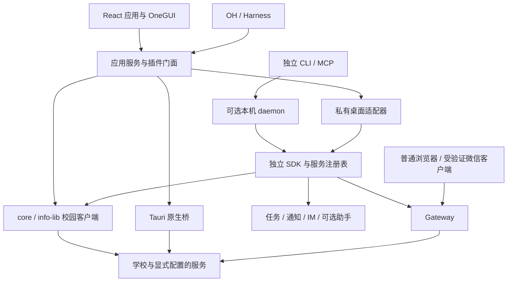
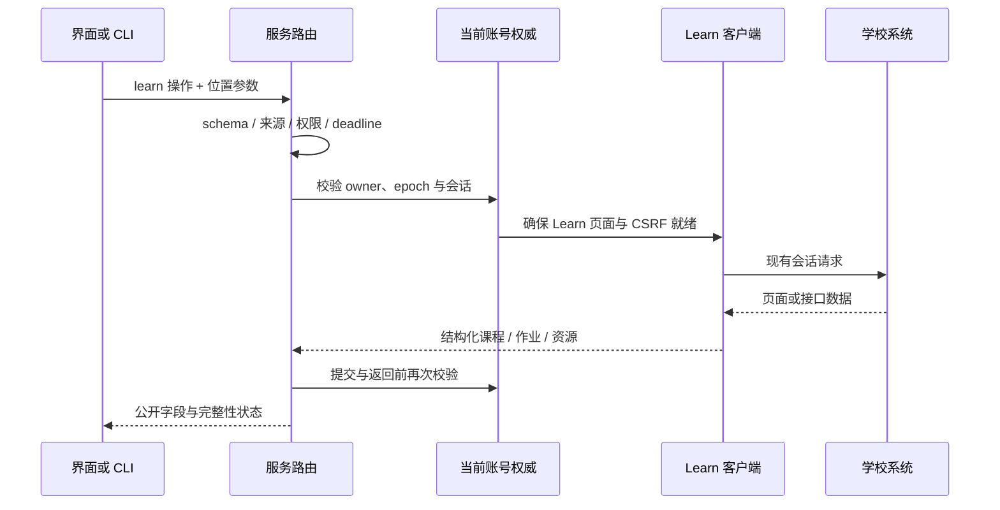

# OneTHU 系统架构

中文 · [English](en/architecture.md)

源码基线：`web` 分支，`7c2e9612`，2026-11-01，对应产品版本号 0.11.4-fix-3。仓库后续提交、本地开发态后台与正式发布安装包各自演进，具体安装包所含功能请参考对应版本的发布说明与构建清单。

## 系统定位

OneTHU 将校园业务客户端、个人工作台与智能体工具链融为一体。前端 React 应用承载日常交互与多模式工作区，底层校园客户端负责对接并解析学校各类接口与网页，独立 SDK 提供完备的账号管理、权限门禁与任务调度运行时，CLI 与 MCP 向终端及外部程序开放操作入口，Gateway 让本机受支持的浏览器和客户端复用已授权的学校会话，而 OneGUI 则为整套界面提供统一的视觉设计与交互底座。

日常网络通信主要发生在本设备与校内各业务系统之间；当启用清华云盘、GitLab、邮箱、日历、外部大模型或 IM 机器人时，客户端也会在用户授权范围内与相应远端服务交互。各项校园功能的实际表现取决于当前账号在校方系统中的权限、会话状态及上游服务可用性。

## 阅读路径

| 文档 | 主要内容 |
| --- | --- |
| [原型与数据模型](architecture/prototype-and-data.md) | 模式、标签页、白板、原子、暂存、数据归属与同步 |
| [SDK 与服务运行时](architecture/sdk-and-api.md) | core/info-lib 分工、认证、操作注册、参数契约、事务守卫 |
| [CLI、智能体与调度](architecture/cli-and-agents.md) | daemon、MCP、Harness、IM、常驻任务与授权范围 |
| [Gateway](architecture/gateway.md) | 代理拓扑、来源校验、学校 SSO、微信票据桥、平台与恢复 |
| [OneGUI](architecture/onegui.md) | 令牌、风格管线、组件、材质、布局、拖动与国际化 |
| [API 参考](api-reference.md) | 按调用方选择接口、调用示例、协议和兼容性 |

## 分层与运行拓扑

桌面端安装可选 CLI 组件后，默认 CLI 与桌面 GUI 会共享同一 profile 下的常驻后台；Android 以及未安装 CLI 的桌面环境则直接通过应用内服务与内置调度适配器运行。两种运行形态共用同一套可移植的业务逻辑与权限语义，由各自宿主提供底层的进程管理、网络实现与生命周期支持。开发期单独启动 Vite 浏览器预览时可用于调试界面与排版，原生 IPC、真实会话、本地文件读写与常驻后台则需在相应宿主环境中运行。

应用内置 OH 的服务调用受智能体服务授权开关管理，外部 CLI/MCP 则设有独立的本机开关。手机端 OH 直接调用应用内服务门面，无需依赖桌面 Node 运行时。资料库、组织协作与暂存箱等紧耦合前端工作区状态的能力由应用门面提供；独立 SDK 运行时则按自身注册结果暴露可独立执行的操作目录。

## 源码职责

| 位置 | 拥有的职责 | 对接方式 |
| --- | --- | --- |
| `apps/desktop/src` | React 页面、三模式、业务状态、应用服务、插件门面 | TypeScript、React、Tauri invoke |
| `apps/desktop/src-tauri` | 原生网络、文件、安装器、窗口、通知、移动插件桥 | 私有 IPC / 原生插件 |
| `packages/core` | HTTP/Cookie、校园客户端、解析、模型、认证辅助 | 可注入 transport 的客户端库 |
| `packages/info-lib` | 现有学校登录、漫游与 2FA hook 管线 | InfoHelper 与平台网络注入 |
| `packages/sdk` | Node 运行时、服务注册、权限、任务、模型与 IM 适配 | `createOneThu`、操作 schema、宿主 ports |
| `packages/cli` | 命令解析、daemon 管理、MCP 和数据导出适配 | JSON 输出、本机 JSON-RPC、stdio |
| `packages/gateway` | HTTP/CONNECT、TLS 门面、PAC、同用户归因、系统恢复 | SDK 私有管理接口与本机监听 |
| `packages/gui` | OneGUI 令牌、组件、风格与交互配方 | React 组件、CSS、StyleDirector |
| `packages/ui` | 仍被加载的旧令牌兼容入口 | 逐步由 OneGUI recipes 接收 |
| `plugins/OneTHU-Harness` | OH 的 Rust 工具循环与宿主通信 | 桌面 sidecar / Android 内嵌 |

`core` 专注于可跨环境复用的校园业务客户端逻辑，独立 SDK 在此基础上补充完整的本机运行时与执行策略。源码包名、前端插件命名空间与 CLI 操作名称各自服务于对应的研发和调用层级，具体映射关系以 API 参考和运行时目录为准。

## 已实现的选择与代价

| 选择 | 作用 | 维护代价 |
| --- | --- | --- |
| 应用服务为主体，CLI 可选 | 手机与普通用户可直接使用服务，高级用户保留常驻能力 | 两种宿主需要严格的数据/任务交接，见 [ADR](adr/2026-10-29-optional-cli-services.md) |
| 校园客户端注入 transport | 共用解析与模型，适配 Rust、Node 和 WebVPN | 各 transport 的 Cookie、重定向和取消语义需要一致 |
| 插件类型与操作 schema 分开 | GUI 交互能力与可编排服务各有清晰契约 | 生成器和适配层需同步维护映射，调用前先查询可用目录 |
| Gateway 在本设备复用身份 | 常用浏览器可使用授权会话，账号权威保持在本机 | 证书信任、来源证明、原代理恢复和平台验收成为运行要求 |
| OneGUI 集中管理语义外观 | 主题、材质和组件状态可组合 | 旧页面仍需渐进迁移与真实视口验收 |

## 一次课程资料请求

访问网络学堂数据需要依次完成统一身份认证、业务站点会话建立与页面 CSRF 令牌就绪三个衔接步骤；客户端会全程核验响应状态，确保拿到真实业务页面后再做结构化解析，遇到学校登录跳转页或 WebVPN 引导页则按会话待建立状态处理。下载课件时，系统先枚举出与当前账号绑定的资源引用，执行下载时再于服务层内部解析真实带凭据地址，避免向调用方直接暴露敏感认证链接。

## 状态、所有者与撤销

| 状态 | 主要所有者 | 失效条件 |
| --- | --- | --- |
| 学校 Cookie、安装指纹、信任令牌 | 当前设备的账号运行时 | 退出、账号切换、学校失效 |
| GUI 页面实例与布局 | Explorer / Board 状态 | 用户关闭、重置或显式编辑 |
| 共享日程及相关账号文档 | daemon 或应用存储中的当前权威 | 所有者/内容版本变化 |
| 正在执行的操作 | 调用上下文 | deadline、取消、权限/epoch 变化 |
| 常驻任务 | 单一任务管理器 | 暂停、授权撤销、账号变化 |
| Gateway 系统设置快照 | 当前设备的网关管理器 | 用户停用、恢复冲突、系统变化 |

GUI 前端、Rust 原生层与 Node 后台在运行期维护必要的状态副本，并通过账号归属、代际编号（epoch）、Cookie revision 与文档版本号协同核对一致性，副本间存在短暂的异步同步窗口。安装或卸载 CLI 组件时，系统会先完成账号文档与定时任务的所有权交接，再切换至目标宿主。若常驻后台暂时无法连接，界面会如实提示连接异常并保留当前有效的原生会话，待后台恢复后再继续协同，确保始终由单一任务管理器负责调度。

## 扩展、安全与生命周期

插件 API 在调用点校验声明权限与平台条件，SDK 操作目录则额外标注读写属性、参数 schema 及本机配置标记。来自模型、MCP、插件和 IM 的请求均由可信宿主统一附加来源标识。写操作在最终发往学校或远端服务前会再次复核当前账号、授权状态、取消信号与剩余时间预算；一旦请求已送达远端，后续状态以重新查询服务端的结果为准。

向校方系统登记信任设备时，展示名称统一采用 `OneTHU（设备名）` 格式，并与底层安装指纹分开维护。单纯读取本机设备名仅用于界面展示，只有用户主动勾选信任设备登录时才会向学校发起登记，校方已有的历史记录保持原样。原生层读取系统设备名的逻辑已在源码中实现，随新版原生构建一并生效。

正式环境通过发布安装包与更新渠道签名完成升级，Vite HMR 仅用于本地开发热重载。原生能力、可选 CLI 运行时与外部插件在加载时均会核对版本号、内容摘要与目标平台兼容性。

## 当前验收与部署边界

| 能力 | 当前证据 |
| --- | --- |
| Mac 系统校园代理、Info / Learn 与原代理共存 | 本机真实请求和恢复检查 |
| Mac 微信清小搭、临时来访报备 | 用户确认进入业务页，网关记录官方票据续接 |
| Windows 网关 | CurrentUser/PAC、SID 与签名实现及夹具；仍需本轮真机验收 |
| Android / iOS 全设备网关 | 原生传输桥尚待实现 |
| 行在清华其他独立 H5 | 按各服务继续验收 |
| 组织双真实账号、跨设备完整协作 | 单机与夹具测试已覆盖，双实号跨设备待补充验收 |

实测过程与现场记录详见 [微信网关验收](reviews/2026-11-01-trusted-client-campus-gateway.md)，各平台接入前提详见 [跨平台指南](guides/campus-gateway-mobile.md)。上表反映截至 2026-11-01 的实测进展，后续代码演进将在新构建完成后持续补充验收记录。
