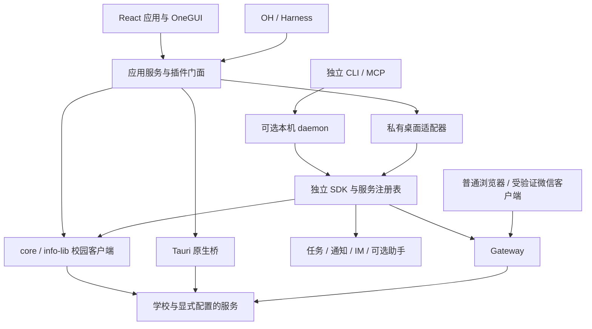
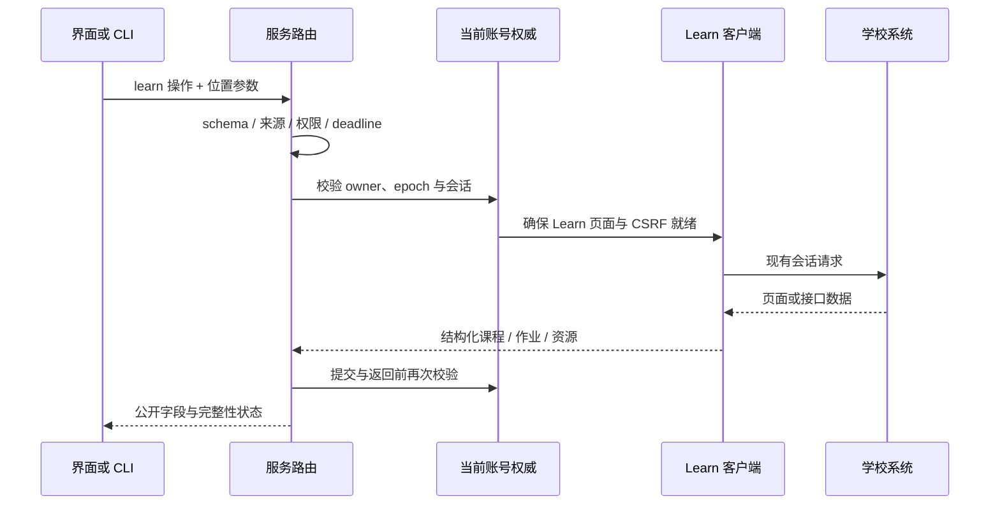

# OneTHU 系统架构

中文 · [English](en/architecture.md)

源码基线：`web` 分支，`7c2e9612`，2026-11-01。产品版本声明为 0.11.4-fix-3；分支中的后续实现、正在运行的 dev 后台和已发布安装包各有独立检查点。功能是否随某份安装包交付，以发布说明和构建清单为准。

## 系统定位

OneTHU 将校园服务客户端、个人工作台和智能体执行入口组合在同一项目中。React 应用负责交互与工作区；校园客户端解析学校接口与网页；独立 SDK 提供带账号、权限和调度的运行时；CLI 与 MCP 为其他程序提供操作入口；Gateway 将已授权学校会话用于受支持的浏览器与客户端访问。OneGUI 管理这些界面的视觉与交互基础。

账户、数据和业务服务主要位于本设备与学校服务之间。云盘、GitLab、邮箱、日历、模型和 IM 各自提供远端存储或服务，因此“本地客户端”仍有明确的外发数据和授权范围。具体校园功能依赖学校系统的账号权限、会话有效性与可用性。

## 阅读路径

| 文档 | 主要内容 |
| --- | --- |
| [原型与数据模型](architecture/prototype-and-data.md) | 模式、标签页、白板、原子、暂存、数据归属与同步 |
| [SDK 与服务运行时](architecture/sdk-and-api.md) | core/info-lib 分工、认证、操作注册、参数契约、事务守卫 |
| [CLI、智能体与调度](architecture/cli-and-agents.md) | daemon、MCP、Harness、IM、常驻任务与授权范围 |
| [Gateway](architecture/gateway.md) | 代理拓扑、来源校验、学校 SSO、微信票据桥、平台与恢复 |
| [OneGUI](architecture/onegui.md) | 令牌、风格管线、组件、材质、布局、拖动与国际化 |
| [API 参考](api-reference.md) | 按调用方选择接口、调用示例、协议和兼容性 |

## 分层与运行拓扑

桌面安装 CLI 组件后，默认 CLI 与 GUI 可连接同一个 profile 的后台。Android 和未安装 CLI 的桌面使用应用内服务及调度适配器。两种部署共享可移植的业务逻辑和权限语义，进程、网络实现和生命周期由各宿主提供。仅启动 Vite 的浏览器预览具备界面能力，原生 IPC、真实会话、文件和后台能力需要相应宿主。

OH 内部应用服务受智能体服务授权约束；外部 CLI/MCP 另有独立开关。手机 OH 查询应用服务时无需安装桌面 Node 运行时。资料库、组织和暂存等依赖 GUI 状态的能力由应用门面提供，独立 SDK 的可用目录按实际注册结果返回。

## 源码职责

| 位置 | 拥有的职责 | 对接方式 |
| --- | --- | --- |
| `apps/desktop/src` | React 页面、三模式、业务状态、应用服务、插件门面 | TypeScript、React、Tauri invoke |
| `apps/desktop/src-tauri` | 原生网络、文件、安装器、窗口、通知、移动插件桥 | 私有 IPC / 原生插件 |
| `packages/core` | HTTP/Cookie、校园客户端、解析、模型、认证辅助 | 可注入 transport 的客户端库 |
| `packages/info-lib` | 现有学校登录、漫游与 2FA hook 管线 | InfoHelper 与平台网络注入 |
| `packages/sdk` | Node 运行时、服务注册、权限、任务、模型与 IM 适配 | `createOneThu`、操作 schema、宿主 ports |
| `packages/cli` | 命令解析、daemon 管理、MCP 和数据导出适配 | JSON 输出、本机 JSON-RPC、stdio |
| `packages/gateway` | HTTP/CONNECT、TLS 门面、PAC、同用户归因、系统恢复 | SDK 私有管理接口与本机监听 |
| `packages/gui` | OneGUI 令牌、组件、风格与交互配方 | React 组件、CSS、StyleDirector |
| `packages/ui` | 仍被加载的旧令牌兼容入口 | 逐步由 OneGUI recipes 接收 |
| `plugins/OneTHU-Harness` | OH 的 Rust 工具循环与宿主通信 | 桌面 sidecar / Android 内嵌 |

`core` 是业务客户端库；独立 SDK 在此基础上增加本机运行时和执行策略。目录名称、插件命名空间与 CLI 操作名属于不同契约。

## 已实现的选择与代价

| 选择 | 作用 | 维护代价 |
| --- | --- | --- |
| 应用服务为主体，CLI 可选 | 手机与普通用户可直接使用服务，高级用户保留常驻能力 | 两种宿主需要严格的数据/任务交接，见 [ADR](adr/2026-10-29-optional-cli-services.md) |
| 校园客户端注入 transport | 共用解析与模型，适配 Rust、Node 和 WebVPN | 各 transport 的 Cookie、重定向和取消语义需要一致 |
| 插件类型与操作 schema 分开 | GUI 交互能力与可编排服务各有清晰契约 | 生成器和适配层需要保持映射，调用前发现实际能力 |
| Gateway 在本设备复用身份 | 常用浏览器可使用授权会话，账号权威保持在本机 | 证书信任、来源证明、原代理恢复和平台验收成为运行要求 |
| OneGUI 集中管理语义外观 | 主题、材质和组件状态可组合 | 旧页面仍需渐进迁移与真实视口验收 |

## 一次课程资料请求

认证成功、学校业务页可用和业务 CSRF 就绪是相邻状态。学校登录链接或 WebVPN 引导页不能充当课程数据。下载先枚举资源，再以当前账号绑定的资源引用解析真实地址；认证 URL 留在服务层。

## 状态、所有者与撤销

| 状态 | 主要所有者 | 失效条件 |
| --- | --- | --- |
| 学校 Cookie、安装指纹、信任令牌 | 当前设备的账号运行时 | 退出、账号切换、学校失效 |
| GUI 页面实例与布局 | Explorer / Board 状态 | 用户关闭、重置或显式编辑 |
| 共享日程及相关账号文档 | daemon 或应用存储中的当前权威 | 所有者/内容版本变化 |
| 正在执行的操作 | 调用上下文 | deadline、取消、权限/epoch 变化 |
| 常驻任务 | 单一任务管理器 | 暂停、授权撤销、账号变化 |
| Gateway 系统设置快照 | 当前设备的网关管理器 | 用户停用、恢复冲突、系统变化 |

GUI、Rust 和 Node 可持有物理镜像。共享以账号归属、代际编号、Cookie revision 和文档版本核验为基础；镜像更新会有短暂延迟。安装或卸载 CLI 时先交接数据和任务所有权，再启用目标宿主。后台暂时不可达时保留错误，不自动启动另一份任务管理器或清空仍有效的原生会话。

## 扩展、安全与生命周期

插件 API 检查权限和平台条件；操作目录另外声明读写、schema 和本机配置属性。来自模型、MCP、插件和 IM 的请求由可信宿主标记来源。写操作在最终提交点复核账号、授权、取消和时间预算；远端已经收到的操作只能通过查询确认结果。

信任设备名统一为 `OneTHU（设备名）`，名称与安装指纹分开维护。读取名称不登记信任，已存在的学校记录保持原样。此命名的原生读取已在源码实现，随后续原生构建交付。

生产更新由发布安装包和渠道校验完成。Vite HMR 服务开发调试；原生能力、可选 CLI 运行时和外部插件分别有版本、摘要与平台校验。

## 当前验收与部署边界

| 能力 | 当前证据 |
| --- | --- |
| Mac 系统校园代理、Info / Learn 与原代理共存 | 本机真实请求和恢复检查 |
| Mac 微信清小搭、临时来访报备 | 用户确认进入业务页，网关记录官方票据续接 |
| Windows 网关 | CurrentUser/PAC、SID 与签名实现及夹具；仍需本轮真机验收 |
| Android / iOS 全设备网关 | 原生传输桥尚待实现 |
| 行在清华其他独立 H5 | 按各服务继续验收 |
| 组织双真实账号、跨设备完整协作 | 与单机/夹具结果分开记录 |

详细现场见 [微信网关验收](reviews/2026-11-01-trusted-client-campus-gateway.md)；平台配置见 [跨平台指南](guides/campus-gateway-mobile.md)。这些状态以 2026-11-01 的记录为界，后续源码更新需要对应新的构建与验收。
