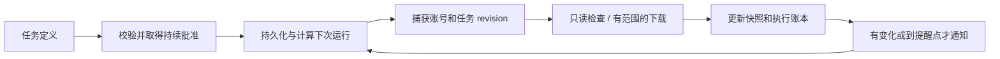

# CLI、智能体与常驻调度

中文 · [English](../en/architecture/cli-and-agents.md) · [系统总览](../architecture.md)

## 三种入口与生命周期

| 入口 | 服务与状态所有者 | App 关闭后 |
| --- | --- | --- |
| 独立 CLI / daemon | Node SDK 和私有 profile | daemon 仍运行时继续执行已批准任务 |
| CLI `--desktop` | 正在运行的 GUI 应用服务 | 依赖 App 存活 |
| 应用 OH / Android Harness | 应用内服务；可转交已安装的后台 | 应用内执行受平台生命周期约束 |

CLI 是命令适配器，daemon 是持有运行时的常驻进程。`createOneThu` 是独立嵌入入口，MCP 则提供智能体协议适配。桌面安装可选 CLI 组件后，默认终端和 GUI 通过同一 profile 的后台共享身份、数据文档与任务。

显式 `--data-dir` 用于隔离环境。默认路径见 [CLI 使用指南](../onethu-cli.md)；`--desktop` 或显式 endpoint 选择已有 GUI 服务。启动失败、会话恢复中和未安装后台分别呈现，不通过另开 App 或另建身份来掩盖故障。

## 命令解析与服务发现

```sh
onethu commands
onethu schema learn.courses
onethu learn courses --args '[]'
onethu call learn.homework --args-file ./arguments.json
```

命令解析保留位置参数 JSON 数组。参数文件适合 Windows shell 与复杂字符串。stdout 输出成功 JSON，stderr 输出安全错误；命令层检查 RPC envelope、请求 ID、大小与时间预算。查询直接调用业务服务，模型只在显式助手入口参与。

`learn export` 是资源枚举与下载编排，支持计划与逐项结果。输出目录写入需要对应确认；失败时保留已完成文件与清单，不能把一次网络中断当成完整归档。

源码：[cli.mjs](../../packages/cli/src/cli.mjs)、[export.mjs](../../packages/cli/src/export.mjs)。

## 本机协议与 daemon

```text
终端 / MCP stdio
       ↓ 本机客户端
127.0.0.1:动态端口 + 私有访问凭据
       ↓ /cli/v1 或 /mcp
操作发现 / auth / policy / service/call
       ↓ SDK
学校客户端 / 调度 / 通知
```

daemon 的访问记录保存在私有 profile，包含本机端口、随机令牌和进程信息。服务限制 loopback、POST、JSON 类型和授权头，拒绝浏览器 Origin；客户端不跟随远端重定向。该访问记录与 profile 锁分别负责连接发现和所有权。

GUI 私有 `desktop.*` 交接接口额外核对协议、账号与代际；它可以传递会话或账号文档，因而与公开工具目录隔离。`gateway.control` 同样属于私有管理面。开发日志只记录状态与错误分类。

自启动适配器在 macOS 使用 LaunchAgent，Windows 使用当前用户计划任务。`daemon stop` 停止当前进程，`daemon uninstall --confirm` 移除自启动登记。关闭、睡眠、离线和系统回收分别影响实际可运行时间。源码：[daemon.mjs](../../packages/cli/src/daemon.mjs)、[service.mjs](../../packages/cli/src/service.mjs)。

## MCP、应用工具与助手

公开 MCP 提供 `onethu_commands` 和 `onethu_call`：先发现操作及 schema，再以位置参数调用。MCP 不承接密码和 2FA 交互，也不能通过参数打开本机自动执行开关。stdio 消息有边界与并发限制，业务操作仍由 SDK 做授权。

OH / Harness 内部的 `app_services`、`app_call` 面向运行中的应用能力，能够发现通讯录、组织、清小搭、暂存和 GUI 工具。它们由可信主窗口绑定的门面提供；外部 CLI 开关与 OH 的应用服务授权分开判断。

SDK 的可选 Node 助手使用 `onethu_catalog`、`onethu_call` 作为模型工具名称。此处的 catalog 工具与公开 MCP 的 `onethu_commands` 分属各自协议。模型提供商配置、允许操作、轮次、工具次数、总时长和上下文预算共同约束执行。模型工具结果会标记为外部资料并按预算处理。

当前 Node 助手支持注入 MadModel provider；它自身不建立学校模型登录。桌面 Harness 的学校模型适配与自填 API 是另一宿主配置。两条实现的可用性按实际配置核验。

## Harness、插件和技能

桌面 Harness 以 Rust sidecar 运行，通过双向 `onethu.call` 请求宿主 API；Android 将 Harness core 编入 App，经桥接回执复用同一门面权限。主窗口持有运行时，悬浮窗和其他视图不再重复加载插件与登录管线。

JS 插件由宿主注入 `OnethuApi`；原生插件拥有本机进程权限，manifest 权限门禁控制宿主调用，不能提供操作系统级进程沙箱。清小搭技能的说明、导入、启用与执行分别记录。轻量 QuickJS 仅支持受限同步计算；依赖完整文件、网络、Python 或 Node 环境的技能由用户导出并交给外部环境。

源码：[rust.ts](../../apps/desktop/src/plugins/rust.ts)、[loader.ts](../../apps/desktop/src/plugins/loader.ts)、[插件协议](../plugin-development.md)、[Node 助手边界](../../packages/sdk/src/assistant/README.md)。

## 常驻任务与持续授权

`createTaskManager(ports)` 将存储、时钟、账号、调用与通知作为注入端口，供 Node 与应用内宿主共用。运行时选择一个调度所有者；安装/卸载 CLI 时迁移已批准任务与记录，保留暂停和错误状态。

任务定义含名称、interval/daily/once 调度和模板。持续批准绑定账号、操作、课程、输出目录和通知对象；更新或恢复会重新核对范围。运行时生成的 grant 由管理器持有，JSON 中同名字段无法构造有效授权。



`school-watch` 读取 Learn 课程、资料、作业与通知，比较标识和摘要，并计算截止提醒。它不依赖模型生成判断。确定性任务减少重复抓取和发送；可选模型/IM 负责发现、创建与解释任务，审批仍由执行策略决定。

调度计算集中在 `nextRun`：interval 从当前时间推进；once 使用带时区的绝对时间；daily 用 IANA 时区的真实规则查找下一次当地时刻。日程时区格式先验证，夏令时缺失时刻按实现的逐分钟搜索处理，最多搜索三天后给出明确错误。该逻辑不依赖操作系统本地时区猜测固定偏移。

同一管理器同一时刻运行一项任务，防止共享学校会话形成并发突发。下载与通知维护 pending / 已完成 / unknown 等账本；进程中断后 pending 转为结果未知，并保留中断记录。重启补查一次错过的周期，避免逐个回放离线期间的全部间隔。

当前上限为 50 项任务、每项 30 次历史记录，一轮最多下载 100 项；具体范围与模板以源码为准。临时读取错误最多尝试三次，重试间隔为 1 秒、2 秒；认证、账号、权限、参数和取消等错误直接结束该步骤。通知和下载按幂等/结果账本控制；任意预约、发信不直接成为通用定时写模板。

源码：[任务管理器](../../packages/sdk/src/tasks/index.ts)、[调度计算](../../packages/sdk/src/tasks/schedule.ts)、[学校检查模板](../../packages/sdk/src/tasks/watch.ts)、[范围校验](../../packages/sdk/src/tasks/validation.ts)、[桌面任务交接](../../apps/desktop/src/state/cliTasks.ts)。

## IM 与通知

通知通道与双向 IM 对话分别管理。任务 inbox、飞书、微信和 HTTPS webhook 使用已配置的绑定；渠道凭据和接收人范围保存在设备/账号私有配置。模型回复与任务通知沿同一授权边界检查外发。

聊天上下文、通道凭据和任务账本使用不同的存储对象，避免文件名或所有权冲突。取消会阻止后续模型工具与写入；已发送到外部系统的消息由该系统决定最终结果。用户要求沉默监测时，稳定且无变化的周期不重复发通知。
