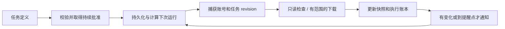

# CLI、智能体与常驻调度


中文 · [English](../en/architecture/cli-and-agents.md) · [系统总览](../architecture.md)

## 三种入口与生命周期

| 入口 | 服务与状态所有者 | App 关闭后 |
| --- | --- | --- |
| 独立 CLI / daemon | Node SDK 和私有 profile | daemon 仍运行时继续执行已批准任务 |
| CLI `--desktop` | 正在运行的 GUI 应用服务 | 依赖 App 存活 |
| 应用 OH / Android Harness | 应用内服务；可转交已安装的后台 | 应用内执行受平台生命周期约束 |

在这一分层中，CLI 负责命令行参数解析与输入输出格式化，daemon 作为常驻进程持有完整的 SDK 运行时，`createOneThu` 面向嵌入式 Node 应用，MCP 则为外部智能体提供标准协议适配。桌面端安装可选 CLI 组件后，默认终端命令与桌面 GUI 会通过同一 profile 下的常驻后台共享登录身份、账号文档与定时任务。

需要隔离测试或运行多套环境时，可通过 `--data-dir` 指定独立数据目录（各平台默认路径见 [CLI 使用指南](../onethu-cli.md)）；传入 `--desktop` 或显式 endpoint 则直接连接正在运行的 GUI 应用服务。遇到后台未安装、会话恢复中或进程启动异常等情况时，客户端会直接返回对应的状态说明，便于定位真实原因，避免静默拉起新窗口或创建孤立会话。

## 命令解析与服务发现

```sh
onethu commands
onethu schema learn.courses
onethu learn courses --args '[]'
onethu call learn.homework --args-file ./arguments.json
```

CLI 调用统一采用 JSON 位置参数数组；在 Windows shell 下或传入包含复杂转义的字符串时，推荐使用 `--args-file` 从文件读取参数。stdout 仅输出执行成功的 JSON，stderr 输出脱敏后的错误信息，同时由命令层检查 RPC envelope、请求 ID、负载大小与时间预算。常规查询直接调用底层确定性业务服务，只有在显式调用助手命令时才会引入大模型参与。

`learn export` 在此基础上编排了课程资源的批量枚举与下载流程，支持先预览导出计划并输出逐项执行结果。写入目标输出目录前需经对应确认；若中途遇到网络波动或单文件失败，工具会妥善保留已落盘的文件与导出清单，并如实标记未完成条目以便后续补传。

源码：[cli.mjs](../../packages/cli/src/cli.mjs)、[export.mjs](../../packages/cli/src/export.mjs)。

## 本机协议与 daemon

```text
终端 / MCP stdio
       ↓ 本机客户端
127.0.0.1:动态端口 + 私有访问凭据
       ↓ /cli/v1 或 /mcp
操作发现 / auth / policy / service/call
       ↓ SDK
学校客户端 / 调度 / 通知
```

daemon 启动后会在私有 profile 目录写入访问记录，保存动态分配的本机端口、随机令牌和进程信息：访问记录供客户端发现连接，profile 锁则确保同一数据目录只有一个活跃运行时。服务端仅接受来自 loopback 地址、携带有效授权头且类型为 JSON 的 POST 请求，主动拦截携带浏览器 `Origin` 头的请求，客户端侧也禁用了跨站重定向跟随。

供主窗口使用的私有 `desktop.*` 交接接口在常规鉴权之外还会核对协议版本、登录账号与代际编号（epoch）；由于这类接口用于同步会话与账号文档，系统将其与 `gateway.control` 一并归入私有管理面，与公开工具目录相互隔离。日常开发日志仅记录脱敏后的运行状态与错误分类。

开机自启适配器在 macOS 上使用当前用户的 LaunchAgent，在 Windows 上注册为当前用户计划任务。执行 `daemon stop` 可停止当前后台进程，执行 `daemon uninstall --confirm` 则移除系统的自启动登记。后台任务的实际可运行时间受设备关机、睡眠、离线与系统进程回收影响。源码：[daemon.mjs](../../packages/cli/src/daemon.mjs)、[service.mjs](../../packages/cli/src/service.mjs)。

## MCP、应用工具与助手

公开 MCP 服务提供 `onethu_commands` 和 `onethu_call` 两项工具：智能体先发现可用操作及参数 schema，再按位置参数发起调用。账号密码输入、二次验证（2FA）以及本机自动执行开关均需用户在客户端本机完成配置，MCP 通道专注于在既有会话与已批准策略下执行业务调用。stdio 传输层设有消息体积与并发上限，所有业务操作最终均由 SDK 权限层统一裁决。

OH / Harness 内部的 `app_services` 与 `app_call` 直接对接运行中的应用服务门面，除了基础校园接口外，还能访问通讯录、组织协作、清小搭、暂存箱和界面工具。这组内部工具由可信主窗口绑定的门面提供，受应用内的智能体服务授权控制，与面向外部进程的 CLI 开关相互独立。

SDK 的可选 Node 助手在向模型注册工具时使用 `onethu_catalog` 与 `onethu_call` 这套内部名称（与公开 MCP 的 `onethu_commands` 各自遵循对应协议）。模型提供商配置、白名单操作集、最大对话轮次、工具调用次数、总时长和上下文预算共同约束整个对话循环；工具返回的校内内容都会标记为外部资料并按预算裁剪。

当前 Node 助手支持由调用方注入已就绪的 MadModel provider，自身专注于对话循环与工具编排；桌面 Harness 中的学校模型登录适配与自定义 API 密钥管理则属于桌面宿主配置，两套实现按各自环境的实际配置启用。

## Harness、插件和技能

桌面 Harness 以独立的 Rust sidecar 进程运行，通过双向 `onethu.call` 请求宿主 API；Android 则将 Harness core 直接编入应用包内，经由原生桥接复用同一门面与权限体系。主窗口统一持有插件与登录运行时，悬浮窗和其他辅助视图直接与主窗口通信，避免重复加载。

JS 插件在加载时由宿主注入受控的 `OnethuApi` 对象；原生 sidecar 插件作为本地常规进程运行，`manifest.permissions` 门禁负责管控其通过 `onethu.call` 调用宿主接口的范围，其本地系统资源权限与宿主进程一致。清小搭技能在查看说明、导入、启用与执行各阶段均有清晰状态记录：内置轻量 QuickJS 引擎适用于纯内存的受限同步计算；需要完整文件读写、网络访问或 Python / Node 环境的技能，可由用户导出后交由外部标准环境执行。

源码：[rust.ts](../../apps/desktop/src/plugins/rust.ts)、[loader.ts](../../apps/desktop/src/plugins/loader.ts)、[插件协议](../plugin-development.md)、[Node 助手边界](../../packages/sdk/src/assistant/README.md)。

## 常驻任务与持续授权

`createTaskManager(ports)` 将持久化存储、时钟、账号状态、业务调用与通知发送抽象为可注入端口，供桌面 Node 后台与应用内宿主共用。运行时同一时刻仅由一个活跃宿主担任调度所有者；安装或卸载 CLI 组件时会自动迁移已批准的任务与历史记录，并原样保留暂停和错误状态。

每项任务定义包含名称、`interval` / `daily` / `once` 调度规则及执行模板。持续执行批准（grant）与当前账号、操作范围、目标课程、下载输出目录和通知接收对象严格绑定；更新任务或从备份恢复时都会重新核对授权范围。有效的运行时 grant 由任务管理器在内部生成并持有，外部 JSON 中的同名字段仅参与常规参数解析。



内置的 `school-watch` 模板采用纯确定性逻辑：定期读取 Learn 课程、课件资料、作业与通知，比对条目标识和内容摘要以识别变更，并计算截止提醒。采用确定性巡检既能省去模型推理开销，也能避免重复抓取和误报；可选的大模型与 IM 助手则负责协助用户发现、创建和解读任务，最终能否执行仍由本机审批策略把关。

下次运行时间的推算集中在 `nextRun` 中完成：`interval` 从当前时刻向后顺延，`once` 解析带时区的绝对时间，`daily` 则直接依据标准 IANA 时区规则推算下一次当地时刻，在跨时区环境下依然保持准确。创建任务时会预先校验时区标识符；遇到夏令时跳变导致的缺失时刻时，算法按分钟粒度向后搜索（跨度上限为三天，超出后返回明确错误提示）。

同一任务管理器在同一时刻串行运行单项任务，避免共享学校会话产生并发请求突发。文件下载与消息通知均维护 `pending`、已完成与 `unknown` 等状态的执行账本；若进程中途意外中断，重启后会将遗留的 `pending` 转为结果待确认并保留中断记录。设备恢复运行后，错过的周期性巡检只会合并补查一次，避免将离线期间错过的轮次逐一回放。

当前每个管理器上限为 50 项任务、每项保留最近 30 次历史记录、单轮最多下载 100 项（具体范围与支持模板以源码定义为准）。遇到瞬时读取错误时最多自动尝试三次，重试间隔依次为 1 秒、2 秒；遇到认证失效、账号切换、权限不足、参数错误或主动取消时则立即结束当前步骤。后台定时模板聚焦于幂等账本保护下的只读巡检、增量提醒与受控目录下载；场馆预约、发送邮件等写操作需通过即时交互触发。

源码：[任务管理器](../../packages/sdk/src/tasks/index.ts)、[调度计算](../../packages/sdk/src/tasks/schedule.ts)、[学校检查模板](../../packages/sdk/src/tasks/watch.ts)、[范围校验](../../packages/sdk/src/tasks/validation.ts)、[桌面任务交接](../../apps/desktop/src/state/cliTasks.ts)。

## IM 与通知

单向通知通道与双向 IM 对话在配置和权限上各自独立管理。内置任务 inbox、飞书、微信与自定义 HTTPS webhook 均按已配置的绑定关系投递；渠道凭据和允许交互的接收人范围保存在当前设备与账号的私有配置中。模型对话回复与定时任务通知在外发前都会经过同一授权边界校验。

聊天上下文、通道凭据和任务账本分存于各自独立的存储对象中，避免文件名或所有权冲突。用户中途取消操作会立即阻止后续的模型工具调用与本地写入；已经发送到外部 IM 系统的消息则由目标平台决定最终投递状态。开启静默监测后，只要所监控内容保持稳定且无新增变化，当轮周期便会安静跳过通知。
