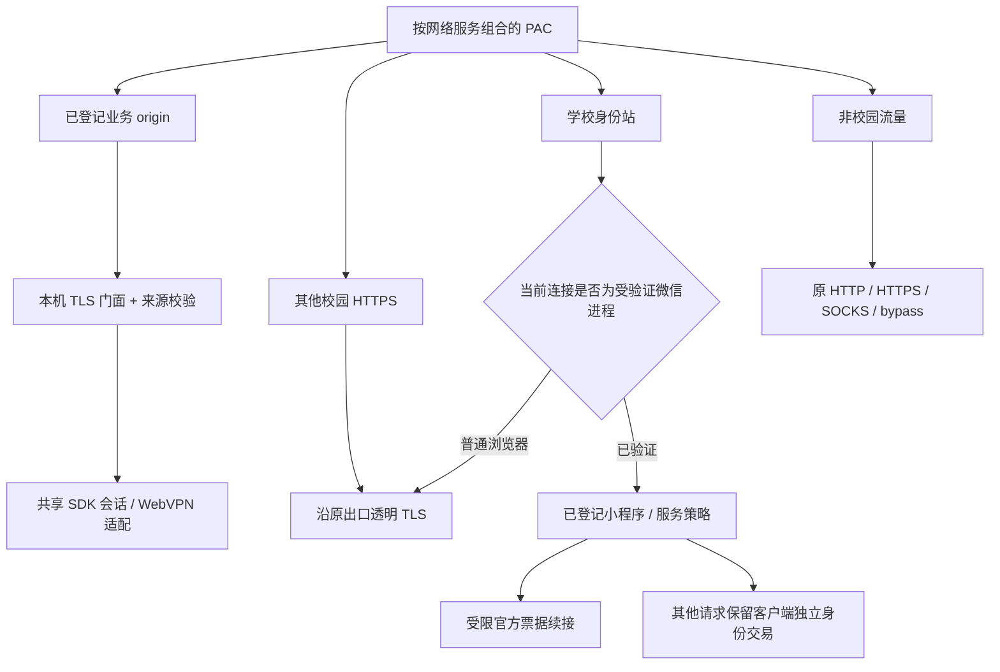
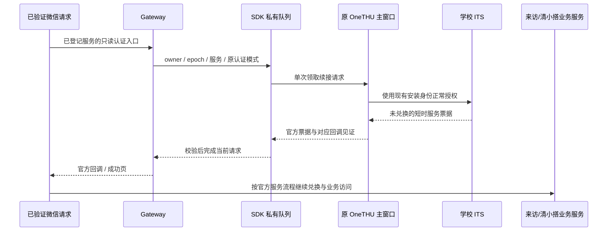

# Gateway 架构

中文 · [English](../en/architecture/gateway.md) · [系统总览](../architecture.md)

## 目标与控制面

Gateway 让同一台设备上受支持的系统浏览器与校园客户端直接复用 OneTHU 已授权的学校会话。核心实现位于 `packages/gateway`，由 SDK 或常驻 daemon 的网关管理器托管，仅在 `127.0.0.1` 回环地址上开启监听。

开启本地监听、安装并信任 CA 根证书以及启用系统代理拆分为三个独立步骤，用户可按需分步控制。每个安装实例与 profile 各自生成并保管专属的 CA 证书、私钥和代理凭据。修改系统网络设置必须由用户显式触发，常规状态查询仅返回脱敏后的运行元数据。底层控制接口 `gateway.control` 仅通过私有 daemon 通道对本机主窗口开放，与面向外部智能体的公开 MCP 工具目录相互隔离。

用户既可以直接通过 Chrome、Safari、Edge 等日常系统浏览器走系统代理访问校内站点，也可以按需安装可选的独立校园浏览器组件；两条接入路径彼此独立，安装独立浏览器属于可选增强项。

## 请求拓扑

网关同时支持 `HTTP/1.1` 正向代理请求与 HTTPS `CONNECT` 隧道，并分别完成协议解析与代理鉴权。建立 `CONNECT` 隧道时，请求目标地址、`Host` 头与 TLS 握手中的 SNI 必须彼此一致；携带重复敏感请求头、报文 framing 异常、指向未开放目标、来源越权或超出配额的请求都会被当场拦截。底层字节流全程接入背压控制、取消信号与上传/下载预算，一旦当前登录账号切换（epoch 变化），所有在途请求将立即中止。

## 业务门面与来源

发往已登记校内业务站点的请求在通过允许的 origin、HTTP 方法与 Fetch Metadata 校验后，会转交给 SDK 的校园代理适配器处理。适配器根据当前网络环境自动选择校内直连或 WebVPN 通道，并在内部维护真实业务域名与网关会话之间的 Cookie 作用域映射；核心登录 Cookie 始终保存在权威会话仓中，返回给浏览器的响应头也会经过安全过滤。

对于网页 HTML/CSS/JS 中的链接、重定向地址及 CSP 策略头，网关会按白名单目标规则做对应映射（CSP 仅增补受控的允许来源），而二进制流与 `Range` 分段响应则原样保持字节语义。遇到历史遗留的明文 HTTP 校内地址时，网关仅对明确加入白名单且不带请求体的 `GET` / `HEAD` 页面导航执行 HTTPS 门面升级；涉及文件上传或表单提交的 `POST` 请求需直接使用 HTTPS 发起，由网关按单次请求直通转发。

普通浏览器访问学校统一身份认证站时，流量直接沿原有网络出口转发并保留学校原始 TLS 证书；其余未列入网关接管清单的校园 HTTPS 站点同样在兼容的原代理配置下透明转发，由浏览器自行维护 TLS 握手与原站会话，只有明确登记在册的业务域名才会接入 OneTHU 会话代填。

源码：[index.mjs](../../packages/gateway/src/index.mjs)、[policy.mjs](../../packages/gateway/src/policy.mjs)、[campusProxy.ts](../../packages/sdk/src/node/campusProxy.ts)。

## 通用 SSO 与业务会话

校内各业务的官方 SSO 入口可通过 Info 应用导航发现。从学校统一身份认证、业务子站 Cookie 落位、服务侧 JWT 签发到落地页 CSRF 令牌初始化，各个握手阶段依次推进：一次性服务票据由校方认证中心签发，并在对应业务站点完成兑换。若目标服务要求二次输入密码或学校额外验证，客户端会向用户如实呈现当前所需的验证步骤。

判定业务会话是否真正就绪时，网关会识别响应正文的实际页面类型，将学校授权确认页、登录表单、WebVPN 引导页、无权限提示页与正常业务页面逐一区分（许多拦截页同样返回 HTTP 200 状态码）。OneTHU 主账号在线状态与具体某项校内业务的会话可用性也各自独立校验，确保状态反馈准确可靠。

## 微信受限桥

为支持桌面微信内的校内小程序与公众号网页免密续接，网关通过操作系统级进程归因确认连接方身份：Mac 端通过精确的本地 TCP 连接反查当前 UID/PID，并核验可执行文件的 Apple 代码签名链、腾讯开发者团队标识与微信 Bundle 标识；Windows 端则比对当前用户 SID、TCP 所属 PID 以及有效的腾讯 Authenticode 数字签名。只有在通过完整的本地进程签名证明后，请求才会进入受限续接流程（单纯匹配的进程名、`User-Agent` 或 `Referer` 均无法触发共享身份）。Mac 端归因仅针对当前精确 TCP 套接字调用 `lsof -b -w -nP`，避开 WebDAV 等网络挂载盘可能引发的阻塞查询，并在每次启用代理前通过真实回环监听自检覆盖这条归因链路。

内置策略注册表将受支持的小程序、官方业务域名、ITS 服务号与合法回调地址一一关联，当前已实测覆盖清小搭及“行在清华”临时来访报备。小程序原生 `wx.request` 常携带 `servicewechat.com` 来源与 cross-site Fetch Metadata，网关会在完成上述进程签名核验后结合完整来源头联合校验。

当小程序打开新的 `web-view` 页面时，首跳文档导航往往不带 `Referer`。针对这一场景，若近期同一受验证微信进程、同一账号 epoch 下刚刚访问过同一已登记服务，网关会签发一个有效期 10 秒的单次无请求体 `GET` 文档导航授权，专供该次首跳加载使用；一旦消费即刻作废，带请求体的请求、凭据 `POST` 及其他进程发起的连接均走各自的独立校验。

桌面 GUI 主窗口与后台 SDK 之间仅传递受控的服务枚举和学校签发的短时一次性票据，账号密码始终留在 GUI 原有的安全凭据通道内。内部续接队列绑定账号与 epoch，并设有单次领取、超时回收与冷却机制，底层对学校 ITS 的认证完整遵循官方标准流程。

针对官方来访报备网页曾生成的 `/login/form//<service>/0` 双斜杠路径，Gateway 与 SDK 同时兼容单斜杠与双斜杠写法，并严格保留服务号、认证模式与回调地址检查。凡是未登记的服务、其他认证模式或来源不匹配的请求，都会平滑回退至微信客户端自身的独立 Cookie 会话，与 OneTHU 身份仓保持隔离。

源码：[客户端策略](../../packages/gateway/src/clientIdentity.mjs)、[进程证明](../../packages/gateway/src/trustedClient.mjs)、[SDK 队列](../../packages/sdk/src/node/clientIdentity.ts)、[GUI 续接](../../apps/desktop/src/state/campusClientRuntime.ts)。

## 系统代理与原代理共存

为了与用户日常使用的网络代理工具共存，Mac 端会按网络服务逐一读取原有的 HTTP/HTTPS/SOCKS 代理、bypass 绕行列表及 PAC/WPAD 状态，为每项服务动态生成专属的组合 PAC；Windows 端则读写 `CurrentUser` 配置并执行变更计划比对。常见的本地手动代理端口可直接串联组合；若检测到已有外部自定义 PAC/WPAD、需要额外账密认证的代理或无法安全解析的复杂规则，网关会保持原系统设置不变，并明确提示当前配置暂不支持自动合并。

每次写入系统代理前，管理器都会重新比对变更计划，确认真实本地监听器、同用户归因链路与 CA 根证书全部就绪后再落盘生效。启用后，非校园网流量继续沿用户原有的网络服务规则转发，Clash 等工具的配置文件、节点、订阅与令牌均原封不动留在原软件中。若运行期间有其他程序修改了系统代理，OneTHU 在停用或恢复时只会清理仍归属自身的配置项，避免覆盖外部新写入的设置。

私有缓存文件 `endpoint-hints.json` 负责持久化上次使用的本地监听端口与随机 PAC 路径，以便重启后尽量沿用同一端点，减少浏览器或微信因缓存旧 PAC 地址而短暂失联的情况。该缓存采用私有原子文件写入，并在加载时校验所属用户与文件类型；若历史端口已被占用，网关会直接拒绝启用并保留原网络状态。学校账号、Cookie 与服务票据一律只保存在安全会话仓中，从不写入该缓存文件。

源码：[manager.mjs](../../packages/gateway/src/manager.mjs)、[platform.mjs](../../packages/gateway/src/platform.mjs)、[pac.mjs](../../packages/gateway/src/pac.mjs)、[endpointHints.mjs](../../packages/gateway/src/endpointHints.mjs)。

## 诊断与恢复

运行诊断面板仅采集白名单目标主机名、服务与路径分类、来源类型、转发路由、匿名客户端标签、HTTP 状态码与失败计数，并将最近 8 条身份认证握手记录存放在独立槽位中，防止被后续静态资源请求冲刷覆盖；完整的原始 URL、查询参数值、Cookie 与票据内容在采集前即已剥离。

恢复流程严格按“读取备份原状态 → 校验当前系统写入归属 → 恢复仍受控字段 → 关闭监听”的顺序执行。替换更新后台代码时，安装器会先完成新包校验与暂存，随后在受保护流程内快速切换重启、核对既有实例的 CA、profile 与端点连续性，并重新验证本地监听及系统代理连通性，将切换期间的短暂后台中断降至最低。

## 平台与验收

| 平台 | 实现 | 验收边界 |
| --- | --- | --- |
| Mac | 系统 PAC、同用户归因、可信微信分流、原代理恢复 | Info/Learn 与两项微信业务已实测 |
| Windows | CurrentUser/PAC、TCP SID、签名和原配置比较 | 夹具通过，仍需当前版本真机验收 |
| Android | 设置能力提示与应用自身网络 | 全设备代理/VPN 传输桥待实现 |
| iOS/iPadOS | 能力边界说明 | 系统原生桥与相应授权待实现 |

基于系统 PAC 的方案天然覆盖遵循系统代理规范的浏览器与桌面应用；若客户端自带独立网络栈、内置私有代理或采用其他传输协议，则需按应用逐一实测确认。目前网关仅开放本机回环监听，LAN 局域网共享与跨设备配对尚未开放——由于手机端的 loopback 地址指向手机自身，移动端若要实现全设备校园网代填，还需借助原生层的本地代理 / VPN 传输桥，并妥善处理 Android 系统 VPN 授权、与现有 VPN 应用的互斥以及目标 App 对用户级 CA 证书的信任规则，具体前提详见 [平台指南](../guides/campus-gateway-mobile.md)。

2026-11-01 的 [真实验收记录](../reviews/2026-11-01-trusted-client-campus-gateway.md) 详细记录了清小搭与临时来访报备业务页的实测过程；“行在清华”旗下的其他独立 H5 服务及其他设备环境正按模块持续推进真机验收。
