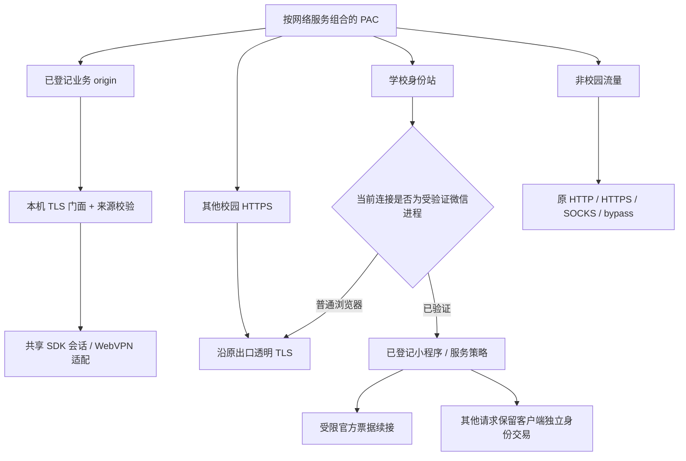
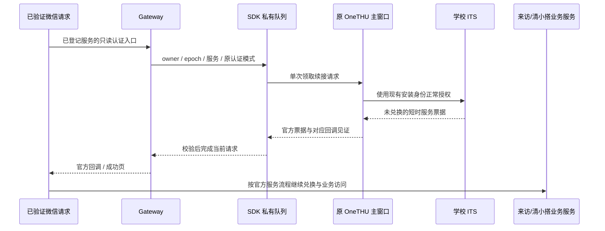

# Gateway 架构

中文 · [English](../en/architecture/gateway.md) · [系统总览](../architecture.md)

## 目标与控制面

Gateway 为同一设备上受支持的浏览器和校园客户端复用 OneTHU 已授权的学校会话。当前实现位于 `packages/gateway`，由已存在的 SDK/daemon 管理器持有，监听绑定 `127.0.0.1`。

启动监听、信任 CA 和启用系统代理是独立状态。每个安装/profile 拥有自己的 CA、私钥和代理凭据。系统设置更改需要明确操作；状态查询只返回安全元数据。`gateway.control` 经私有 daemon 接口调用，凭据、系统信任和客户端票据控制不加入公开 MCP 工具目录。

可选独立校园浏览器有自己的认证入口；普通系统浏览器通过系统代理路径接入。架构将两种入口分开记录，独立浏览器不是系统接入的前提。

## 请求拓扑

`HTTP/1.1` forward proxy 与 HTTPS CONNECT 使用相应解析和认证。CONNECT 的目标、Host 与 TLS SNI 需要一致；重复敏感头、异常 framing、任意目标、越权来源和超限请求被拒绝。字节流使用背压、取消与上传/下载预算，账号 epoch 变化撤销在途请求。

## 业务门面与来源

业务请求通过允许的 origin、方法与 Fetch Metadata 校验后，交给 SDK 的校园代理适配器。适配器决定直连或 WebVPN，并维护真实域与物理网关 Cookie 的作用域。Cookie 留在权威仓中，浏览器返回字段经受控处理。

HTML/CSS/JS 中的地址、重定向和 CSP 来源按已允许目标映射，CSP 仅调整允许来源；二进制和 Range 响应保持字节语义。旧 HTTP 地址仅对明确启用的无请求体 GET/HEAD 导航先转为 HTTPS 门面；上传和 POST 不自动重放。

普通浏览器访问身份站时，仍保留学校证书和原出口。其他校园 HTTPS 在已支持的原代理配置下透明转发，原站会话和 TLS 继续由浏览器处理；未登记业务不会自动获得 OneTHU Cookie。

源码：[index.mjs](../../packages/gateway/src/index.mjs)、[policy.mjs](../../packages/gateway/src/policy.mjs)、[campusProxy.ts](../../packages/sdk/src/node/campusProxy.ts)。

## 通用 SSO 与业务会话

Info 应用导航可发现官方服务入口。学校身份、业务 Cookie、服务 JWT 与落地页 CSRF 分别建立；单次服务票据由学校签发，并在对应服务兑换。需要密码或学校额外验证时，客户端报告真实状态。

网关不把“页面 HTTP 200”直接判为已登录：学校确认页、登录表单、WebVPN 引导页和被拒绝的业务页各自分类。已登录 OneTHU 与当前某业务会话已可用也分别验证。

## 微信受限桥

Mac 通过精确 TCP 归因确认当前 UID/PID，并验证当前可执行文件的 Apple 签名链、腾讯团队和微信标识。Windows 对应当前 SID、TCP PID 和有效腾讯 Authenticode。进程名、User-Agent 或单独 Referer 都不足以获得共享身份。Mac 归因限定精确 TCP 连接，并使用 `lsof -b -w -nP` 避免 WebDAV 等挂载触发阻塞的文件系统查询；启用前的真实监听自检覆盖这条归因路径。

注册表将已知小程序、官方业务域、ITS 服务号和回调关联。当前实测服务为清小搭及行在清华临时来访报备。合法原生 `wx.request` 可携带 `servicewechat.com` 小程序来源与 cross-site metadata；校验在进程证明后结合完整来源处理。

新 web-view 导航可能没有 Referer。此时仅在近期同一受验证进程、同一账号 epoch、同一登记服务已有可归因请求时，提供 10 秒单次 GET 文档导航授权。重放、请求体、凭据 POST 和跨进程请求不能借用它。

GUI 与 SDK 之间传递服务枚举和短时票据，密码留在 GUI 既有凭据路径。队列包含账号/epoch、单次领取、超时和冷却。真实学校验证仍保留官方流程。

官方来访网页曾生成 `/login/form//<service>/0`。Gateway 与 SDK 同时支持该位置一个或两个斜杠，并保留服务号、模式与回调检查。未知服务、其他模式或异常来源回到客户端自己的 Cookie 交易，不混用 OneTHU 身份仓。

源码：[客户端策略](../../packages/gateway/src/clientIdentity.mjs)、[进程证明](../../packages/gateway/src/trustedClient.mjs)、[SDK 队列](../../packages/sdk/src/node/clientIdentity.ts)、[GUI 续接](../../apps/desktop/src/state/campusClientRuntime.ts)。

## 系统代理与原代理共存

Mac 按网络服务读取原 HTTP/HTTPS/SOCKS、bypass、PAC/WPAD 状态，再生成各自组合 PAC。Windows 使用 CurrentUser 配置和对应的计划校验。已知手动代理可组合；任意外部 PAC/WPAD、需要额外认证或无法可靠解析的配置保留原样并报告不支持。

启用前重新比较计划，先检查真实监听器、同用户证明路径和 CA，再写系统设置。非校园流量继续沿原网络服务规则；Clash 配置、节点、订阅与令牌保持在原软件中。另一个程序更改系统设置后，恢复操作只回收仍属于 OneTHU 的值。

`endpoint-hints.json` 持久化监听端口与 PAC 随机路径，减少微信或浏览器继续使用旧 PAC 的问题。缓存采用私有原子文件和所属用户/文件类型检查。端口占用时拒绝启用，保留原网络状态。它不保存学校账号、Cookie 或票据。

源码：[manager.mjs](../../packages/gateway/src/manager.mjs)、[platform.mjs](../../packages/gateway/src/platform.mjs)、[pac.mjs](../../packages/gateway/src/pac.mjs)、[endpointHints.mjs](../../packages/gateway/src/endpointHints.mjs)。

## 诊断与恢复

诊断保留允许的目标主机、服务/路径分类、来源类型、路由、匿名客户端标签、状态码与失败计数。认证记录独立保留最后 8 条，避免后续资源覆盖；原 URL、查询值、Cookie 和票据不进入诊断。

恢复流程按“读取原状态 → 校验当前写入归属 → 恢复仍受控字段 → 关闭监听”组织。代码替换先完整校验和暂存，在受保护流程内短时切换并重新验证监听及系统接入。现有实例的 CA、profile 和端点连续性分别核对；这一流程仍有短暂后台中断。

## 平台与验收

| 平台 | 实现 | 验收边界 |
| --- | --- | --- |
| Mac | 系统 PAC、同用户归因、可信微信分流、原代理恢复 | Info/Learn 与两项微信业务已实测 |
| Windows | CurrentUser/PAC、TCP SID、签名和原配置比较 | 夹具通过，仍需当前版本真机验收 |
| Android | 设置能力提示与应用自身网络 | 全设备代理/VPN 传输桥待实现 |
| iOS/iPadOS | 能力边界说明 | 系统原生桥与相应授权待实现 |

系统 PAC 主要覆盖遵循系统代理的请求，自带网络栈、独立代理或其他传输协议需要单独验收。LAN 监听与跨设备配对尚未开放。手机的 loopback 属于手机本身；桌面端口不能直接当作手机端口使用。Android VPN 的系统授权、与现有 VPN 的互斥、目标 App 对用户 CA 的信任需要原生实现及真机验收。[平台指南](../guides/campus-gateway-mobile.md)列出具体前提。

2026-11-01 的 [真实验收记录](../reviews/2026-11-01-trusted-client-campus-gateway.md)覆盖清小搭与来访业务页；行在清华其他 H5 和其他设备继续分别验收。
