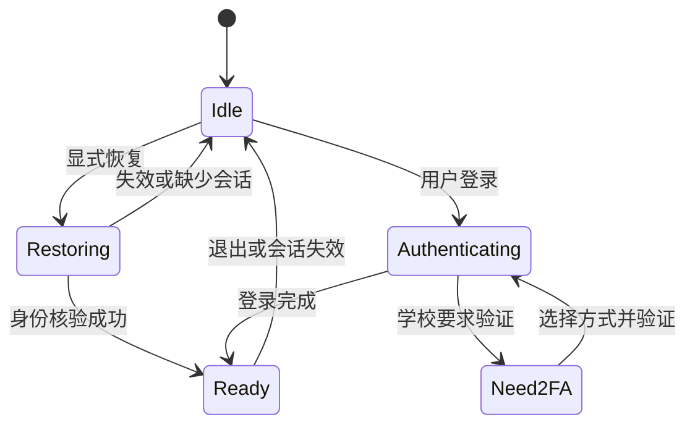

# SDK 与服务运行时

中文 · [English](../en/architecture/sdk-and-api.md) · [系统总览](../architecture.md)

## 客户端库与运行时

`packages/core` 提供校园业务模型、HTTP/Cookie、认证辅助与各服务客户端。客户端通过注入的 transport 工作，宿主负责具体网络环境。`packages/info-lib` 保留学校统一认证、漫游、2FA hooks 和平台网络注入。OneTHU 的适配层将现有登录管线与自有客户端接到受控会话中。

`packages/sdk` 进一步提供 Node 会话存储、操作注册、授权、任务、通知、插件和助手。其入口为 `createOneThu`。这层需要 Node 环境；部分 Learn、任务和策略模块另有 browser 条件出口，供工作区的 GUI 宿主复用。

源码：[core](../../packages/core/src/index.ts)、[info-lib](../../packages/info-lib/src/lib/core.ts)、[SDK 入口](../../packages/sdk/src/index.ts)、[共享 Learn 服务](../../packages/sdk/src/learn.ts)。

## 一个 profile 的权威

`createNodeSession` 打开私有目录并持有排他锁。同一进程仅允许一个活动 Node 会话运行时。默认 CLI 通过 daemon 复用已持有该 profile 的实例；嵌入方可为独立任务选择明确的私有目录。

持久会话包含稳定指纹、账号、Cookie、信任因子、保存时间与代际状态。密码由当前登录流程在内存中持有，独立 SDK 不保存密码。GUI 的“记住密码”由原生应用另外管理，其内容不属于公开 SDK 或模型结果。

账号变化时清理旧会话相关 transport、资源缓存与准备状态，并增加 epoch。Windows 使用当前用户的受保护 DACL；Unix 目录/文件使用私有权限。读取时检查路径、文件类型、符号链接和所属用户。源码：[session.ts](../../packages/sdk/src/node/session.ts)、[storage.ts](../../packages/sdk/src/node/storage.ts)。

## 认证状态与业务准备



SDK 返回 `ready` 或 `need-2fa`，后者由同一运行时保存挑战上下文。选择方式后才发起对应流程；TOTP 无需发送验证码。信任设备由显式选项决定，名称为 `OneTHU（设备名）`，稳定指纹和信任令牌继续复用。

Learn 还需要自己的业务落地页与 CSRF。`ensureLearnReady` 对同一账号/Cookie revision 合并准备请求，通过独立候选客户端核验后再发布 CSRF。身份站登录链接、WebVPN 引导或异常 HTML 返回可区分的错误，业务层不会将其当作空课程列表。

雨课堂使用独立业务会话及 classroom 标识。GUI 可经私有交接把当前账号的有效雨课堂状态提供给后台；学校主登录成功不会直接证明雨课堂也已登录。

## 操作契约

```ts
interface ServiceOperation {
  name: string;
  description: string;
  parameters: Schema;
  permission: string;
  mutation?: boolean;
  authenticated?: boolean;
  localOnly?: boolean;
  run(args: unknown[], context: OperationContext): unknown | Promise<unknown>;
}
```

上面展示契约要点，完整声明以 [services/types.ts](../../packages/sdk/src/services/types.ts) 为准。位置参数数组对应 tuple schema；参数顺序、可选参数和额外字段按 schema 校验。静态 catalog 提供部分类型和说明，实际注册由服务工厂及运行时控制项完成。

`app.list(source)` 返回该来源可见的实际操作。GUI 应用目录与独立 SDK 目录可以具有相同的服务命名风格，覆盖范围由各宿主决定。尤其通讯录、暂存和部分白板操作需要运行中的 App。仅在静态 catalog 见到名称不足以证明独立运行时注册了该方法。

## 分发与最终提交检查

1. 校验调用 envelope、操作名和参数 schema。
2. 由可信宿主设置来源 `local / mcp / plugin / im / agent`，核对权限与 `localOnly`。
3. 恢复或核验学校会话，捕获 owner、epoch、策略 revision 与 deadline。
4. 计算写入授权；本机显式确认、自动执行策略和任务持续授权分别处理。
5. 通过 `beforeWrite` 复核账号、权限、取消、时间和任务范围。
6. 执行服务并在返回前再次核验，投影公开结果。

同一操作的并发写入有忙碌保护；日程、CalDAV 和云盘相关数据写入另经数据队列。该机制降低本地竞争，远端事务一致性仍由对应服务提供。来源字段属于宿主调用选项，外部 JSON 参数不能将自己提升为本机配置来源。

## 嵌入示例

示例使用独立私有目录；桌面默认 profile 已由 daemon 持有时，外部程序通过 CLI/MCP 连接。

```ts
import { createOneThu } from '@onethu/sdk';

const app = await createOneThu({ dataDir: '/absolute/private/sdk-example' });
try {
  const catalog = app.list();
  const status = await app.auth.restore();
  if (status.authenticated) {
    const courses = await app.call({ operation: 'learn.courses', args: [] });
    // courses 按当前操作 schema / 返回契约处理。
  }
} finally {
  await app.close();
}
```

`app.start()` 用于启用恢复及常驻生命周期；按需嵌入查询仍应在结束时 `close()`。关闭依次撤销请求、网关、IM/助手、任务、插件、存储及会话锁。

## 下载、完整性与输出

Learn 服务枚举课程、作业、公告和附件，形成当前 owner/epoch 绑定的 `resourceRef`。下载解析该引用并核验目录、文件名、认证地址和类型。公告附件与作业附件应保留真实名称和扩展名，URL 留在内部资源表。

枚举返回的 `complete`、逐项失败和后续页信息由调用方检查。成功下载项可保留；部分失败不会自动宣告整门课程已完整归档。SDK 的公开结果投影去除凭据字段及 URL 中的认证参数，普通字符串和数组保留内容；模型上下文预算、RPC 响应大小与单个业务分页另有边界。

明确的数值限制见 [API 参考](../api-reference.md#大小时间与完整性)。

## GUI 与后台交接

私有 `desktop.*` 接口携带协议版本、预期账号和 epoch；会话及 Cookie 镜像另带 revision。GUI 内存可展示数据和处理需要交互的验证，后台持有共享服务和常驻任务。部分数据文档按版本读写；安装/卸载交接完成后只保留一个调度所有者。

Gateway 管理和服务出票属于私有控制面。它们不会出现在公开 MCP 操作目录，代理口令、Cookie 和学校票据也不会作为工具发现结果返回。源码：[sharedRuntime.ts](../../apps/desktop/src/lib/sharedRuntime.ts)、[daemon.mjs](../../packages/cli/src/daemon.mjs)。

## 错误和恢复

会话缺失、账号变化、权限撤销、学校 2FA、限流、schema 错误和网络超时各有不同处理。恢复失败只撤销已判定失效的对应状态，后台启动/路径/协议错误保留可诊断信息。写入遇到超时后先检查远端结果，读取可在预算内有限重试。

对外错误经公开错误投影移除 HTML 登录页和凭据内容。学校给出的业务详情可作为外部 reason 显示，应用自身错误在渲染时本地化。各来源的数据内容和提示词均不能改变调用者的权限。
