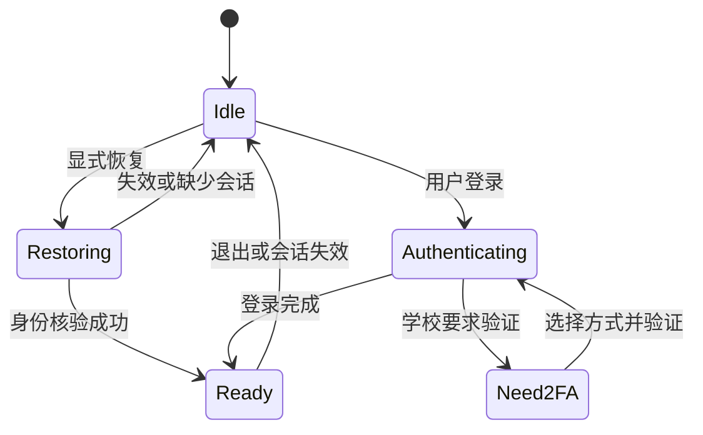

# SDK 与服务运行时


中文 · [English](../en/architecture/sdk-and-api.md) · [系统总览](../architecture.md)

## 客户端库与运行时

`packages/core` 提供校园业务模型、HTTP/Cookie 处理、认证辅助与各服务客户端。客户端通过宿主注入的 transport 发起请求，由宿主提供具体的网络环境。`packages/info-lib` 封装学校统一认证、漫游、2FA hooks 与平台网络注入，再由 OneTHU 的适配层将登录管线与自有客户端接入受控会话。

`packages/sdk` 在此基础上提供 Node 会话存储、操作注册、授权、任务、通知、插件与助手能力，入口为 `createOneThu`。完整运行时基于 Node 环境运行；同时部分 Learn、任务与策略模块提供 browser 条件导出，方便工作区中的 GUI 宿主直接复用。

源码：[core](../../packages/core/src/index.ts)、[info-lib](../../packages/info-lib/src/lib/core.ts)、[SDK 入口](../../packages/sdk/src/index.ts)、[共享 Learn 服务](../../packages/sdk/src/learn.ts)。

## 一个 profile 的权威

`createNodeSession` 会打开私有目录并持有排他锁，同一进程内同时维护一个活动的 Node 会话运行时。默认情况下，CLI 通过 daemon 复用已持有该 profile 的实例；嵌入式调用方也可以为独立任务指定专属的私有目录。

持久化会话记录稳定指纹、账号、Cookie、信任因子、保存时间与代际状态；登录密码仅在当次认证流程的内存中使用，不会写入独立 SDK 存储。GUI 的“记住密码”功能由原生应用单独托管，并隔离在公开 SDK 接口与模型输出之外。

切换账号时，运行时会清理旧会话关联的 transport、资源缓存与准备状态，并递增 epoch。存储层在 Windows 上采用当前用户的受保护 DACL，在 Unix 系统上为目录和文件设置私有权限，读取时还会校验路径、文件类型、符号链接与所属用户。源码：[session.ts](../../packages/sdk/src/node/session.ts)、[storage.ts](../../packages/sdk/src/node/storage.ts)。

## 认证状态与业务准备



登录调用会返回 `ready` 或 `need-2fa`。遇到二次验证时，同一运行时会保留挑战上下文，待用户选定验证方式后再发起对应流程（使用 TOTP 时直接校验动态口令，无需下发验证码）。勾选信任设备后，设备将以 `OneTHU（设备名）` 登记，并在后续会话中继续复用稳定指纹与信任令牌。

网络学堂（Learn）在统一认证之外还需完成业务落地页加载与 CSRF 令牌提取。`ensureLearnReady` 会按账号与 Cookie revision 合并并发的准备请求，经独立候选客户端核验通过后再发布 CSRF 令牌。一旦遇到身份站登录跳转、WebVPN 引导页或异常 HTML 响应，客户端会直接抛出可区分的专属错误，便于调用方准确识别会话异常与真实的空课程列表。

雨课堂维护独立的业务会话与 classroom 标识，需在学校统一认证之外单独建立或同步登录态；GUI 端也可通过私有交接通道，将当前账号已生效的雨课堂状态同步给后台运行时。

## 操作契约

```ts
interface ServiceOperation {
  name: string;
  description: string;
  parameters: Schema;
  permission: string;
  mutation?: boolean;
  authenticated?: boolean;
  localOnly?: boolean;
  run(args: unknown[], context: OperationContext): unknown | Promise<unknown>;
}
```

上方代码展示了操作契约的核心字段，完整类型定义见 [services/types.ts](../../packages/sdk/src/services/types.ts)。调用时传入的位置参数数组与 tuple schema 一一对应，参数顺序、可选参数及附加字段均按 schema 严格校验。静态 catalog 提供基础类型与元数据说明，而运行时的可用操作由各服务工厂与控制项动态注册。

调用 `app.list(source)` 即可查询当前来源实际可用的操作清单。GUI 应用与独立 SDK 采用一致的服务命名风格，具体暴露的操作范围则由各自宿主决定：例如通讯录、暂存箱与部分白板操作依赖运行中的客户端，建议调用方始终以运行时 `app.list(source)` 的实时发现结果为准。

## 分发与最终提交检查

1. 校验调用 envelope、操作名与参数 schema。
2. 由可信宿主标记调用来源（`local / mcp / plugin / im / agent`），并核对权限集与 `localOnly` 约束。
3. 恢复或核验学校会话，记录当前的 owner、epoch、策略 revision 与 deadline。
4. 评估写入授权，分别处理本机显式确认、自动执行策略与计划任务的持续授权。
5. 在写入前通过 `beforeWrite` 复核账号归属、权限、取消信号、剩余时间与任务范围。
6. 执行具体服务调用，返回前再次核验会话一致性，并按公开契约投影返回结果。

针对同一操作的并发写入设有忙碌保护，日程、CalDAV 与云盘等数据写入还会经过串行数据队列，以减少本地并发竞争；远端数据的事务一致性则由对应的上游服务保障。调用来源字段由宿主在受控调用选项中注入，与外部传入的 JSON 参数严格隔离，确保只有本机可信宿主能够行使配置级权限。

## 嵌入示例

以下示例使用独立的私有数据目录；若需访问已由后台 daemon 托管的桌面默认 profile，外部程序可通过 CLI 或 MCP 接口连接。

```ts
import { createOneThu } from '@onethu/sdk';

const app = await createOneThu({ dataDir: '/absolute/private/sdk-example' });
try {
  const catalog = app.list();
  const status = await app.auth.restore();
  if (status.authenticated) {
    const courses = await app.call({ operation: 'learn.courses', args: [] });
    // courses 按当前操作 schema / 返回契约处理。
  }
} finally {
  await app.close();
}
```

`app.start()` 用于启动会话恢复与后台常驻生命周期；无论是常驻运行还是按需单次查询，结束时都应调用 `app.close()`，按序关停进行中的请求、网关、IM/助手、计划任务、插件、存储句柄并释放会话锁。

## 下载、完整性与输出

Learn 服务在枚举课程、作业、公告与附件时，会生成与当前 owner 及 epoch 绑定的 `resourceRef`。下载流程通过解析该引用来核验目标目录、文件名、认证地址与媒体类型；公告附件与作业附件在落盘时保留原始文件名和扩展名，带认证信息的真实 URL 则封装在内部资源表中。

枚举结果会附带 `complete` 标记、逐项错误信息及分页游标，供调用方判断是否已拉取全量内容；批量下载中若出现个别失败，已下载的文件会正常保留，同时返回状态会如实标明未完成项，便于后续补传或重试。SDK 在向外投影结果时会自动剥离凭据字段与 URL 中的认证参数，完整保留业务字符串与数组内容；模型上下文预算、RPC 报文体积及单次业务分页则按各自独立的边界控制。

各项配额与超时的具体数值见 [API 参考](../api-reference.md#大小时间与完整性)。

## GUI 与后台交接

私有的 `desktop.*` 接口在通信时携带协议版本、预期账号与 epoch，会话及 Cookie 镜像还附带 revision 版本号。GUI 前台负责界面渲染与交互式验证，后台进程则承载共享服务与常驻任务。共享数据文档按版本号并发读写；在安装或卸载 CLI 组件完成交接后，始终由唯一一个调度方接管计划任务。

Gateway 管理与服务出票集中在私有控制面内处理，仅向本机受控宿主开放，代理口令、Cookie 与学校票据全程留在内部运行时，与公开的 MCP 工具目录及返回结果完全隔离。源码：[sharedRuntime.ts](../../apps/desktop/src/lib/sharedRuntime.ts)、[daemon.mjs](../../packages/cli/src/daemon.mjs)。

## 错误和恢复

运行时针对会话缺失、账号切换、权限收回、学校 2FA 挑战、接口限流、schema 校验失败与网络超时提供精细的分类处理。会话恢复失败时仅清理已确认失效的对应状态；后台启动、路径或协议异常则保留完整的诊断线索。读取请求在时间预算内支持有限重试，写入请求遇到超时则会先核对远端实际状态，避免盲目重复提交。

对外返回的错误统一经过脱敏投影，自动剔除原始 HTML 登录页与敏感凭据：上游服务返回的业务提示会保留在外部 reason 字段中，应用自身的错误码则在界面层按语言环境本地化呈现。调用方的操作权限始终由宿主会话与授权策略静态决定，与外部网页内容或模型提示词相互独立。
