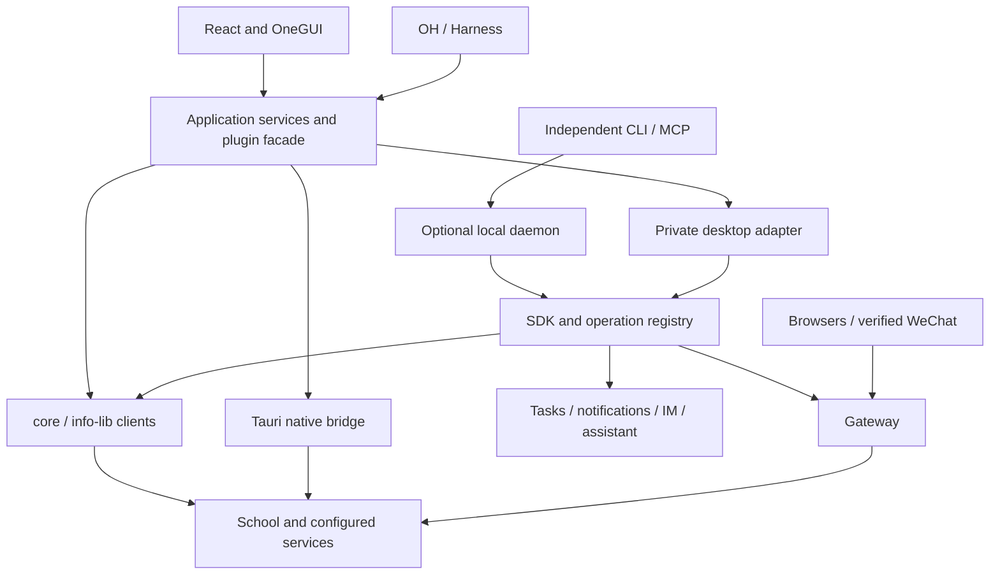
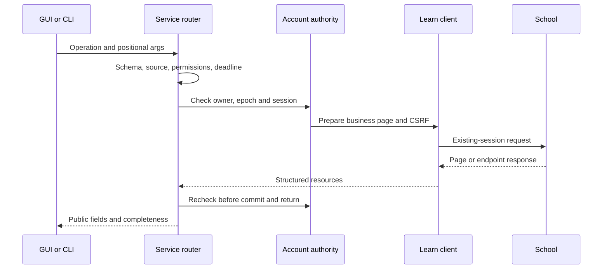

# OneTHU system architecture

[中文](../architecture.md) · English

Source baseline: branch `web`, commit `7c2e9612`, 2026-11-01. The declared product version is 0.11.4-fix-3. Branch implementations, the running dev backend and published installers have separate build and acceptance checkpoints. Release notes and artifact manifests determine what a particular installer contains.

## System purpose

OneTHU combines campus service clients, a personal workbench and agent execution interfaces. React owns interaction and workspaces; campus clients interpret school endpoints and pages; the independent SDK supplies account-aware execution and scheduling; CLI and MCP expose operations to other programs. Gateway applies an authorized school session to supported browsers and clients. OneGUI provides their visual and interaction foundations.

Accounts and services primarily interact between the device and school systems. Cloud storage, GitLab, mail, calendars, models and IM supply their own remote services. Local-client deployment therefore still has explicit data disclosures and authorizations. Campus capabilities depend on school permissions, session validity and availability.

## Reading map

| Reference | Topics |
| --- | --- |
| [Prototype and data](architecture/prototype-and-data.md) | Modes, tabs, boards, atoms, staging, ownership and synchronization |
| [SDK and service runtime](architecture/sdk-and-api.md) | Client libraries, authentication, registration, schemas and commit guards |
| [CLI, agents and scheduling](architecture/cli-and-agents.md) | Daemon, MCP, Harness, IM and persistent authorization |
| [Gateway](architecture/gateway.md) | Proxy topology, SSO, WeChat ticket bridge, platform support and recovery |
| [OneGUI](architecture/onegui.md) | Tokens, style pipeline, materials, layout, gestures and localization |
| [API reference](api-reference.md) | Interface selection, examples, protocols and compatibility |

## Layers and deployment

With the optional CLI component installed, the desktop app and default CLI can connect to the same profile's daemon. Android and desktops without that component use application-owned services and scheduling adapters. Portable logic and policy are shared; processes, transports and lifecycles belong to each host. Vite alone provides a frontend preview, while native networking, files, sessions and background execution require their hosts.

OH application services require agent-service consent. External CLI/MCP access has its own switch. Mobile OH can use application services without installing desktop Node. Contacts, staging and some workspace features depend on GUI state; the independent SDK advertises only its registered operations.

## Source ownership

| Location | Responsibility | Interface |
| --- | --- | --- |
| `apps/desktop/src` | React, modes, domain state, application services, plugin facade | TypeScript / React / invoke |
| `apps/desktop/src-tauri` | Native networking, files, installers, windows, notifications, mobile bridges | Private IPC / native plugins |
| `packages/core` | HTTP/Cookies, campus clients, parsing, models, auth helpers | Transport-injected library |
| `packages/info-lib` | Existing university login, roaming and 2FA hooks | InfoHelper / platform transport |
| `packages/sdk` | Node runtime, registry, policy, tasks, model and IM adapters | `createOneThu` / schemas / ports |
| `packages/cli` | Commands, daemon management, MCP and export | JSON / local JSON-RPC / stdio |
| `packages/gateway` | HTTP/CONNECT, TLS facade, PAC, peer attribution, recovery | Private controls / loopback listeners |
| `packages/gui` | OneGUI tokens, components and recipes | React / CSS / StyleDirector |
| `packages/ui` | Still-loaded legacy token compatibility | Migration to OneGUI recipes |
| `plugins/OneTHU-Harness` | Rust OH loop and host calls | Desktop sidecar / Android embedding |

`core` is a business-client library. The independent SDK adds runtime ownership and execution policy. Repository packages, plugin namespaces and CLI operation names describe different contracts.

## Implemented choices and costs

| Choice | Purpose | Maintenance cost |
| --- | --- | --- |
| Application services with optional CLI | Mobile/basic users keep direct services; advanced users gain residency | Strict document/task handoff between hosts; see the [ADR](../adr/2026-10-29-optional-cli-services.md) |
| Transport-injected campus clients | Shared parsing/models with Rust, Node and WebVPN | Cookie, redirect and cancellation semantics must agree |
| Plugin types and operation schemas | Separate GUI interaction from programmable services | Generators/adapters must maintain mappings; discover actual capabilities |
| Device-local session gateway | Authorized identity stays local while browsers reuse it | CA trust, provenance, recovery and platform acceptance |
| Central semantic visual system | Composable themes, materials and states | Gradual legacy migration and real-viewport acceptance |

## A course-resource request

Authenticated identity, a usable business session and page CSRF are adjacent states. A login link or WebVPN guide is not a course response. Downloads resolve account-bound resource references; authenticated URLs remain inside the service layer.

## Ownership and revocation

School sessions belong to a device account runtime; Explorer and Board own view instances and layouts. Versioned account documents own shared calendars/configuration. Each call captures account/policy generation, cancellation and deadline. A single task manager owns active scheduling. Gateway separately owns its system-setting snapshot.

GUI, Rust and Node can hold physical mirrors. Account identity, epoch, Cookie revision and document versions govern handoff; mirrors can update with a short delay. Installing/uninstalling CLI transfers documents and task ownership before activating the destination. A temporary backend failure must remain diagnosable and must not create a second scheduler or erase a valid native session.

## Extensions and lifecycle

Plugin permissions and platform checks combine with operation schemas, mutation flags and local-configuration restrictions. Trusted adapters assign the source for model, MCP, plugin and IM calls. Final-write guards recheck account, authorization, cancellation and time. Already submitted remote effects require reconciliation.

Trusted-device labels use `OneTHU（device name）`; labels are independent of installation fingerprints. Name lookup does not register trust or rename historical school records. Native OS-name lookup is implemented in source and ships with a subsequent native build.

Production updates use installers and artifact/channel verification. Vite HMR serves development. Native code, optional CLI runtimes and plugins have separate platform, version and digest validation.

## Acceptance boundaries

| Capability | Evidence |
| --- | --- |
| Mac system gateway, Info/Learn, original-proxy coexistence | Live requests and restoration checks |
| Mac WeChat Qingxiaoda and visitor reporting | User-confirmed business pages and official ticket renewal |
| Windows gateway | CurrentUser/PAC, SID/signature code and fixtures; physical acceptance pending |
| Android/iOS device-wide gateway | Native transport bridge pending |
| Other Xingzai H5 services | Accepted separately by service |
| Full organization collaboration across two accounts | Tracked separately from single-device fixtures |

See the [live WeChat review](../reviews/2026-11-01-trusted-client-campus-gateway.md) and [platform guide](../guides/campus-gateway-mobile.md), maintained with detailed Chinese evidence. These checkpoints describe 2026-11-01; later changes require matching build and device evidence.
