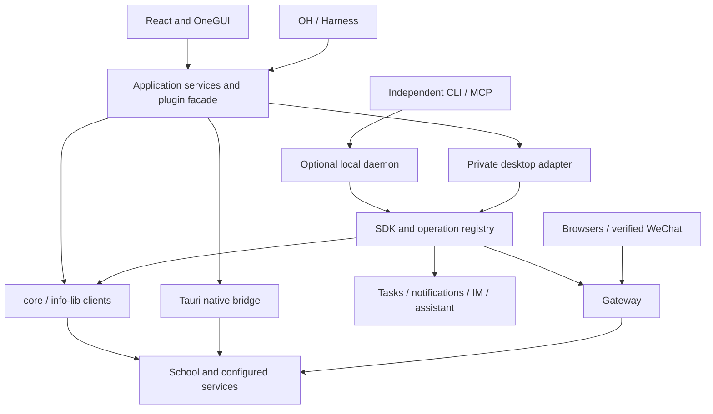
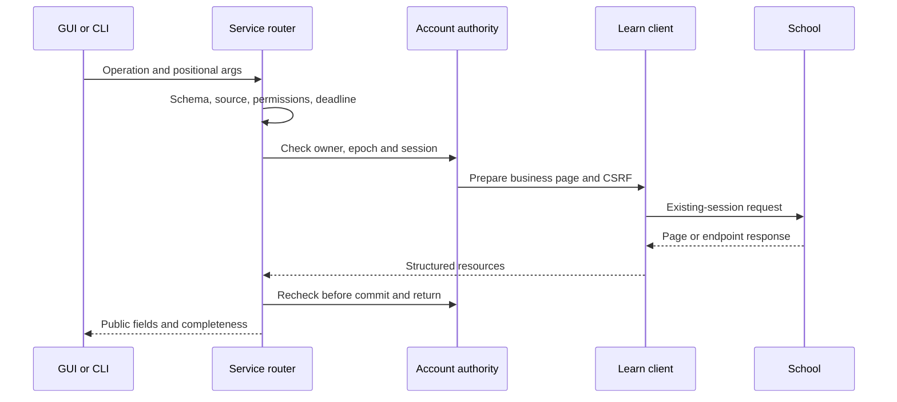

# OneTHU system architecture

[中文](../architecture.md) · English

This architecture overview tracks branch `web` at commit `7c2e9612` (2026-11-01, product version 0.11.4-fix-3). Active development branches, local dev servers, and packaged installers ship on independent schedules; consult the release notes and artifact manifests for the exact capabilities included in a given installer.

## System purpose

OneTHU brings together campus service clients, a customizable personal workbench, and programmable agent interfaces. React drives workspaces and interactive views on top of OneGUI's visual and motion foundations; campus client libraries communicate with university endpoints; the standalone SDK provides account-aware execution and background scheduling; CLI and MCP expose structured operations to external programs; and Gateway extends an authorized campus session to supported browsers and desktop clients.

Campus traffic flows directly between the user's device and university systems, while integrations such as Tsinghua Cloud, GitLab, email, calendars, AI models, and IM bots connect to their respective remote services. Even as a local-first client, OneTHU provides explicit data-scope disclosures and authorization prompts whenever external services or agents participate, and available campus features follow the user's university permissions and live session state.

## Reading map

| Reference | Topics |
| --- | --- |
| [Prototype and data](architecture/prototype-and-data.md) | Modes, tabs, boards, atoms, staging, ownership and synchronization |
| [SDK and service runtime](architecture/sdk-and-api.md) | Client libraries, authentication, registration, schemas and commit guards |
| [CLI, agents and scheduling](architecture/cli-and-agents.md) | Daemon, MCP, Harness, IM and persistent authorization |
| [Gateway](architecture/gateway.md) | Proxy topology, SSO, WeChat ticket bridge, platform support and recovery |
| [OneGUI](architecture/onegui.md) | Tokens, style pipeline, materials, layout, gestures and localization |
| [API reference](api-reference.md) | Interface selection, examples, protocols and compatibility |

## Layers and deployment

When the optional CLI component is installed on desktop, both the GUI app and the default `onethu` CLI connect to a shared background daemon for that profile. Android builds—and desktop installations without the CLI component—use the app's built-in service and scheduling adapters instead. Portable domain logic and authorization policies are shared across both setups, while process management, network transports, and lifecycle hooks belong to each host. Running Vite standalone launches a mock-backed frontend preview, whereas live campus networking, local file access, persistent sessions, and background execution run inside the Tauri or Node hosts.

OH access to application services is gated by an explicit agent-service consent setting, and external CLI/MCP access has its own dedicated toggle. On mobile, OH invokes application services directly without requiring a desktop Node runtime. Features tied to live interface state—such as contacts, Vault staging, and certain workspace actions—run through the GUI host, while the standalone SDK advertises the portable operations registered in its own catalog.

## Source ownership

| Location | Responsibility | Interface |
| --- | --- | --- |
| `apps/desktop/src` | React, modes, domain state, application services, plugin facade | TypeScript / React / invoke |
| `apps/desktop/src-tauri` | Native networking, files, installers, windows, notifications, mobile bridges | Private IPC / native plugins |
| `packages/core` | HTTP/Cookies, campus clients, parsing, models, auth helpers | Transport-injected library |
| `packages/info-lib` | Existing university login, roaming and 2FA hooks | InfoHelper / platform transport |
| `packages/sdk` | Node runtime, registry, policy, tasks, model and IM adapters | `createOneThu` / schemas / ports |
| `packages/cli` | Commands, daemon management, MCP and export | JSON / local JSON-RPC / stdio |
| `packages/gateway` | HTTP/CONNECT, TLS facade, PAC, peer attribution, recovery | Private controls / loopback listeners |
| `packages/gui` | OneGUI tokens, components and recipes | React / CSS / StyleDirector |
| `packages/ui` | Still-loaded legacy token compatibility | Migration to OneGUI recipes |
| `plugins/OneTHU-Harness` | Rust OH loop and host calls | Desktop sidecar / Android embedding |

`packages/core` provides stateless protocol parsing and campus service clients, while `packages/sdk` layers runtime session ownership, storage, and execution policy on top. Workspace package names, GUI plugin namespaces, and CLI/SDK operation names each serve their respective integration layer.

## Implemented choices and costs

| Choice | Purpose | Maintenance cost |
| --- | --- | --- |
| Application services with optional CLI | Mobile/basic users keep direct services; advanced users gain residency | Strict document/task handoff between hosts; see the [ADR](../adr/2026-10-29-optional-cli-services.md) |
| Transport-injected campus clients | Shared parsing/models with Rust, Node and WebVPN | Cookie, redirect and cancellation semantics must agree |
| Plugin types and operation schemas | Separate GUI interaction from programmable services | Generators and adapters stay synchronized; callers query live catalogs |
| Device-local session gateway | Authorized identity stays local while browsers reuse it | CA trust, provenance, recovery and platform acceptance |
| Central semantic visual system | Composable themes, materials and states | Gradual legacy migration and real-viewport acceptance |

## A course-resource request

Completing SSO sign-in, establishing a service-specific session, and acquiring a page CSRF token are distinct steps in the request pipeline: if a campus endpoint returns an SSO redirect or a WebVPN landing page, the client raises an explicit session-preparation error so callers can distinguish expired sessions from genuinely empty course lists. Subsequent file downloads resolve short-lived, account-bound resource references while keeping raw authenticated URLs inside the service layer.

## Ownership and revocation

Each layer maintains a clear single source of truth: the device account runtime owns university sessions, Explorer and Board manage view instances and layouts, versioned account documents store shared calendars and configuration, a single active task manager coordinates scheduled runs, and Gateway tracks its own system-proxy snapshot for clean restoration. Every call captures the active account epoch, policy revision, cancellation signal, and deadline on entry.

Because the GUI frontend, Rust native layer, and Node daemon hold local mirrors for responsiveness, handoffs reconcile state using account identity, session epoch, Cookie revision, and document version numbers. Installing or removing the optional CLI component migrates versioned documents and scheduler ownership before activating the target runtime. When a background daemon encounters a startup or IPC error, the host retains diagnostic context while preserving the valid native session and single-scheduler invariant.

## Extensions and lifecycle

Extension calls pass through layered safeguards: manifest permissions and platform checks combine with operation tuple schemas, mutation flags, and local-only restrictions. Trusted host adapters assign the caller source for model, MCP, plugin, and IM requests, and pre-commit guards re-verify the active account, user authorization, cancellation state, and remaining deadline right before a write executes; if a timeout occurs after a write is submitted, the runtime reconciles upstream state before returning.

When a user opts into trusting a device during 2FA, OneTHU registers the label `OneTHU（device name）` alongside a stable installation fingerprint. Reading the local device name populates that display label for new trust registrations while leaving historical university device records unchanged. Native OS device-name lookup is implemented in source and ships with packaged native builds.

Production updates flow through verified installers and release channels, while Vite HMR serves local frontend development. Native binaries, optional CLI runtimes, and plugins each validate target platform, version compatibility, and cryptographic digests independently.

## Acceptance boundaries

| Capability | Evidence |
| --- | --- |
| Mac system gateway, Info/Learn, original-proxy coexistence | Live requests and restoration checks |
| Mac WeChat Qingxiaoda and visitor reporting | User-confirmed business pages and official ticket renewal |
| Windows gateway | CurrentUser/PAC, SID/signature code and fixtures; physical acceptance pending |
| Android/iOS device-wide gateway | Native transport bridge pending |
| Other Xingzai H5 services | Accepted separately by service |
| Full organization collaboration across two accounts | Tracked separately from single-device fixtures |

See the [live WeChat review](../reviews/2026-11-01-trusted-client-campus-gateway.md) and [platform guide](../guides/campus-gateway-mobile.md), maintained in Chinese with full test logs. The table above reflects verification milestones as of 2026-11-01, with subsequent changes tracked alongside matching native builds and device runs.
