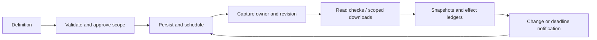

# CLI, agents and resident scheduling

[中文](../../architecture/cli-and-agents.md) · [System overview](../architecture.md)

## Entrypoints and lifetimes

| Entrypoint | Owner | After GUI closure |
| --- | --- | --- |
| Independent CLI / daemon | Node SDK and private profile | Approved tasks continue while daemon runs |
| CLI `--desktop` | Running application services | Requires the app |
| OH / Android Harness | App services, optionally installed daemon | App-owned execution follows platform lifecycle |

CLI adapts commands, the daemon owns a resident runtime, `createOneThu` embeds it, and MCP adapts an agent protocol. With CLI installed, the desktop and default terminal share a profile's account, documents and tasks. Explicit `--data-dir` isolates an environment; `--desktop` or endpoint selects GUI services. Startup, recovery and installation failures are reported separately.

## Discovery and commands

```sh
onethu commands
onethu schema learn.courses
onethu learn courses --args '[]'
onethu call learn.homework --args-file ./arguments.json
```

Arguments are positional JSON arrays. UTF-8 files avoid Windows shell-quoting problems. Success goes to stdout and safe errors to stderr. Clients validate response envelopes, IDs, sizes and deadlines. Queries call services directly; a model participates only through an explicit assistant path.

`learn export` composes enumeration and downloads. File effects need confirmation. Completed files and per-item status survive partial failures. Sources: [cli.mjs](../../../packages/cli/src/cli.mjs), [export.mjs](../../../packages/cli/src/export.mjs), [usage](../onethu-cli.md).

## Local daemon protocol

```text
CLI / MCP stdio
   → authenticated loopback client
   → random local port: /cli/v1 or /mcp
   → discovery / auth / policy / service/call
   → SDK and campus services
```

A private access record stores port, random token and process metadata. The server requires loopback, POST, JSON and authorization, and rejects browser Origin. Clients refuse remote redirects. Profile locking establishes ownership; the access record provides discovery.

Private `desktop.*` handoff checks protocol, owner and epoch. Session/document payloads and `gateway.control` remain outside public tool catalogs. Diagnostics retain safe state and error classes.

Autostart uses a macOS LaunchAgent or current-user Windows scheduled task. `daemon stop` stops the process; `daemon uninstall --confirm` removes its autostart entry. Sleep, shutdown, offline periods and OS reclamation affect actual execution. Sources: [daemon.mjs](../../../packages/cli/src/daemon.mjs), [service.mjs](../../../packages/cli/src/service.mjs).

## MCP and application tools

Public MCP exposes `onethu_commands` for discovery and `onethu_call` for a positional operation. It does not accept password/2FA interaction or let JSON arguments enable automatic execution. Stdio framing/concurrency limits complement SDK authorization.

OH/Harness uses application tools such as `app_services`, `app_call` and dedicated GUI tools. A trusted main-window facade supplies contacts, organizations, Xiaoda, staging and workspace access. OH application consent is independent from the external CLI switch.

The optional Node assistant uses `onethu_catalog` and `onethu_call` as model tool names. Its discovery tool is distinct from public MCP's `onethu_commands`. Provider configuration, allowlisted operations, turns, tool count, time and context budgets bound the loop. Tool results are external data and subject to explicit context limits.

The Node assistant can use an injected MadModel provider but does not perform independent school-model login. Desktop Harness model adapters and user-configured APIs belong to their host. Availability is evaluated for each configuration.

## Harness, plugins and skills

Desktop Harness is a Rust sidecar making reverse `onethu.call` requests. Android embeds Harness core and returns bridge replies through the same permission facade. The main window owns execution; overlays do not independently start plugin/login runtimes.

JS plugins receive `OnethuApi`. Native plugins have local process privileges: host permission checks do not create an OS sandbox. Xiaoda skill discovery, import, enablement and execution are separate states. Bounded QuickJS supports synchronous computation; heavier filesystem/network/Python/Node skills are exported to an external environment.

Sources: [rust.ts](../../../apps/desktop/src/plugins/rust.ts), [loader.ts](../../../apps/desktop/src/plugins/loader.ts), [plugin protocol](../plugin-development.md), [assistant bounds](../../../packages/sdk/src/assistant/README.md).

## Tasks and standing authorization

`createTaskManager(ports)` injects storage, clock, owner, dispatch and delivery so Node and app hosts share scheduling logic. One host owns scheduling at a time. Install/uninstall transfers approved tasks and records, including paused/error states.

Task definitions contain name, interval/daily/once schedule and template. Approval binds account, operations, courses, output directory and recipients; updates/resume recheck that scope. Runtime grants are manager-owned objects rather than forgeable JSON fields.



`school-watch` enumerates Learn courses, materials, assignments and announcements, compares identities/digests and computes deadline reminders. It does not need model inference. Agents and IM can request/discuss tasks; execution policy still controls approval.

`nextRun` advances interval schedules from now, interprets once schedules as absolute zoned timestamps, and uses real IANA timezone rules for daily local times. Timezones are validated. A minute-by-minute search handles missing civil/DST times, bounded to three days before a classified failure; fixed local offsets are not guessed.

One manager runs one task at a time to avoid bursts against a shared school session. Notification/download ledgers retain pending, completed and unknown outcomes. After interruption, pending effects become unknown and history records the interruption. Restart performs one recovery check rather than replaying every missed interval.

Current bounds are 50 tasks, 30 history runs per task and up to 100 downloads per run. Transient reads attempt at most three times, with 1-second and 2-second waits. Authentication/account/permission/schema/cancellation failures end the step. Effect ledgers control duplicates. Arbitrary reservation/mail writes are not accepted as generic scheduled-operation templates.

Sources: [manager](../../../packages/sdk/src/tasks/index.ts), [schedule](../../../packages/sdk/src/tasks/schedule.ts), [watch](../../../packages/sdk/src/tasks/watch.ts), [scope validation](../../../packages/sdk/src/tasks/validation.ts), [GUI handoff](../../../apps/desktop/src/state/cliTasks.ts).

## IM and delivery

Notification channels and conversational IM have separate configuration and lifecycles. Inbox, Feishu, WeChat and HTTPS webhook use configured account/device bindings. Recipients and credentials stay private; external delivery follows scope checks.

Conversation state, channel credentials and effect ledgers use distinct storage objects. Cancellation prevents subsequent tools/commits, while a service decides the outcome of an already-sent message. Quiet monitoring emits no repeated notification for unchanged, non-actionable state.
