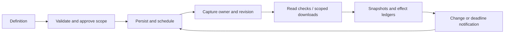

# CLI, agents and resident scheduling


[中文](../../architecture/cli-and-agents.md) · [System overview](../architecture.md)

## Entrypoints and lifetimes

| Entrypoint | Owner | After GUI closure |
| --- | --- | --- |
| Independent CLI / daemon | Node SDK and private profile | Approved tasks continue while daemon runs |
| CLI `--desktop` | Running application services | Requires the app |
| OH / Android Harness | App services, optionally installed daemon | App-owned execution follows platform lifecycle |

The CLI parses terminal commands, the daemon hosts a resident Node runtime, `createOneThu` embeds the SDK directly, and MCP exposes the same service router to external agents. Once the CLI component is installed, the desktop app and the default terminal share the profile's account, synced documents, and scheduled tasks. Passing `--data-dir` isolates execution in a dedicated directory, while `--desktop` or an explicit endpoint routes requests to a running GUI instance. Startup, recovery, and installation errors each surface distinct diagnostics.

## Discovery and commands

```sh
onethu commands
onethu schema learn.courses
onethu learn courses --args '[]'
onethu call learn.homework --args-file ./arguments.json
```

Commands accept positional JSON argument arrays, and passing a UTF-8 file via `--args-file` avoids shell-quoting pitfalls on Windows. Normal output writes to `stdout` while redacted error details go to `stderr`. Clients verify response envelopes, request IDs, payload sizes, and deadlines. Standard service queries call the underlying campus clients directly; a language model runs only when you invoke an assistant workflow.

`learn export` combines resource enumeration with local file downloads after user confirmation. If an export fails partway through, already-downloaded files stay on disk alongside per-item status records. Sources: [cli.mjs](../../../packages/cli/src/cli.mjs), [export.mjs](../../../packages/cli/src/export.mjs), [usage](../onethu-cli.md).

## Local daemon protocol

```text
CLI / MCP stdio
   → authenticated loopback client
   → random local port: /cli/v1 or /mcp
   → discovery / auth / policy / service/call
   → SDK and campus services
```

A private access file records the active loopback port, a random bearer token, and process metadata. The local server accepts only authenticated `POST` requests with JSON bodies over loopback, rejects browser `Origin` headers, and clients follow loopback endpoints exclusively without remote redirects. Profile locks establish single-process ownership while the access file handles local discovery.

Private `desktop.*` handoff calls verify protocol version, account owner, and session epoch. Session credentials, document payloads, and `gateway.control` travel only over private channels and stay out of public tool catalogs, while diagnostics record redacted state and error categories.

Background autostart registers a user LaunchAgent on macOS or a current-user scheduled task on Windows. `daemon stop` shuts down the running process, and `daemon uninstall --confirm` removes the autostart registration. Actual task timing follows host availability across sleep, shutdown, offline periods, and OS process management. Sources: [daemon.mjs](../../../packages/cli/src/daemon.mjs), [service.mjs](../../../packages/cli/src/service.mjs).

## MCP and application tools

Public MCP provides `onethu_commands` to browse available operations and `onethu_call` to invoke them with positional arguments. Interactive password or 2FA sign-in and automatic-execution grants are configured locally through the CLI or desktop app, complemented by `stdio` framing and concurrency bounds on top of SDK authorization.

Inside the app, OH and Harness call application tools such as `app_services`, `app_call`, and dedicated GUI tools. A trusted main-window facade provides access to contacts, organizations, Xiaoda, staging boxes, and workspaces. In-app OH consent is managed independently from the external CLI toggle.

The optional Node assistant uses `onethu_catalog` for discovery and `onethu_call` for execution, keeping its model-facing catalog separate from public MCP's `onethu_commands`. The tool loop stays bounded by provider settings, allowlisted operations, turn count, tool-call limits, timeouts, and context budgets, treating tool outputs as external data within strict size limits.

You can pass an injected MadModel provider to the Node assistant, while interactive school-model login and user-configured API adapters live in the desktop Harness host. Each host checks provider availability against its own active configuration.

## Harness, plugins and skills

On desktop, Harness runs as a Rust sidecar that issues reverse `onethu.call` requests back to the host; on Android, Harness core is embedded directly and routes bridge replies through the same permission facade. The main window coordinates all plugin and login runtimes centrally, including actions triggered from overlays.

JavaScript plugins receive a scoped `OnethuApi`, whereas native plugins run as local user processes gated by host permission checks. Xiaoda skills progress through separate stages for plaza discovery, local import, enablement, and execution: lightweight synchronous logic runs inside the bounded QuickJS engine, while skills that need filesystem, network, Python, or Node support can be exported to run in an external desktop environment.

Sources: [rust.ts](../../../apps/desktop/src/plugins/rust.ts), [loader.ts](../../../apps/desktop/src/plugins/loader.ts), [plugin protocol](../plugin-development.md), [assistant bounds](../../../packages/sdk/src/assistant/README.md).

## Tasks and standing authorization

`createTaskManager(ports)` accepts injected storage, clock, owner, dispatch, and delivery ports so the Node daemon and GUI hosts share the exact same scheduler. A single host owns active scheduling at any moment, and installing or uninstalling the CLI component hands off approved tasks and run history—including paused and errored states—between the app and daemon.

Each task definition specifies a name, an `interval`, `daily`, or `once` schedule, and an execution template. User approval locks in the target account, allowed operations, course list, output directory, and notification recipients; editing or resuming a task revalidates that scope, and runtime grants live as internal manager-owned objects in memory.



`school-watch` runs deterministically without model calls: it enumerates Learn courses, materials, assignments, and announcements, diffs resource digests, and calculates upcoming deadline reminders. Agents and IM channels can draft or query tasks, while local execution policy governs standing approval.

`nextRun` advances interval schedules from the current timestamp, treats `once` schedules as absolute zoned instants, and evaluates `daily` schedules against validated IANA timezone rules. If a civil or DST transition skips a local minute, a minute-by-minute scan searches up to three days ahead before reporting a typed scheduling error.

Each manager executes one task at a time to keep traffic gentle on the shared campus session. Notification and download ledgers track `pending`, `completed`, and `unknown` states: if a run is interrupted, in-flight effects move to `unknown` and are logged in history, and restarting after downtime triggers a single catch-up check before resuming the regular schedule.

A profile supports up to 50 tasks, keeping the latest 30 run records per task and up to 100 downloads per run. Transient read failures retry up to three times with 1-second and 2-second backoffs, while authentication, account, permission, schema, or cancellation errors stop the step immediately. Effect ledgers prevent duplicate downloads and alerts, and scheduled `operation` templates stay scoped to read checks and approved resource downloads while reservations and outgoing mail remain interactive.

Sources: [manager](../../../packages/sdk/src/tasks/index.ts), [schedule](../../../packages/sdk/src/tasks/schedule.ts), [watch](../../../packages/sdk/src/tasks/watch.ts), [scope validation](../../../packages/sdk/src/tasks/validation.ts), [GUI handoff](../../../apps/desktop/src/state/cliTasks.ts).

## IM and delivery

Outbound notification channels and two-way conversational IM maintain independent configurations and lifecycles. The local inbox, Feishu, WeChat, and HTTPS webhooks each bind to a verified account and device scope, keeping recipient details and channel credentials private and validating scope before every external send.

Conversation history, channel credentials, and delivery ledgers live in separate storage records. Cancelling a run stops any further tool calls or state commits, while messages already handed to an external platform follow that service's delivery lifecycle. During quiet stretches when nothing has changed, monitoring stays silent until new updates or approaching deadlines appear.
