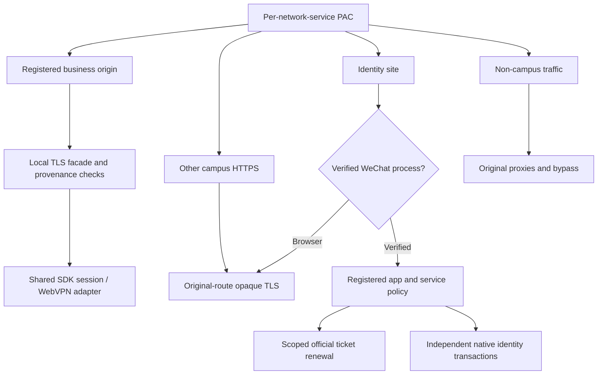
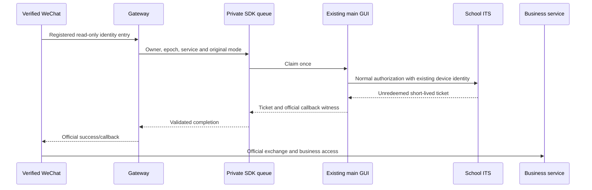

# Gateway architecture

[中文](../../architecture/gateway.md) · [System overview](../architecture.md)

## Purpose and controls

Gateway lets supported browsers and campus clients on the same computer share an authenticated OneTHU school session. Implemented in `packages/gateway`, it runs under the local SDK or daemon manager and listens exclusively on `127.0.0.1`.

Local listening, CA certificate trust, and system proxy routing are enabled as independent steps, with each installation profile generating its own CA, private key, and proxy credentials. System-level changes always require explicit user confirmation. Private `gateway.control` operations—along with credential, trust, and ticket payloads—stay internal to the host and outside public MCP discovery.

Standard browsers connect through the per-service system PAC integration, while an optional isolated campus browser uses its own dedicated authenticated entry point alongside it.

## Request topology

Gateway parses and authenticates HTTP/1.1 forward requests and HTTPS `CONNECT` tunnels through dedicated handlers, requiring the request authority, `Host` header, and TLS SNI to match. Requests with duplicate sensitive headers, malformed framing, unauthorized targets or provenance, or oversized bodies are rejected early. Streaming responses enforce backpressure, cancellation, and size budgets, and switching accounts rotates the session epoch to cancel active requests immediately.

## Business facade

Requests pass origin, HTTP method, and Fetch Metadata checks before reaching the SDK campus adapter, which chooses direct campus access or WebVPN and manages logical and physical Cookie scopes while keeping authoritative session cookies inside the runtime.

Allowlisted origins receive targeted URL, CSP, and redirect rewriting that preserves security policy, while binary payloads and `Range` requests pass through byte-for-byte. Bodyless legacy HTTP `GET` and `HEAD` navigations redirect cleanly to the HTTPS facade; `POST` requests and uploads require the client to submit directly over HTTPS.

Ordinary browser connections to the identity server keep end-to-end university TLS certificates over the original route. Other campus HTTPS hosts pass through as opaque TLS tunnels over existing proxy settings, and OneTHU session cookies are attached solely to registered campus services.

Sources: [index.mjs](../../../packages/gateway/src/index.mjs), [policy.mjs](../../../packages/gateway/src/policy.mjs), [campusProxy.ts](../../../packages/sdk/src/node/campusProxy.ts).

## School SSO and business sessions

Gateway resolves official service entry points through Info navigation, establishing identity cookies, service cookies, JWTs, and page-level CSRF tokens at their respective layers. Each target service redeems its own university-issued ticket, and any password or second-factor challenge surfaces directly for user interaction.

Because campus servers often return HTTP `200` for confirmation screens, password forms, gateway landing pages, and access-denied notices, Gateway inspects page structure to classify each response accurately and verifies OneTHU login state separately from target-service session readiness.

## Restricted WeChat bridge

To share campus identity with desktop WeChat mini-programs, Gateway verifies the calling OS process before inspecting request metadata. On macOS, it matches the exact TCP UID/PID tuple via `lsof -b -w -nP` (avoiding blocking stat calls on network mounts such as WebDAV) and validates the executable's Apple code-signing chain, Tencent team ID, and WeChat bundle identifier. On Windows, it verifies the current user SID, TCP PID, and Tencent Authenticode signature. Activation preflights both the local listener and this process-attribution path.

An internal registry pairs approved mini-program IDs with their official campus origins, ITS service IDs, and callback URLs—currently covering Qingxiaoda and Xingzai visitor reporting on macOS. Once OS process identity is proven, Gateway evaluates full request provenance, including native `wx.request` calls carrying a registered `servicewechat` `Referer` and cross-site metadata.

When a fresh mini-program `web-view` opens without a `Referer` header, a preceding app-attributed request can issue a single-use, 10-second `GET` navigation grant tied to that exact verified process, account epoch, and registered service.

Account passwords remain inside the GUI's credential path while the private SDK queue passes only service identifiers and short-lived tickets, guarded by owner and epoch checks, single-claim semantics, deadlines, and cooldowns. Interactive university challenges stay on the official login flow.

Because the visitor-reporting page emits `/login/form//<service>/0`, both Gateway and the SDK normalize single and double slashes at that segment while enforcing full service, mode, and callback validation. Any other WeChat traffic continues using the client's own independent Cookie jar.

Sources: [policy](../../../packages/gateway/src/clientIdentity.mjs), [process verification](../../../packages/gateway/src/trustedClient.mjs), [SDK queue](../../../packages/sdk/src/node/clientIdentity.ts), [GUI renewal](../../../apps/desktop/src/state/campusClientRuntime.ts).

## Coexistence and endpoint continuity

On macOS, Gateway inspects proxy, bypass, and PAC/WPAD settings per network service; on Windows, it reads `CurrentUser` proxy settings and validates a composition plan before making changes. Standard manual proxies compose cleanly downstream, whereas external PAC/WPAD URLs or authenticated upstream proxies are left untouched with a clear compatibility message.

Before applying system proxy settings, Gateway revalidates the plan and preflights the active listener, peer-attribution check, and local CA certificate. Non-campus traffic keeps its original route—for example, Clash subscriptions, rules, nodes, and credentials continue running in Clash undisturbed. When turning Gateway off, restoration compares live system values against the saved snapshot so changes made afterward by other tools stay intact.

A private `endpoint-hints.json` file persists listener ports and randomized PAC paths across restarts using atomic writes and ownership checks, helping browsers avoid stale PAC caches. If a saved port is busy, Gateway reports the conflict cleanly without disturbing the other process, and the hint file stores only port and path metadata.

Sources: [manager](../../../packages/gateway/src/manager.mjs), [platform](../../../packages/gateway/src/platform.mjs), [PAC](../../../packages/gateway/src/pac.mjs), [endpoint hints](../../../packages/gateway/src/endpointHints.mjs).

## Diagnostics and recovery

Diagnostic logs record allowlisted host, service, and path categories alongside provenance, route selection, an anonymized peer tag, status codes, and counters, while keeping a dedicated eight-entry ring buffer for recent identity events so asset requests do not push them out. Raw URLs, query parameters, cookies, and tickets are stripped before logging.

Crash or startup recovery reads the saved proxy snapshot, verifies ownership, restores Gateway-managed system settings, and closes local listeners. When updating protected runtime code, the manager validates and stages the new build first, performs a brief listener reload, and reverifies endpoints, CA trust, profile ownership, and system proxy status.

## Platform evidence

macOS has completed live acceptance testing across system-proxy routing, Info/Learn browser access, and both WeChat mini-program flows. Windows implements `CurrentUser` PAC composition and SID/Authenticode verification with fixture coverage, awaiting physical-device sign-off. Additional Xingzai H5 services and native mobile transport bridges on Android and iOS—covering OS VPN/proxy consent, coexistence with existing VPN apps, and per-app CA trust—are tracked as separate platform work.

System PAC routing serves browsers and apps that honor OS proxy settings, while Gateway binds strictly to local `127.0.0.1` on the current computer; apps with custom network stacks use dedicated integration paths. See the [platform guide](../../guides/campus-gateway-mobile.md) and [2026-11-01 acceptance record](../../reviews/2026-11-01-trusted-client-campus-gateway.md).
