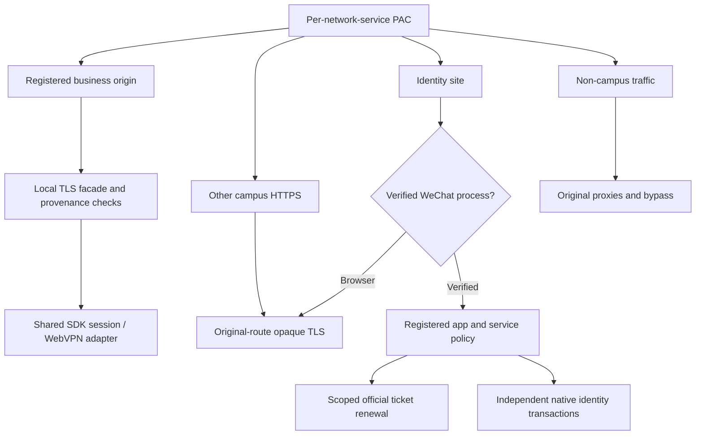
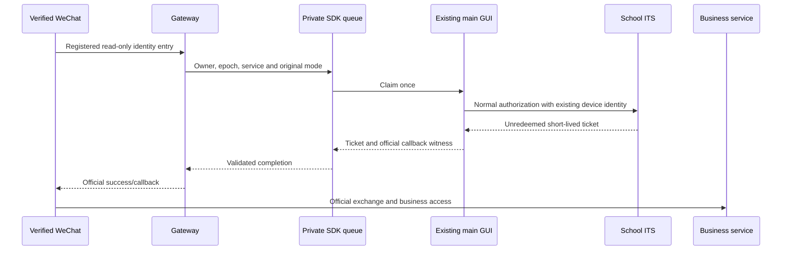

# Gateway architecture

[中文](../../architecture/gateway.md) · [System overview](../architecture.md)

## Purpose and controls

Gateway reuses an authorized OneTHU school session for supported browsers/clients on the same device. `packages/gateway` is owned by the existing SDK/daemon manager and binds to `127.0.0.1`.

Listening, CA trust and system proxy activation are separate states. Each installation/profile has its own CA, private key and proxy credentials. System changes require explicit actions. Private `gateway.control` is excluded from public MCP discovery, including credential/trust/ticket payloads.

An optional isolated campus browser has a separate authenticated entry. Ordinary browser system integration does not depend on it.

## Request topology

HTTP/1.1 forward requests and HTTPS CONNECT have separate parsing/authentication. Authority, Host and TLS SNI must agree. Sensitive duplicate headers, malformed framing, unauthorized targets/provenance and oversized requests fail. Streaming uses backpressure, cancellation and budgets; account epoch rotation revokes active work.

## Business facade

Allowed origins/methods and Fetch Metadata precede the SDK campus adapter. It selects direct access or WebVPN and maintains logical/physical Cookie scope. Authoritative cookies remain inside the runtime.

Approved URL/CSP/redirect rewriting adjusts allowlisted origins while preserving the policy; binary and Range responses retain byte semantics. Explicit legacy HTTP GET/HEAD navigations without bodies can redirect to an HTTPS facade. POST/uploads are not automatically replayed.

Ordinary-browser identity connections keep school certificates and the original route. Other campus HTTPS can be transparently tunneled under supported original-proxy configurations; unregistered businesses do not receive OneTHU cookies.

Sources: [index.mjs](../../../packages/gateway/src/index.mjs), [policy.mjs](../../../packages/gateway/src/policy.mjs), [campusProxy.ts](../../../packages/sdk/src/node/campusProxy.ts).

## School SSO and business sessions

Info navigation discovers official service entries. Identity cookies, business cookies, JWTs and page CSRF are established separately. School-issued service tickets are exchanged by the corresponding service. Password/challenge requirements remain explicit.

HTTP 200 alone is not login acceptance: confirmation pages, password forms, gateway guides and denied business pages are classified. A logged-in OneTHU session and a usable service session are checked separately.

## Restricted WeChat bridge

Mac proves an exact TCP UID/PID and validates the running executable's Apple chain, Tencent team and WeChat identifier. Windows uses current SID, TCP PID and valid Tencent Authenticode. Process names, User-Agent or Referer alone cannot authorize shared identity. Mac attribution uses the exact TCP tuple and `lsof -b -w -nP` to avoid blocking filesystem queries on mounts such as WebDAV. Activation preflights the real listener and this attribution path.

The registry binds known mini-program IDs, official origins, ITS service IDs and callbacks. Accepted Mac flows are Qingxiaoda and Xingzai visitor reporting. Legitimate native `wx.request` can use a registered servicewechat Referer with cross-site metadata; the complete provenance is evaluated after process proof.

A fresh web-view may omit Referer. A recent app-attributed request can grant one 10-second GET document navigation for the same verified process, account epoch and registered service. Replay, body-bearing/credential POSTs and another process cannot use that grant.

Passwords stay in the GUI's existing credential path; the queue carries service enums and short-lived tickets. Owner/epoch, single claim, deadline and cooldown fence renewal. Genuine school challenges retain the official path.

The visitor webpage generates `/login/form//<service>/0`. Both Gateway and SDK accept one/two slashes at that position, preserving registered service, mode and callback checks. Other/unmatched requests keep the native client's independent Cookie transaction.

Sources: [policy](../../../packages/gateway/src/clientIdentity.mjs), [process verification](../../../packages/gateway/src/trustedClient.mjs), [SDK queue](../../../packages/sdk/src/node/clientIdentity.ts), [GUI renewal](../../../apps/desktop/src/state/campusClientRuntime.ts).

## Coexistence and endpoint continuity

Mac reads proxies, bypass and PAC/WPAD by network service. Windows reads CurrentUser configuration and validates its prepared plan. Known manual proxies can be composed; unsupported external PAC/WPAD, authenticated or ambiguous proxy configurations remain untouched with a classified failure.

Activation rechecks the plan and preflights the actual listener, peer proof and certificate before system mutation. Non-campus traffic retains original routes; Clash subscriptions, rules, nodes and credentials stay in Clash. Restoration compares current values and preserves another app's later changes.

Private `endpoint-hints.json` keeps listener ports and random PAC paths across restarts, reducing stale host caches. It uses atomic writes and file/owner validation. Port conflicts fail without killing other processes. The cache contains no account, cookie or ticket.

Sources: [manager](../../../packages/gateway/src/manager.mjs), [platform](../../../packages/gateway/src/platform.mjs), [PAC](../../../packages/gateway/src/pac.mjs), [endpoint hints](../../../packages/gateway/src/endpointHints.mjs).

## Diagnostics and recovery

Diagnostics retain allowlisted host/service/path classes, provenance, route, anonymous peer tag, status and counters. A separate last-eight identity history survives subsequent asset traffic. Raw URLs, query values, cookies and tickets are excluded.

Recovery reads the original snapshot, compares ownership, restores controlled values and closes listeners. Protected code replacement validates/stages the artifact first, then reloads briefly and rechecks endpoints/system activation. CA, profile and address continuity are independent checks; reload is not zero downtime.

## Platform evidence

Mac has live system-proxy, Info/Learn and two WeChat business-page acceptance. Windows has CurrentUser/PAC, SID/signature implementation and fixtures, with physical acceptance pending. Android/iOS device-wide native transport bridges remain unimplemented. Other Xingzai H5 services need separate acceptance.

System PAC primarily covers clients honoring system proxy settings; independent stacks, proxies and other transports need separate acceptance. LAN listening and cross-device pairing are not enabled. A phone's loopback belongs to that phone. Android system approval, existing-VPN conflicts and target-app CA trust need native implementation and device tests. See the [platform guide](../../guides/campus-gateway-mobile.md) and [2026-11-01 acceptance record](../../reviews/2026-11-01-trusted-client-campus-gateway.md).
