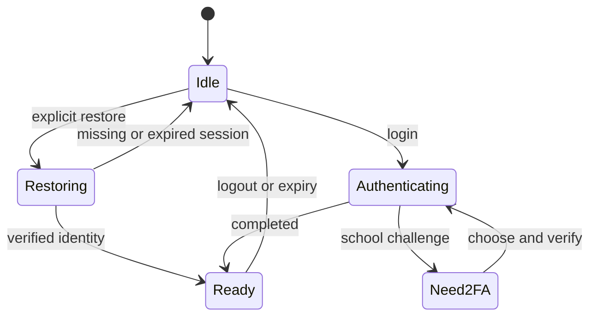

# SDK and service runtime


[中文](../../architecture/sdk-and-api.md) · [System overview](../architecture.md)

## Libraries and runtime

`packages/core` implements campus domain models, HTTP and Cookie jars, authentication helpers, and service clients over injected network transports. `packages/info-lib` provides the university SSO login, roaming, and 2FA-hook pipeline, and host adapters wire both libraries into a managed session runtime.

`packages/sdk` layers local Node session storage, operation registration, permission enforcement, scheduled tasks, notifications, plugins, and an optional assistant behind `createOneThu`. The full runtime targets Node.js, while portable subsets for Learn, task scheduling, and execution policy also export browser-compatible entry points for GUI hosts.

Sources: [core](../../../packages/core/src/index.ts), [info-lib](../../../packages/info-lib/src/lib/core.ts), [SDK](../../../packages/sdk/src/index.ts), [portable Learn service](../../../packages/sdk/src/learn.ts).

## Profile ownership

`createNodeSession` opens a private profile directory under an exclusive lock so each Node process owns a single active session runtime. By default, CLI invocations connect to the resident daemon managing that profile, while standalone SDK embeddings pass a dedicated private `dataDir`.

On disk, the profile stores a stable device fingerprint, account identifier, session cookies, trusted-device token, and epoch counter. Standalone SDK logins hold the password only in process memory during authentication; optional remembered-password storage in the desktop or mobile app is managed separately by the native host and stays completely outside SDK and model outputs.

Switching accounts clears cached transports, service preparation state, and resource tables while advancing the session epoch. Profile storage uses Unix private file modes and current-user Windows DACLs, validating path ownership, file types, and symlinks on every read. Sources: [session.ts](../../../packages/sdk/src/node/session.ts), [storage.ts](../../../packages/sdk/src/node/storage.ts).

## Authentication and business preparation



`auth.login` resolves to `ready` or `need-2fa`, keeping any active challenge state inside the same process until verification finishes. Choosing a second-factor method triggers its verification flow (with TOTP codes verified directly without SMS/push delivery), and registering a trusted device is an explicit opt-in that reuses the profile's existing fingerprint and trust token under the `OneTHU（device name）` label.

Web Learning requires an additional business-session handshake and CSRF token. `ensureLearnReady` deduplicates concurrent preparation calls per account and Cookie revision, publishes the CSRF token only after verifying a real Learn page, and surfaces login redirects, gateway prompts, or unexpected HTML as typed errors.

Rain Classroom maintains its own independent session and classroom identifiers alongside university SSO; when signed in via the desktop app, valid account-bound Rain Classroom state can be handed privately to the resident runtime.

## Operation contract

```ts
interface ServiceOperation {
  name: string;
  description: string;
  parameters: Schema;
  permission: string;
  mutation?: boolean;
  authenticated?: boolean;
  localOnly?: boolean;
  run(args: unknown[], context: OperationContext): unknown | Promise<unknown>;
}
```

See [types.ts](../../../packages/sdk/src/services/types.ts) for the full type definitions. Operations take positional tuple arrays validated against schemas that cover optional trailing parameters and strict object keys. Shared static catalogs supply parameter schemas and descriptions, while each host's service factories determine which operations are registered at runtime.

Call `app.list(source)` to inspect the operations actually active for a given caller. GUI and standalone hosts share naming conventions while registering capabilities suited to their environment—for instance, contacts, staging boxes, and interactive canvas actions require a running app.

## Dispatch and commit checks

1. Validate request envelope, operation name, and argument tuple schema.
2. Bind caller `source` inside the trusted transport adapter and verify permissions and `localOnly` rules.
3. Restore or check session identity, capturing account owner, epoch, policy revision, and deadline.
4. Check interactive confirmation, device auto-execution policy, or an internal manager-owned task grant.
5. Reverify account and cancellation state via `beforeWrite` right before committing side effects.
6. Reverify state before returning and strip internal fields through public output projection.

Per-operation busy locks serialize concurrent mutations, and calendar, CalDAV, and cloud-document writes run through a dedicated data queue, while remote atomicity follows each upstream campus or cloud service. Caller privilege levels come strictly from the local transport adapter.

## Embedding

Pass an isolated private directory when embedding the SDK in your own script, or talk to the desktop daemon over CLI/MCP when sharing the default user profile.

```ts
import { createOneThu } from '@onethu/sdk';

const app = await createOneThu({ dataDir: '/absolute/private/sdk-example' });
try {
  const catalog = app.list();
  const status = await app.auth.restore();
  if (status.authenticated) {
    const courses = await app.call({ operation: 'learn.courses', args: [] });
  }
} finally {
  await app.close();
}
```

Calling `app.start()` activates session restoration and resident background loops, and both resident and one-shot embeddings should call `app.close()` on exit to cancel active requests and shut down Gateway, IM/assistant loops, tasks, plugins, storage, and profile locks cleanly.

## Resources and completeness

Learn queries index course files, assignments, announcements, and attachments into account- and epoch-bound `resourceRef` handles. Download calls resolve those handles after validating target directories, safe filenames, upstream hosts, and response MIME types—preserving real attachment filenames and extensions while keeping authenticated download URLs internal to the runtime.

List and export responses include `complete`, per-item error entries, and continuation cursors so partial exports retain already-saved files cleanly. Output projection strips tokens, secrets, and embedded URL credentials while keeping regular data intact, with separate size bounds applied at the transport, service-pagination, and model-context layers. See [API limits](../api-reference.md#size-time-and-completeness).

## GUI handoff

Private `desktop.*` RPCs verify protocol version, expected account ID, and session epoch, pairing Cookie sync with revision numbers and shared account documents with optimistic content versions. Interactive sign-in and UI state live in the app, while an installed daemon hosts shared background services and scheduled tasks, migrating ownership explicitly on install and uninstall.

Gateway management, proxy credentials, session cookies, and university tickets travel solely over private local channels and stay excluded from public MCP tool discovery. Sources: [sharedRuntime.ts](../../../apps/desktop/src/lib/sharedRuntime.ts), [daemon.mjs](../../../packages/cli/src/daemon.mjs).

## Failure and recovery

Unauthenticated states, account switches, revoked permissions, 2FA prompts, rate limits, schema errors, and network timeouts each map to distinct error codes so callers can respond appropriately. Local startup, path, or IPC hiccups report clear diagnostics while leaving any valid native session on disk untouched; transient read errors can retry within budget, while uncertain writes check remote state before resending.

Public error payloads strip raw login HTML and credentials. Upstream messages from university servers stay tagged as external reasons while app-owned copy localizes at display time, and returned text or remote content is always treated purely as data under host permission rules.
