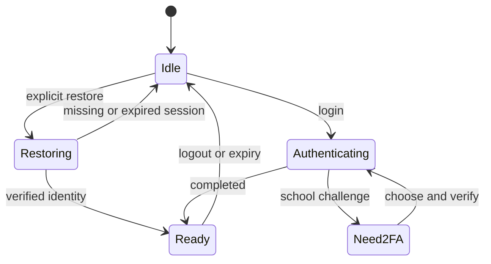

# SDK and service runtime

[中文](../../architecture/sdk-and-api.md) · [System overview](../architecture.md)

## Libraries and runtime

`packages/core` provides campus models, HTTP/Cookie handling, auth helpers and service clients with injected transports. `packages/info-lib` retains the university login, roaming and 2FA-hook pipeline. Host adapters connect these implementations to a controlled session.

`packages/sdk` adds Node session storage, registration, permissions, tasks, notifications, plugins and an optional assistant. Its entry point is `createOneThu`. The full runtime needs Node; selected Learn/task/policy modules have browser exports for workspace hosts.

Sources: [core](../../../packages/core/src/index.ts), [info-lib](../../../packages/info-lib/src/lib/core.ts), [SDK](../../../packages/sdk/src/index.ts), [portable Learn service](../../../packages/sdk/src/learn.ts).

## Profile ownership

`createNodeSession` opens private storage and holds an exclusive profile lock. One Node process has one active session runtime. The default CLI reuses the daemon holding its profile; independent embedding uses an explicit private directory.

Persisted state includes stable fingerprint, account, cookies, trust factor and generation. The standalone SDK holds passwords in process memory. GUI remembered-password storage is separately managed by the native app and is excluded from public SDK/model results.

Account rotation clears affected transports, preparation and resource caches and advances epoch. Unix private modes and protected current-user Windows DACLs protect files; reads validate paths, type, ownership and links. Sources: [session.ts](../../../packages/sdk/src/node/session.ts), [storage.ts](../../../packages/sdk/src/node/storage.ts).

## Authentication and business preparation



Login returns `ready` or `need-2fa`; the same process retains the challenge. Method selection precedes its flow, and TOTP needs no code delivery. Trusted-device registration requires an explicit option; `OneTHU（device name）` labels reuse the existing fingerprint and trust token.

Learn additionally needs its business page and CSRF. `ensureLearnReady` deduplicates preparation for the same account/Cookie revision and publishes only a verified candidate's CSRF. Login links, gateway guides and unexpected HTML return classified failures rather than empty courses.

Rain Classroom has its own business session and classroom IDs. The GUI can privately hand valid account-bound state to the backend. University authentication alone does not establish a Rain Classroom session.

## Operation contract

```ts
interface ServiceOperation {
  name: string;
  description: string;
  parameters: Schema;
  permission: string;
  mutation?: boolean;
  authenticated?: boolean;
  localOnly?: boolean;
  run(args: unknown[], context: OperationContext): unknown | Promise<unknown>;
}
```

This excerpt shows contract roles; [types.ts](../../../packages/sdk/src/services/types.ts) is authoritative. Positional arrays follow tuple schemas, including optional arguments and extra-field restrictions. Static catalogs supply some descriptions/schemas; service factories and runtime controls determine actual registration.

`app.list(source)` discovers registered operations visible to that source. GUI and independent runtimes can use similar names with different coverage. Contacts, staging and some board features require a running app. A static catalog entry alone does not prove an independently registered method.

## Dispatch and commit checks

1. Validate envelope, name and schema.
2. Assign source in the trusted adapter and check permissions / `localOnly`.
3. Restore or verify identity; capture owner, epoch, policy revision and deadline.
4. Evaluate local confirmation, automatic policy or a manager-owned task grant.
5. Recheck through `beforeWrite` before committing effects.
6. Recheck before return and project public fields.

Concurrent writes to the same operation have busy protection. Calendar/CalDAV/cloud document operations also use a data queue. Remote transaction consistency remains service-specific. External JSON cannot assign itself trusted local-configuration status.

## Embedding

Use a distinct private profile for independent embedding. Connect through CLI/MCP when the desktop daemon already owns its default profile.

```ts
import { createOneThu } from '@onethu/sdk';

const app = await createOneThu({ dataDir: '/absolute/private/sdk-example' });
try {
  const catalog = app.list();
  const status = await app.auth.restore();
  if (status.authenticated) {
    const courses = await app.call({ operation: 'learn.courses', args: [] });
  }
} finally {
  await app.close();
}
```

`app.start()` enables restoration and resident lifecycle. On-demand embedding must still close. Cleanup revokes requests and closes gateway, IM/assistant, tasks, plugins, storage and session ownership.

## Resources and completeness

Learn enumerates course files, assignments, notifications and attachments into owner/epoch-bound `resourceRef` records. Downloads resolve references and validate output directories, filenames, addresses and response types. Notification and assignment attachments retain actual filenames/extensions; authenticated URLs stay internal.

Callers inspect `complete`, per-item failures and continuation metadata. Successful files can survive a partial export. Public projections remove secret fields and URL credentials while retaining ordinary strings/arrays; transport size, business pagination and model context have separate limits. See [API limits](../api-reference.md#size-time-and-completeness).

## GUI handoff

Private `desktop.*` calls carry protocol version, expected account and epoch. Cookie mirrors additionally use revision; account documents have content versions. The GUI supports interactive authentication and view state; the daemon owns shared services and resident tasks when installed. Ownership migrates explicitly during installation/uninstallation.

Gateway controls and ticket renewal use private channels, outside public MCP catalogs. Proxy credentials, cookies and school tickets are not tool-discovery results. Sources: [sharedRuntime.ts](../../../apps/desktop/src/lib/sharedRuntime.ts), [daemon.mjs](../../../packages/cli/src/daemon.mjs).

## Failure and recovery

Missing sessions, account changes, revocation, 2FA, rate limits, schema failures and network timeouts require different responses. Startup/path/protocol failures remain diagnosable and do not justify discarding an otherwise valid native session. Reads can retry within budget; unknown writes require remote reconciliation.

Public errors remove login HTML and credentials. School-supplied business details may remain external reasons; application-owned messages localize at render time. Returned text and instructions never change caller permissions.
