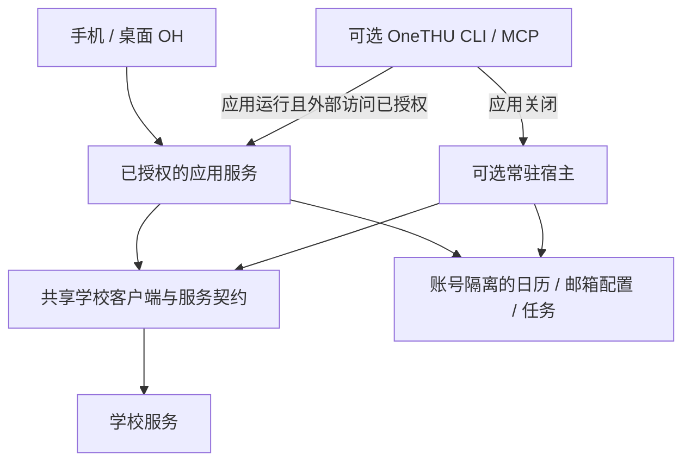

# OneTHU CLI、SDK 与常驻助理


[English](en/onethu-cli.md) · [安装和完整命令示例](../packages/cli/README.md) · [SDK 嵌入接口](../packages/sdk/README.md)

更新：2026-10-29。本文介绍 0.11.4-fix-2 版本的应用内服务、可选 CLI 与常驻助理能力。

## 产品分层

**OneTHU CLI** 是面向终端用户与外部智能体的命令行入口，**OneTHU SDK** 提供可嵌入的运行时，**MCP** 则是其中的标准工具接入协议。常驻进程负责在后台持续运行已批准的定时任务并维护 IM 消息通道；桌面应用提供图形化管理界面，与后台复用同一套学校客户端、网络学堂资源服务、任务引擎和执行策略。



OH 直接调用应用内服务运行，因此在手机端、未安装 CLI 的电脑上，或是关闭外部 CLI 访问开关时，依然可以正常查询已授权的校园数据并管理应用内任务。外部 CLI/MCP 访问开关与免逐次确认授权相互独立，可按需分别控制。

桌面默认安装包内置主应用与 Harness，Node 运行时与 CLI 作为可选组件按需分发。你可以在完整版导览最后一页或「我的 → OH / OneTHU Harness → OneTHU CLI」中一键安装，界面会自动从 GitHub 或现有清华云盘镜像下载对应平台包并完成校验。卸载时会先保存日程、登录会话与任务状态，停止唯一的后台常驻宿主后再移除运行文件，本地 profile 中的账号信息、执行历史与业务数据均完整保留。未安装常驻组件时，任务随桌面应用运行；安装后可在关闭主窗口后继续后台值守，电脑休眠期间自动暂停并在唤醒后恢复。

终端用户也可直接从 Release 下载 `OneTHU-CLI_VERSION_darwin_arm64.zip` 或 `OneTHU-CLI_VERSION_win32_x64.zip`，核验 SHA-256 后解压使用。macOS 运行 `./onethu --version`，Windows 运行 `.\onethu.cmd --version`；启动器自带并校验 Node 运行时，系统无需预先安装 Node。从源码打包分发包可执行 `node apps/desktop/scripts/package-cli.mjs`，日常编译桌面应用时无需生成该压缩包。

默认情况下，CLI 优先连接正在运行的桌面应用，直接调用好友、组织、暂存箱等完整应用服务；桌面应用未打开时，则自动接入同账号后台常驻宿主已实现的能力目录。可通过 `--desktop` 显式指定连接桌面端，或通过 `--data-dir` 显式选择隔离的数据目录。涉及复杂图形界面的操作需配合打开桌面应用完成，当前宿主支持的具体操作可通过能力目录实时查看。

本地日程与邮箱授权配置共享同一份账号记录，图形界面与终端的增删改彼此可见，窗口刷新或重新聚焦时会自动读取最新内容。首次迁移会自动合并不同 UID 的记录，日常并发写入受版本号检查保护，卸载期间产生的离线修改则会基于基线合并；若同一条日程在两端被同时改成不同内容，系统会保留原数据并提示冲突供用户裁决。

桌面端已授权的云盘连接与雨课堂会话通过主窗口本地私有桥接同步给常驻宿主，敏感凭据全程隔离在底层通道中，不会出现在模型工具的返回结果里。若独立 CLI 已手动配置为其他账号或凭据，同步过程会保留 CLI 现状并提示冲突。独立模式下的插件、模型服务商与独立 IM 入站需按对应宿主分别配置；桌面端现有的 OH/IM 接收通道维持单一所有者以避免重复处理。

宿主迁移会完整保留任务 ID、执行历史、下载账本与通知去重记录。遇到通知收件人待确认或任务 ID 重名时，原始记录保持不变并在界面提示待移交项目，后台已有任务依然可以查看、暂停和删除。桌面端接管若一时失败会保留旧会话以便重试；在 CLI 中完成验证码登录流程后，同一会话周期内的状态更新也会同步唤醒桌面端恢复连接。切换账号或退出登录时会自动取消原账号的在途任务。

## 能力覆盖

调用前可通过 `onethu commands` 和 `onethu schema OPERATION` 查询当前宿主实际开放的操作列表与参数结构；独立常驻宿主与桌面端开放的操作集合各有侧重，直接以命令目录返回的实时清单为准。

| 领域 | 独立运行时已接入 | 具体边界 |
| --- | --- | --- |
| 认证 | 稳定设备指纹、会话保存/恢复、SM2 登录、交互式 2FA、退出 | 无自动密码持久化；学校额外校验需人工完成 |
| 网络学堂 | 学期、课程、课件、作业/公告正文和附件、讨论区、资料归档 | 跨学期或异常课程无法完整枚举时标明范围并保留已获取结果 |
| 校园信息 | 课表、成绩、考试、新闻、校历、空教室、选课/课程评价、卡/网/宿舍查询 | 沿用现有校方接口和分页 |
| 图书馆/研讨间/空间 | 资源、预约记录、批准后的预约与取消 | 研讨间首次邮箱绑定需在官方页面完成；查询接口保持纯只读 |
| 体育场馆 | 场馆/时段/记录、取消、官方预约链接 | 实际预订仍走官方交互 |
| 邮箱与日历 | 共享 IMAP/SMTP/CalDAV 配置、只读邮件查询、批准后的发送/日程写入、本地日历 | 需邮箱客户端授权码；日程修改使用 ETag，跨本地/云移动需另行处理 |
| 云盘 | 显式配置、连接状态、资料库/目录、搜索、分享 | 已授权的桌面连接私有同步；通用上传/下载仍以当前宿主目录为准 |
| GitLab | 项目、文件、议题、评论、合并请求、流水线及批准的写入 | 网络中断导致写入状态未确认时返回待核实状态，避免重复提交 |
| 其他 | 外部作业快照/刷新、服务目录搜索、报备表单/本地草稿、账号本地 Markdown 记忆读取 | 报备最终提交保留官方交互；OH 云记忆需显式迁移或另行接入 |
| 插件 | 本地目录/ZIP 静态检查与安装、JS/Rust 运行、命令、权限与卸载 | 以本机用户权限运行受信本地代码；GUI/WASM 插件能力返回不支持提示 |
| 常驻助理 | 定时检查、增量下载、DDL 提醒、任务管理、IM 入站/出站、模型工具循环 | 需常驻进程在线；尚无静默时段、独立微信扫码和内置 MadModel 登录 |

画布自由排版、手势拖拽与应用标签页管理等操作依赖图形窗口，SDK 能力目录会将它们标记为 GUI 专属。

## 独立宿主的生命周期

`createOneThu({dataDir})` 启动时会获取私有目录的独占锁，加载本机配置并注册已实现的操作；实例构造与能力目录查询均在纯本地完成，不会向学校服务器发起请求。`auth.login` 用于显式登录认证，成功后持久化保存 Cookie 和设备指纹；`restore` 则利用已有会话做只读有效性校验。普通单次命令在执行完毕后立即关闭运行时，`daemon serve` 则持续持有运行时并启动定时任务与 IM 通道。

指向同一数据目录的后续 CLI 会读取私有的 `daemon-access.json`，连接本地随机回环端口与常驻进程通信。服务端采用定长随机令牌与常量时间比较校验身份，自动拒绝带有浏览器 Origin 头、格式异常、令牌不符或体积超限的请求；原始凭据全程留在进程内部，不会通过 `status`、服务结果或模型目录返回。stdio MCP 复用同一套服务路由，同时严格区分调用来源身份，本机配置权限仅向受信任的本地入口开放。

macOS 可注册当前用户的 LaunchAgent，Windows 可注册当前用户的计划任务。电脑休眠、进程退出或断网期间，状态查询会如实反映暂停或离线状态；恢复运行后，错过的多个周期只合并补跑一次，避免长时间离线后集中发起大量请求。

## 调度、授权与幂等

任务定义包含调度规则、目标课程或操作、下载输出目录与通知对象，并同时记录所属账号与修订号。任务在创建、修改和恢复时取得持续授权，实际触发执行时由进程内部生成绑定本次任务的内存态授权对象（外部传入的普通 JSON 无法构造），并在每次文件落盘与消息外发前再次校验账号、修订号、目录、资源范围、通知通道与取消信号。

调度周期支持固定间隔（interval）、带时区的每日定时（daily）与一次性 ISO 时间。`school-watch` 模板负责比对课程资源指纹与作业截止时间并汇总变更；`operation` 模板面向明确的只读查询与受控资料下载（通用定时预约与批量发信暂未纳入模板范围）。每次拉取的新结果与历史快照分别保存，偶发请求失败时支持少量重试且不会覆盖先前的有效数据。

暂停、移除或修改任务会立即向正在执行的旧版本发送取消信号，Node 端与桌面原生下载器均会响应中断。已发往远端的操作若在途中中断，执行历史会如实记录为 partial、interrupted 或 unknown 以便用户核查。资源下载采用先写临时文件、校验通过后原子重命名发布的流程，自动拦截符号链接、越界目录与覆盖已有文件的行为，异常清理时也只会移除当次新建的临时文件。

系统将“任务本身运行完成”与“通知消息送交平台”分开记账。每次外发通知前会先写入幂等记录；若进程在等待回执期间重启，未决状态会记为 unknown 并停止自动重发，避免重复打扰。平台返回 accepted 表示服务端已接收投递请求。通知通道 ID 与具体接收人稳定绑定，日常轮换接口密钥可平滑延续，更换接收人时则会重新请求用户确认任务授权范围。

单个独立数据目录最多支持 50 项任务，每项保留最近 30 次执行记录，单轮最多下载 100 个文件，去重账本也设有体积上限。日常校园检查完全由确定性逻辑执行，零模型额度消耗；大语言模型仅用于解析用户自然语言指令与编排已登记的工具。

## IM 与模型的边界

微信通道复用成熟的 iLink 协议，飞书通道采用 WebSocket 事件流并配合明确的回复回执。每条通道均绑定校园账号、发件人与聊天对象，仅接收指定联系人的私聊文本。入站消息先持久化登记再转交业务处理器，网络重连、服务端重复推送或进程重启都不会重复执行同一条已接收事件。

常用的 `/status`、`/tasks` 等指令会直接调用底层服务快速响应；自然语言输入则进入受轮数、工具调用数、字节量与超时预算约束的模型循环。默认配置仅向模型暴露只读查询能力，本机用户可按需勾选写入工具并开启自动执行；修改配置、读取凭据、执行任意 Shell 与安装插件等高权限操作始终保留给人工控制，不会授予模型。工具拉取的网页和文档内容一律作为外部数据隔离处理，其中的文本指令无法改变既有授权边界。

API Key、IM 凭据与 Cookie 保存在受本机文件权限与 ACL 保护的私有目录中（依赖系统账户权限隔离，暂未叠加额外静态加密）；模型对话时会将必要的用户文本与工具摘要发送给所选的模型服务商。短期会话记忆按账号与聊天对象分开保存有限文本及简短状态，OH 云记忆则沿用原有存储路径。桌面端已启用的任务通知通道在核验相同账号与收件人后，会通过本地私有桥接将后台出站凭据同步给常驻宿主；IM 入站监听继续维持单一所有者。

## 参考实现与选择

调度与常驻机制参考了 Hermes 的[定时任务设计](https://github.com/NousResearch/hermes-agent/blob/main/website/docs/developer-guide/cron-internals.md)与[调度器](https://github.com/NousResearch/hermes-agent/blob/main/cron/scheduler.py)，以及 OpenClaw 的[定时服务](https://github.com/openclaw/openclaw/blob/main/src/cron/service.ts)和[常驻自动化说明](https://github.com/openclaw/openclaw/blob/main/docs/gateway/heartbeat.md)，借鉴了任务持久化、执行与投递分账记录、离线单次补查、固定私聊绑定及生命周期取消等设计思路。

具体代码完全基于 OneTHU 既有的校园协议栈与 IM 编解码模块独立实现。定时巡检采用确定性模板以契合校园网服务的合理查询频率；自定义模型专注于意图理解与结果归纳，最终操作统一经过同一套服务路由，让应用内 OH 与外部智能体共享一致的能力边界。

## 验收记录

自动化验收中，独立 SDK 基于本地模拟的学校服务响应完成了统一认证、2FA、会话恢复、真实文件下载、多账号隔离及中途取消验证；CLI 通过真实子进程和隔离目录完成了安装、daemon 启停、协议鉴权、MCP 通信与跨重启的任务持久化验证；IM 通道通过本地 HTTP/WebSocket 协议夹具验证，模型循环使用本地模拟响应跑通全链路。整套测试在本地闭环运行，零外部副作用（无真实场馆预约、真实邮件或 IM 外发，亦未注册新的校方信任设备）。

桌面端任务管理界面基于标准 OneGUI 组件构建，已在隔离数据环境下完成中英文、宽屏与窄窗布局的点击验收，覆盖任务的创建、编辑、暂停、历史查阅与本机收件箱，验收记录保存在本地 `output/cli-task-ui-fixture/QA.md`。此前在桌面伴随模式下跑通的真实课程查询与课件下载已验证共享协议栈本身，独立宿主的直连登录则单列在下方实机清单中继续跟进。

后续实机联调清单包括：独立宿主下的真实校园账号登录、Windows 安装与 ACL 权限及开机自启动、真实飞书与微信账号绑定，以及所选在线模型服务。定时任务的免打扰时段与登录失效合并提醒留待后续迭代补充，目前遇到会话失效可直接从任务历史中查看原因。本轮对应版本为 0.11.4-fix-2，安装包与后续实机验收进展见该版本发布报告。

## 雨课堂查询（Rain Classroom / Yuketang）

雨课堂通过独立的 `yuketang` 命名空间提供查询，网络学堂继续使用 `learn`。OH 内置工具名为 `query_yuketang`；独立智能体与 MCP 客户端可从能力目录中发现相同的七项查询操作。

在桌面端「设置 → 账户 → 雨课堂」完成扫码登录，并开启智能体授权、安装可选 CLI 后，已有的雨课堂会话会通过本机私有通道同步给 CLI 后台，关闭主窗口后依然可在终端直接查询。雨课堂会话与学校统一身份认证相互独立：`status.configured` 用于确认本地是否存有配置，会话实时有效性以 `courses` 的实际返回结果为准；未配置或会话过期时会返回明确提示引导重新扫码登录。

```sh
onethu yuketang status
onethu yuketang courses
onethu yuketang contents --args '["课堂id"]'
onethu yuketang homework --args '["课堂id",90]'
onethu yuketang homeworkDetail --args '["课堂id","leafTypeId"]'
onethu yuketang leafDetail --args '["课堂id","leafId"]'
onethu yuketang noticeDetail --args '["课堂id",["公告id"]]'
```

`courses` 返回课堂 ID 列表；`contents` 逐页获取课件、视频、作业、试卷、公告等目录条目及对应的详情查询 ID，按指定课堂筛选时仅拉取该课堂的动态日志。`homework` 返回截止时间与提交状态等信息，保留既往历史作业并拉取未来指定天数内（默认 30 天，第二参数可显式设为 1–3660 天，传 `["",90]` 可查询全部课堂）即将截止的作业。调用时请留意区分网络学堂的 `courseId` 与雨课堂的 `classroomId`、`leafTypeId`、`leafId`。

所有读取结果均附带 `complete` 与 `issues` 字段：部分课堂拉取失败时会保留已获取的数据并将结果标为未完整；遇到服务端分页停滞在重复页时报告 `YUKETANG_PAGINATION_STALLED`；登录失效或账号切换时则会立即中止并清空旧态。整组接口均为只读查询，不会提交或修改作业。

独立 CLI 同时也支持通过 `exthw.configure` 手动导入本机会话（建议配合受权限保护的 `--args-file` 传参，避免将 Cookie 留在命令历史中），原有的 `exthw.*` 命令继续兼容有效。若独立 CLI 已存有另一份雨课堂会话，桌面同步时会保留 CLI 现有配置并返回冲突提示，可由本机用户通过 `exthw.configure` 明确指定要采用的会话。原始 Cookie 全程隔离在请求层内，不会写入工具结果、模型上下文或导出文档。
