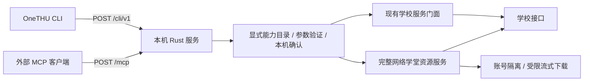

# OneTHU CLI：学校服务的命令行入口

2026-10-24。用户将原有的 OH MCP 连接修复与课程资料导出需求扩展为面向 macOS 与 Windows 的 OneTHU CLI。MCP 继续作为智能体接入协议，与 CLI 共用同一套底层服务能力；MadModel 的认证修复同步独立推进。

## 架构决策

整体采用桌面伴随式 CLI 方案：基于 Node.js 20 的零依赖客户端通过本机回环 HTTP 调用已登录的 OneTHU 桌面端，由桌面应用统一负责学校会话维护、二次验证、权限管控、数据解析与文件下载。Rust Harness 承担本机协议监听与桥接转发，直达学校服务层，绕开聊天上下文、模型选择与 MadModel 预检开销。

前期曾评估过另外两条路线：若让独立 CLI 另起炉灶实现学校登录与凭据存储，会成倍增加跨端认证链路的维护负担；若直接包装现有的 OH 摘要工具，则难以提供稳定的资源 ID、完整正文、可靠分页以及原始附件归档。伴随式方案要求调用期间保持桌面应用运行，换来了 macOS 与 Windows 完全复用同一套服务代码的简洁架构。

## 能力与确认

- 从公共类型生成经显式审核的能力目录，只有列入目录的业务方法才对外开放，并通过 `commands` 与 `schema` 向智能体提供准确的参数定义。
- 完整纳入学校信息、课程、成绩、课表、图书馆、研讨间、公共空间、场馆、日程、邮件、云盘、GitLab 等现有可命令化接口。其中场馆服务目前提供场次查询、退订以及打开官方预约页功能。
- 只读操作返回结构化结果并自动剥离认证敏感字段；邮件正文采用 PEEK 模式读取，保留收件箱原有的未读状态。
- 预约、取消、发信、分享、改写及本地下载均须传入 `confirm:true`，并由 OneTHU 弹出本机确认框供用户核对具体操作与参数。同一时间只处理一项写操作确认；遇到执行结果未明的情况直接交由调用方核查，避免重复提交；GitLab 仅在原请求端点明确返回认证失效时自动刷新会话并重试一次。
- 能力目录仅面向结构化的学校业务接口，将任意网络请求、原始凭据读取、模型配置、底层存储与脚本执行严格隔离在外部调用范围之外。

## 生命周期与隔离

外部监听默认关闭。应用启动激活与独立 `mcp_sync` 均从受信宿主读取开关状态，读取异常时保持关闭，界面实时展示真实的监听状态。一旦关闭开关、撤销智能体授权、切换账号或宿主失联，在途请求与迟到响应都会立即中止失效。

本地服务仅绑定 loopback 回环地址，拒绝浏览器 `Origin` 请求头、HTTP 重定向与非预期路径，并设有请求体大小与超时上限；客户端也只连接明确的回环地址。学校 Cookie 与 Token 全程保留在桌面宿主内，文件下载通过当次会话登记的资源引用来定位目标，确保只拉取受控的学校资源。

## 网络学堂与归档

- 当前学期直接取自学校接口，课程条目保留课程 ID 与中文名称。
- 课件按接口已有的 `size` 参数递增拉取；公告通过 `offset` 翻页遍历，同时涵盖已过期公告。一旦检测到重复页、总数漂移、缺失 ID 或触及分页上限，便明确标记为未完整拉取。
- 作业详情完整保留题目说明、提交正文、教师附件、参考答案、本人提交记录与批改附件；公告保留正文与附件，并自动收集正文中可识别的内联资源链接。
- 原生下载在每次跳转时校验校园资源域名范围，复用当前会话、UA 与账号代次，识别并拦截登录页 HTML；采用流式落盘并同步计算 SHA-256、清洗 Windows 非法文件名、保护目标输出路径且默认保留已有同名文件。
- `learn export` 默认先输出归档计划，确认执行后按中文课程目录保存正文、附件与独立的 manifest 清单。再次运行时会先核对本地文件的实际大小与哈希值，校验一致即直接复用，同时原样保留用户在课程目录下的个人笔记。
- 由于学校作业三分类接口暂未提供可核验的服务端总数，相关资源查询会返回 `enumerationComplete:false`，导出报告也会如实标注 `partial`，留待后续获取明确的服务端总量依据后再开启完整标记。

## 验收

自动化测试覆盖真实 CLI 子进程、HTTP 与 MCP 协议、合成学校响应、完整参数校验、本机弹窗确认、并发关闭、切换账号后的迟到响应、分页边界、多附件归档、重跑复用及同名冲突保护。随后连接本机开发版应用完成目录核对与学校只读查询验证，macOS 文件系统测试同时覆盖本机 APFS 卷与项目所在的外置磁盘；Windows 安装脚本与原生行为留待 Windows 主机继续验收。

具体实现文件、命令用法与功能说明参见 [OneTHU CLI 指南](../onethu-cli.md)。本轮专注本地实现与验证，桌面安装包与公开更新渠道留待后续发版时统一合入。

## 实现收口

- 当前能力目录共收录 119 项公共服务与 10 项网络学堂专属操作，统一走同一套学校会话与权限体系。尚待补齐提交保护机制的旧版云盘上传/下载与记忆写入继续留在应用界面内使用。
- 主窗口担任 CLI 与 MCP 的唯一执行器；OH 悬浮窗口可正常发起对话，将 sidecar 进程管理、RPC 调度与外部写操作确认统一交由主窗口承载。原生进程启停串行执行，每次回执均与具体的进程代次绑定。
- 旧版 MCP 工具整理为逐项审核的只读兼容表并统一接入 CLI 校验管线，不再向 MCP 开放工作流、任意工具或插件执行器捷径。
- 写操作确认弹窗在 45 秒后超时关闭；单次调用总时限默认 110 秒、上限 150 秒，CLI 客户端会将自身的超时预算同步传递给宿主。关闭服务、撤销授权、停用插件或切换账号都会使原请求立即失效。
- 下载流程共享同一批截止时间与单调时钟预算，在等待网络、写入分块、计算哈希与最终重命名落盘各阶段逐段检查剩余时间；中途停止后会保留已完整落盘的文件并返回 `remaining` 列表，下次运行时按整文件粒度跳过已完成项。
- 取消预约时若返回结果未明且随后的回查请求也出错，会如实报告未知状态，避免把查询异常误判为已取消；研讨间的只读查询也保持无副作用，免去自动绑定邮箱的隐式修改。

## 2026-10-24 本机实测结果

- 编译并重启本机 macOS dev 原生应用与 Harness，确认仅由主窗口承载服务执行与弹窗确认，并顺利读取到当前已登录账号状态。
- CLI 能力目录共列出 129 项操作，实测读取到 11 门在修课程；抽查其中一门课返回课件 5 项、作业 2 项、公告 3 项（验收记录仅保留条目计数，隐去真实课程内容与个人身份信息）。
- MCP 初始化握手、工具目录拉取与结构化课程调用全部通过，共开放 46 项工具，涵盖共享服务入口与经审核的只读兼容工具。
- 在主窗口点击批准一次课件下载，成功落盘 2,847,315 字节文件；独立复算的 SHA-256 与接口返回值完全一致，再次执行同一命令时顺利识别并复用本地已有文件。
- MadModel 真实认证检查返回有效状态并同步拉取模型列表，验收过程仅核对鉴权与模型列表，未发起付费对话请求。
- 排查并修复作业正文缺失问题：`viewCj` 只读详情页返回正常，而 `tijiao` 提交页返回 `webvpn-guide` 引导页，导致原先合并两页结果的判断误丢了有效详情。现已新增独立的 `getHomeworkReadDetail` 供 CLI 专读详情页，应用界面则保留原有的双页提交状态检查。实测两条真实作业均返回完整正文及教师、本人提交附件，其中一份教师附件实测下载 19,539 字节。受限于学校接口暂未返回作业总数，归档清单继续如实标记为 `partial`。
- Windows 原生环境以及向学校真实提交预约、发信、分享等写操作留待后续联调；本次 CLI 服务需配合新版桌面端运行，早先发布的 0.11.3 公开安装包暂未包含该模块。
- 最终 `pnpm test:cli` 全部通过：涵盖客户端 61、服务边界 35、预约 24、窗口归属 6、其它提交守卫 6、学习服务 28、资源枚举 25，共 185 项／组；core 与 desktop 类型检查通过，i18n 中英文词条均为 7,594/7,594、errors 0，主仓库与 Harness 的 diff 空白格式检查全部通过。Harness 侧另有 60 项 Rust 单元测试与 44 项真实协议检查通过，原生下载 14 项、原生窗口归属 2 项测试全部通过。
- 独立客户端归档包已生成至 `output/onethu-cli/onethu-cli-0.11.3.tgz`，内附中英文使用指南与双平台安装脚本，对应校验值保存在同目录 `.sha256` 文件中。
- 共享记忆服务恢复连接后，本轮结论已同步写入《OneTHU CLI 首版完成与实际验收》（checksum `19ded86c`），本文档继续保留完整的实现细节与待实机联调范围。
