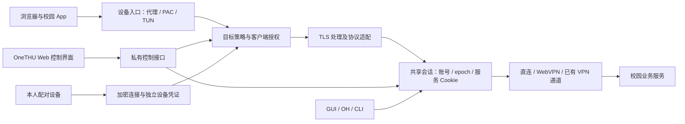

# OneTHU 校园超级代理实施计划

**Goal:** 在用户授权的设备上，仅安装 OneTHU，即可自动处理校园访问与会话复用；覆盖目标包括桌面、手机浏览器、清华相关微信小程序和本人配对设备。

**Architecture:** OneTHU 原生伴随服务承载网络入口，既有账号运行时持有学校会话，Web 界面提供控制与状态。代理与 GUI/OH/CLI 共用会话权威，代理数据流独立于现有 JSON-RPC。浏览器扩展不作为依赖。

**Tech Stack:** 首个协议原型使用 Node.js 20+ 的 HTTP、TLS、流和测试模块；后续原生系统集成分别实现，不预设所有平台使用同一套 VPN API。

**状态：** `web` 分支；架构提案与本机协议原型。全覆盖是产品目标，完成度按下表实测登记。当前没有修改系统代理、安装 CA、读取真实账户票据、开放局域网或自动启动新的账号运行时。

**2026-10-31 验证：** G0 首个 HTTP/1.1 协议原型完成，24 项 loopback 集成测试通过。Chrome 156 在独立临时配置下通过 HTTPS 代理认证、页面导航、POST、二进制下载和跳转验收，使用本机模拟上游。G1–G6 仍待实现与验收。详细记录见 `docs/reviews/2026-10-31-campus-gateway-prototype.md`。

## 用户约束

- 只安装 OneTHU，无浏览器扩展。首次系统授权后，日常使用自动处理。
- 现有校园网站网址、第三方浏览器和微信入口均在覆盖目标中。
- 百分百覆盖须包括网络接入、TLS、学校会话、业务身份和实际功能，而非仅统计 HTTP 请求成功。
- 学校再次要求验证时，保留可完成的认证入口；设备信任的创建、撤销与学校策略一致。
- `main`、`dev3` 保持稳定；网关工作在 `web` 进行。`web` 是开发分支名，纯网页无法独自安装系统代理、证书或运行 TUN。

## 架构与数据流

每个请求绑定发起时的账号 epoch。切换账号、撤销设备或退出后，旧请求停止向客户端输出数据。会话 Cookie 留在会话管理者中，浏览器请求携带的其他账户 Cookie 不能混入共享 Cookie 仓。

## 架构决策

### ADR-001：原生伴随服务承载代理

考虑过扩展、纯网页入口、原生代理三条路线。扩展不符合用户要求；纯网页可作为管理界面和受控服务入口，但无法设置整机网络。选择原生代理作为接入方向。系统授权、恢复旧代理、证书移除和平台签名由各平台适配器负责。

### ADR-002：共享现有会话，另设流式数据入口

现有 `createNodeSession` 有进程唯一实例和数据目录锁；现有 daemon 是私有 JSON-RPC，响应上限与编码方式不适合网页和大文件。原型依赖注入 `session.request/epoch/assertCurrent`，不自行创建、复制或恢复账户。接入正式运行时应在会话拥有者进程内挂载该能力，或提供受限、独立的流通道；不能把通用代理暴露到公开 MCP 工具目录。

### ADR-003：HTTPS 接管需要客户端明确建立信任

CONNECT 的不透明转发仅提供网络通道。要在 HTTPS 请求中复用会话，客户端必须接受代理提供的站点证书。原型只接受调用者提供的证书，测试证书只在临时目录生成，并只供测试客户端信任。正式版需要每个安装独立生成的 CA、系统安全存储、可撤销授权及移除流程。

普通信任根可能具有广泛签发能力；目标域名限制首先是网关代码策略，不宣称它自动成为密码学上的证书权限限制。第三方应用拒绝用户 CA 或要求固定公钥时，覆盖状态仍是待解决，不能把网络连通标为会话共享成功。

### ADR-004：代理授权与浏览器请求来源同时校验

测试入口使用独立的代理凭据，只监听 `127.0.0.1`。不能仅因来源是本机就允许借用学校账号。原型采用精确 origin 名单，并拒绝跨站 Fetch Metadata / 不匹配 Origin；没有来源信息的 HTTP 请求也拒绝。CONNECT 握手不要求页面来源，隧道中的业务请求逐条校验。浏览器的 Cookie 和 Authorization 不进入共享账户请求，服务令牌由权威适配器管理。正式校园 SSO 的跨域跳转和 Cookie SameSite、CSRF、业务 token 需要按服务适配，不能简单移除保护来获得兼容性。

### ADR-005：平台和局域网接入分别验收

系统代理可能不覆盖所有网络库。Android 同一用户/资料只允许一个活动 VPN 服务，需协调 aTrust、Clash 等现有通道。局域网模式要逐设备配对、加密传输、独立可撤销凭证；设备发现不授予账号权限。当前原型不提供 LAN 监听。

## 首轮实现：协议与会话边界

新增文件：

- `packages/gateway/src/index.mjs`：HTTP forward proxy、受控 CONNECT/TLS 入口、流生命周期。
- `packages/gateway/src/policy.mjs`：origin、Host/SNI、代理授权、请求来源和头部策略。
- `packages/gateway/package.json`：零新增运行时依赖的实验包。
- `packages/gateway/test/gateway.test.mjs`：真实 loopback HTTP/TLS 套接字集成测试。
- `packages/gateway/README.md`：接口、运行测试方式、已实现能力与接入条件。

执行顺序：

1. 写本地集成测试，覆盖 HTTP 和 CONNECT 后的 HTTPS 请求、二进制响应、上传、重定向、拒绝未授权目标。
2. 实现限定目标的代理内核。`session.request` 固定使用 `redirect: manual`、原始字符集字节模式；不自动重放写请求。
3. 增加账号变更、超时、断开、大小上限、跨站请求与 Host/SNI 混淆的故障测试。任何不支持的协议返回明确结果。
4. 独立审查代理凭据、学校 Cookie、内部错误和内部响应头是否会泄漏。
5. 运行 `node --test packages/gateway/test/*.test.mjs`，记录实际结果。仅原型测试通过不代表真实校园网站或整机接管验收通过。

首轮协议范围为 HTTP/1.1；WebSocket、HTTP/2、HTTP/3、系统安装、真实会话连接另行完成。下载内容保持流式输出及背压，资源上限显式报告失败，禁止静默截断后返回成功。请求遇到失败不会自动重试 POST 或上传。

## 后续阶段及完成条件

| 阶段 | 内容 | 完成条件 |
| --- | --- | --- |
| G0 协议内核 | 本机 HTTP/HTTPS、策略、流、账号隔离 | 真实套接字和故障集成测试通过 |
| G1 权威会话接入 | 复用现有 GUI/OH/CLI 会话，不另建登录 | 同账号续期、退出、跨账号与并发刷新通过；不新增信任浏览器 |
| G2 校园网页 | 原网址访问、WebVPN 改写、CSRF、Cookie、跳转、附件 | 网络学堂、信息门户、预约等逐站真实功能验收 |
| G3 桌面接管 | macOS/Windows 代理、CA 生命周期、启动恢复、现有代理共存 | 全新浏览器资料、重启、异常退出、卸载恢复均通过 |
| G4 手机与小程序 | Android/iOS 网络入口、证书信任、每个小程序业务身份 | 按设备、系统、浏览器/微信版本与具体服务记录通过或阻塞原因 |
| G5 协议补齐 | WebSocket/SSE、HTTP/2/3、IPv6、DNS、长连接及大文件 | 无认证旁路、无静默降级/截断、网络切换恢复可用 |
| G6 配对设备 | 加密 LAN 通道、设备撤销和账号授权 | 未配对设备拒绝，撤销立即生效，校园账号身份明确 |

## 验收矩阵与运行成本

平台覆盖记录同时包含：网络可达、TLS 可用、学校会话可用、业务身份可用、读取、写入、附件和退出撤销。只有这些所需项目全部通过，才能标记对应场景完成。

桌面基线至少包括 Windows/macOS 的 Chrome、Edge、Firefox，以及 macOS Safari。移动端包括实际支持的 Android/iOS 浏览器与用户指定的清华微信小程序，不能以浏览器成功外推微信。网络基线包括校内、校外、已有代理、aTrust、Wi-Fi/移动网络切换和本人 LAN 设备。

运行时记录连接数、队列与失败代码，不记录完整敏感 URL、Cookie、令牌或正文。明确内存、上传下载大小、连接数、超时和证书缓存预算。正式接入时验证大文件、慢客户端、并发登录、断网重试与代理崩溃后的可恢复性。

## 依据

- [清华 VPN 服务与 aTrust 客户端](https://its.tsinghua.edu.cn/1wzcycejdh_list.jsp?urltype=tree.TreeTempUrl&wbtreeid=1771)
- [Android VPN](https://developer.android.com/develop/connectivity/vpn)
- [Android 网络安全配置与证书信任](https://developer.android.com/privacy-and-security/security-config)
- [Apple 手动安装证书的完全信任](https://support.apple.com/en-gb/102390)
- [Windows WinHTTP 与 WinINet 代理配置](https://learn.microsoft.com/en-us/windows/win32/winhttp/setting-wininet-proxy-configurations-in-winhttp)
- [HTTP/3](https://www.rfc-editor.org/rfc/rfc9114.html)
- 源码依据：`packages/sdk/src/node/session.ts`、`packages/sdk/src/node/transport.ts`、`packages/core/src/crypto/webvpn.ts`、`packages/cli/src/daemon.mjs`。
