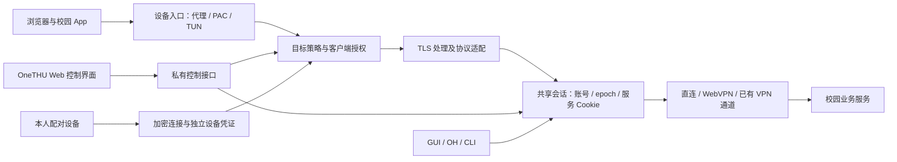

# OneTHU 校园超级代理实施计划

**Goal:** 在用户授权的设备上，仅安装 OneTHU，即可自动处理校园访问与会话复用；覆盖目标包括桌面、手机浏览器、清华相关微信小程序和本人配对设备。

**Architecture:** OneTHU 原生伴随服务承载网络入口，既有账号运行时持有学校会话，Web 界面提供控制与状态。代理与 GUI/OH/CLI 共用会话权威，代理数据流独立于现有 JSON-RPC。浏览器扩展不作为依赖。

**Tech Stack:** Node.js `^20.19.0 || >=22.12.0` 的 HTTP、TLS、流模块；`@peculiar/x509` 管理安装独立 CA；既有 SDK / daemon 持有会话，Tauri 主窗口提供私有控制桥。macOS / Windows 平台适配分别调用各自系统工具，不预设所有平台使用同一套 VPN API。

**状态：** `web` 分支；已实现本机协议内核、现有权威会话接入、桌面控制界面、独立校园浏览器、本机 CA、macOS / Windows 代理适配器及恢复记录。全覆盖仍是产品目标。当前已通过本地 fixture，以及 Mac 上复用现有账号读取真实网络学堂课程列表和首个课程页面；没有提交业务、实际下载文件、执行系统 CA 授权或系统代理修改，也没有开放局域网或另建登录运行时。

**2026-10-31 验证：** 当前 gateway 53/53、SDK 239/239、CLI 80/80、桌面 UI fixture 22/22、启动交接 guard 18/18；桌面 TypeScript 通过，中英字典各 7746 键、0 错误。协议与管理器的独立 Chromium fixture 已通过。随后在当前 Mac 保留原 GUI 进程与同一账号，完成真实网络学堂课程列表和首个课程页面读取，详见下方实测记录。首轮 G0 的 24 项测试属于历史基线，见 `docs/reviews/2026-10-31-campus-gateway-prototype.md`。G1/G2 的这一路径已有实际证据，其他服务、完整账号生命周期和 G3 的 OS 授权仍待验收；G4–G6 未完成。

## 用户约束

- 只安装 OneTHU，无浏览器扩展。首次系统授权后，日常使用自动处理。
- 现有校园网站网址、第三方浏览器和微信入口均在覆盖目标中。
- 百分百覆盖须包括网络接入、TLS、学校会话、业务身份和实际功能，而非仅统计 HTTP 请求成功。
- 学校再次要求验证时，保留可完成的认证入口；设备信任的创建、撤销与学校策略一致。
- `main`、`dev3` 保持稳定；网关工作在 `web` 进行。`web` 是开发分支名，纯网页无法独自安装系统代理、证书或运行 TUN。

## 架构与数据流



每个请求绑定发起时的账号 epoch。切换账号、撤销设备或退出后，旧请求停止向客户端输出数据。会话 Cookie 留在会话管理者中，浏览器请求携带的其他账户 Cookie 不能混入共享 Cookie 仓。

## 架构决策

### ADR-001：原生伴随服务承载代理

考虑过扩展、纯网页入口、原生代理三条路线。扩展不符合用户要求；纯网页可作为管理界面和受控服务入口，但无法设置整机网络。选择原生代理作为接入方向。系统授权、恢复旧代理、证书移除和平台签名由各平台适配器负责。

### ADR-002：共享现有会话，另设流式数据入口

现有 `createNodeSession` 有进程唯一实例和数据目录锁；daemon 的私有 JSON-RPC 只传控制指令，网页和大文件走独立代理流。`createManagedGateway` 已挂到既有 SDK 实例，SDK 的 `createCampusProxySession` 复用当前会话和 Cookie 仓，不自行创建、复制或恢复账户。`gateway.control` 仅允许私有 daemon 及受限 Tauri 主窗口控制；不进入公开 MCP 工具目录。CLI `gateway` 只连接已运行的 daemon，缺少时明确报错，不自动另启账号运行时。桌面显式启动时，已就绪的同账号 daemon 保持权威，不导入旧 GUI Cookie；仅空账号、idle、允许 bootstrap 且无退出标记时交接，经异步身份/epoch 检查后启动。此路径不调用安装组件用的策略/任务同步。

### ADR-003：HTTPS 接管需要客户端明确建立信任

CONNECT 的不透明转发仅提供网络通道。要在 HTTPS 请求中复用会话，客户端必须接受代理提供的站点证书。当前实现为每个安装生成独立 CA，私有目录保存密钥，并只为允许主机签发缓存中的站点证书；`setup` 和 `start` 不修改系统信任。独立校园浏览器使用临时资料、私有 CDP pipe 与指定 CA 公钥的进程内例外，不使用扩展、不改常用浏览器资料。系统接入的 `trust/untrust` 必须主动确认；macOS / Windows 实际授权、升级与卸载移除仍待实机验收。

普通信任根可能具有广泛签发能力；目标域名限制首先是网关代码策略，不宣称它自动成为密码学上的证书权限限制。第三方应用拒绝用户 CA 或要求固定公钥时，覆盖状态仍是待解决，不能把网络连通标为会话共享成功。

### ADR-004：代理授权与浏览器请求来源同时校验

测试入口使用独立的代理凭据，只监听 `127.0.0.1`。不能仅因来源是本机就允许借用学校账号。采用精确 origin 名单，并拒绝跨站 Fetch Metadata / 不匹配 Origin；缺少来源信息的业务请求仍拒绝。已配置的旧 HTTP origin 允许无请求体 GET / HEAD 先跳转到对应 HTTPS 门面，此时不借用账号会话；HTTPS 门面的业务请求仍校验来源。POST / 上传不会因此重放。CONNECT 握手不要求页面来源，隧道中的业务请求逐条校验。浏览器的 Cookie 和 Authorization 不进入共享账户请求，服务令牌由权威适配器管理。学堂网页所需的 XSRF-TOKEN 仅从当前权威仓中明确非 HttpOnly 的精确应用记录投影，认证 Cookie 保持私有。正式校园 SSO 的跨域跳转和 Cookie SameSite、CSRF、业务 token 需要按服务适配，不能简单移除保护来获得兼容性。

### ADR-005：平台和局域网接入分别验收

系统代理可能不覆盖所有网络库。Android 同一用户/资料只允许一个活动 VPN 服务，需协调 aTrust、Clash 等现有通道。局域网模式要逐设备配对、加密传输、独立可撤销凭证；设备发现不授予账号权限。当前原型不提供 LAN 监听。

## 已实现代码与边界

当前主要文件：

- `packages/gateway/src/manager.mjs`：现有会话内的生命周期、私有控制、范围 PAC、状态与失败恢复。
- `packages/gateway/src/certificates.mjs`：安装独立 CA、允许主机签发和私有文件。
- `packages/gateway/src/platform.mjs`：macOS / Windows 信任与代理操作；拒绝覆盖已启用代理，按记录恢复且保留外部修改。
- `packages/gateway/src/browser.mjs`：独立 Chrome / Chromium / Edge 资料、私有 CDP pipe、代理认证及进程内证书例外。
- `packages/gateway/src/routes.mjs` 与 `packages/sdk/src/node/campusProxy.ts`：旧 HTTP 系统的 HTTPS 门面、物理直连/WebVPN 路由、重定向与 HTML/CSS/JS/CSP 逆向 URL 改写。
- `packages/sdk/src/index.ts`、`packages/cli/src/daemon.mjs`、`packages/cli/src/cli.mjs`：共享运行时挂载与 `gateway.control` / `onethu gateway`。
- `apps/desktop/src-tauri/src/cli_daemon.rs`：主窗口私有方法白名单。
- `apps/desktop/src/components/CampusGatewaySettings.tsx`：独立于外部 CLI 开关的状态、启动/停止、校园浏览器、信任、恢复与主动凭据显示；中英文案及翻译 seed 齐全。
- `apps/desktop/src/lib/campusGatewayStart.ts` 与 `tools/campus-gateway-start-test.mjs`：启动前的会话拥有者检查、只允许空账号 bootstrap、异步账号变化防护；18 项针对性测试。

SDK 仅对识别出的特定 WebVPN Cookie bootstrap，在 GET / HEAD 下完成引导并重取一次；POST 与上传不自动重放。范围内 URL 逆向改写保留 CSP 指令、nonce 和 hash，二进制及 Range 内容跳过正文改写。这些实现仍不代表 `document.cookie`、业务 token、跨域 SSO、Service Worker 或每个校园服务全部兼容。

### 首轮协议工作（历史基线）

新增文件：

- `packages/gateway/src/index.mjs`：HTTP forward proxy、受控 CONNECT/TLS 入口、流生命周期。
- `packages/gateway/src/policy.mjs`：origin、Host/SNI、代理授权、请求来源和头部策略。
- `packages/gateway/package.json`：本机代理包；首轮内核无外部运行时依赖，当前 CA 增加 `@peculiar/x509` 与 `reflect-metadata`。
- `packages/gateway/test/gateway.test.mjs`：真实 loopback HTTP/TLS 套接字集成测试。
- `packages/gateway/README.md`：接口、运行测试方式、已实现能力与接入条件。

执行顺序：

1. 写本地集成测试，覆盖 HTTP 和 CONNECT 后的 HTTPS 请求、二进制响应、上传、重定向、拒绝未授权目标。
2. 实现限定目标的代理内核。`session.request` 固定使用 `redirect: manual`、原始字符集字节模式；不自动重放写请求。
3. 增加账号变更、超时、断开、大小上限、跨站请求与 Host/SNI 混淆的故障测试。任何不支持的协议返回明确结果。
4. 独立审查代理凭据、学校 Cookie、内部错误和内部响应头是否会泄漏。
5. 运行 `node --test packages/gateway/test/*.test.mjs`，记录实际结果。仅原型测试通过不代表真实校园网站或整机接管验收通过。

首轮协议范围为 HTTP/1.1；当前已实现会话连接和桌面系统适配代码，真实系统接入与其余校园功能仍需验收。WebSocket、HTTP/2、HTTP/3 尚未完成。下载内容保持流式输出及背压，资源上限显式报告失败，禁止静默截断后返回成功。请求遇到失败不会自动重试 POST 或上传。

## 后续阶段及完成条件

| 阶段 | 当前状态 | 完成条件 |
| --- | --- | --- |
| G0 协议内核 | 已实现并通过本地协议及 Chromium fixture | 真实套接字和故障集成测试通过 |
| G1 权威会话接入 | 已挂载既有 SDK / daemon；Mac 同账号真实学堂读取通过，完整生命周期未验收 | 同账号续期、退出、跨账号与并发刷新通过；不新增信任浏览器 |
| G2 校园网页 | 已实现 HTTPS 门面、WebVPN 路由与正文/CSP 改写；学堂列表和首个课程页读取通过，其他功能/服务未验收 | 网络学堂、信息门户、预约等逐站真实功能验收 |
| G3 桌面接管 | 已实现 CA、独立浏览器、系统代理/信任与恢复；实际 OS 授权未验收 | 全新浏览器资料、重启、异常退出、卸载恢复均通过 |
| G4 手机与小程序 | 未实现 Android/iOS 系统入口及微信业务接入 | 按设备、系统、浏览器/微信版本与具体服务记录通过或阻塞原因 |
| G5 协议补齐 | HTTP/1.1 流已实现；WebSocket、HTTP/2/3、其他网络能力未完成 | 无认证旁路、无静默降级/截断、网络切换恢复可用 |
| G6 配对设备 | 未实现 LAN 监听、加密配对与设备撤销 | 未配对设备拒绝，撤销立即生效，校园账号身份明确 |

## 2026-10-31 当前 Mac 实测记录

原 Mac dev GUI 进程 PID `67363` 和同一账号保持不变，仅更新 daemon 运行时。该次运行时标识为 `f5c002823d1240b6cadd26877a910a3731aa067c66352642fff59c5201c2829a`。测试未重启 GUI、未重新登录、未修改系统代理或证书信任；真实页面由独立无界面 Chromium 读取。

| 已检查路径 | 证据 |
| --- | --- |
| 网络学堂课程列表 | 标题正确；11 张课程卡片，169 个链接；17 个 XHR 全部 HTTP 200；jQuery 为可用函数，防伪 Token 存在；无密码输入框、无 JavaScript 异常。 |
| 列表中的首个课程链接 | 跟随逻辑网址进入 `/f/wlxt/index/course/student/course`；HTTP 200，578 个 DOM 节点，10 个作业/课件/通知等导航链接；8 个课程 XHR（通知、讨论、作业列表、课件）全部 HTTP 200；无密码输入框、网关错误码或 JavaScript 异常。 |

实际 `openGatewayBrowser` helper 也通过真实站点验收：使用自身私有 CDP pipe + PAC，加载 11 张课程卡片，无密码输入框；无界面对话框被拒绝，浏览器正常关闭。完整本轮记录见[共享会话与 Mac dev 验收](../reviews/2026-10-31-campus-gateway-integration.md)。

首页出现的 2 个学校 alert 在无界面测试中被关闭，不据此判定可见窗口无弹窗或交互体验完整通过。仅上述页面与读取请求通过；没有执行真实提交、预约、业务修改或文件下载，也未逐个点击所有导航入口。桌面按钮已通过模拟 native 接口的 UI fixture，真实原生窗口的点击流程仍单独待验收。

English: the existing Mac dev GUI process and account were retained; only the daemon runtime changed. Live Learn course-list rendering and its first course navigation passed in isolated headless Chromium: 17 list-page XHRs and 8 course-page XHRs all returned HTTP 200. The actual `openGatewayBrowser` helper also loaded the live course-list page via its private CDP pipe and PAC, then closed normally. The test dismissed two school alert dialogs. This does not establish visible-window dialog UX, every navigation target, submissions, downloads, other campus services or actual OS trust/proxy changes.

## 当前 Mac dev 验收步骤 / Current Mac dev acceptance

实际入口已按源代码核对：完整模式的设置齿轮 → **Harness → 高级配置 → 模型 / MCP / 日志 → 校园超级代理**。英文为 **Harness → Advanced configuration → Model / MCP / logs → Campus superproxy**。组件复用 MCP 面板所在位置，但不受「允许外部 CLI / MCP 访问」开关控制。

1. 使用包含本次 Rust 白名单和运行时的桌面 dev 构建，在 OneTHU 内已有登录；缺少运行环境时先在上方安装/更新 CLI，再刷新状态。Vite 网页预览只能显示不可用说明；热更新无法替换旧原生宿主。
2. 点击「启动代理」，确认 loopback 端口，再点「打开校园浏览器」。此路径不要求系统证书授权、不修改系统代理。
3. 在独立窗口读取网络学堂、导航与附件，逐项记录实际服务结果。需要学校再次验证时回到 OneTHU 完成；任何提交、预约等写操作另行明确验收。
4. 点击「停止代理」，确认监听和独立窗口关闭。如果曾启用系统代理，确认原设置恢复。遗留状态会在基本行显示「恢复原代理设置」，无需先启动代理。

English: use the updated native desktop dev build and existing sign-in; install/update the local runtime if requested. Choose **Start proxy**, then **Open campus browser**, and inspect actual campus pages and read-only attachments in the isolated window. Record each service result; complete renewed school verification in OneTHU. Finish with **Stop proxy** and confirm listener/window closure. For an earlier process's proxy journal, use **Restore proxy settings** before any new system setup.

可选系统验收单列：展开「系统代理与手动接入」→ 核对范围/指纹 →「授权信任证书」→「启用系统代理」。已有 Clash/PAC/手动/SOCKS 代理时应明确拒绝并保持原配置；用户可改用独立校园浏览器。最后「恢复原代理设置」→ 按需「撤销信任」。**本轮没有实际执行这一组 OS 操作；平台模拟测试不能代替实机授权、异常恢复和卸载验证。**

Optional OS acceptance is separate: inspect scope/fingerprint, choose **Trust certificate**, then **Enable system proxy**. Existing proxies must be preserved and activation refused; use the isolated browser instead. Finish with **Restore proxy settings**, then **Remove trust** if desired. **These real OS operations have not been performed in this round.**

CLI 对应命令（只连接已运行 daemon，所有非 status 操作要求 `--confirm`）：

```sh
onethu gateway status
onethu gateway start --confirm
onethu gateway open-browser --confirm
onethu gateway stop --confirm
```

另外有 `setup`、`trust`、`untrust`、`system-enable`、`system-disable`、`credentials`。最后一个命令会显示独立代理密码，只用于主动的手动接入，不能作为常规状态检查写进日志。没有 daemon 时命令失败，用户需先打开 OneTHU 或明确运行 `onethu daemon start`。自动测试与命令说明见 [Gateway README](../../packages/gateway/README.md)。

Cookie 迁移仍需单列验收：新 SDK/core bootstrap 保留未知 HttpOnly 属性，但旧 native 快照曾将缺失属性导出为 false，无法仅从存量快照还原属性来源。浏览器投影仍只限 Learn 精确作用域的 `XSRF-TOKEN`；本次真实页面通过不能视为旧 native 属性迁移已完成。

## 验收矩阵与运行成本

平台覆盖记录同时包含：网络可达、TLS 可用、学校会话可用、业务身份可用、读取、写入、附件和退出撤销。只有这些所需项目全部通过，才能标记对应场景完成。

桌面基线至少包括 Windows/macOS 的 Chrome、Edge、Firefox，以及 macOS Safari。移动端包括实际支持的 Android/iOS 浏览器与用户指定的清华微信小程序，不能以浏览器成功外推微信。网络基线包括校内、校外、已有代理、aTrust、Wi-Fi/移动网络切换和本人 LAN 设备。

运行时记录连接数、队列与失败代码，不记录完整敏感 URL、Cookie、令牌或正文。明确内存、上传下载大小、连接数、超时和证书缓存预算。正式接入时验证大文件、慢客户端、并发登录、断网重试与代理崩溃后的可恢复性。

## 依据

- [清华 VPN 服务与 aTrust 客户端](https://its.tsinghua.edu.cn/1wzcycejdh_list.jsp?urltype=tree.TreeTempUrl&wbtreeid=1771)
- [Android VPN](https://developer.android.com/develop/connectivity/vpn)
- [Android 网络安全配置与证书信任](https://developer.android.com/privacy-and-security/security-config)
- [Apple 手动安装证书的完全信任](https://support.apple.com/en-gb/102390)
- [Windows WinHTTP 与 WinINet 代理配置](https://learn.microsoft.com/en-us/windows/win32/winhttp/setting-wininet-proxy-configurations-in-winhttp)
- [HTTP/3](https://www.rfc-editor.org/rfc/rfc9114.html)
- 源码依据：`packages/sdk/src/node/session.ts`、`packages/sdk/src/node/transport.ts`、`packages/core/src/crypto/webvpn.ts`、`packages/cli/src/daemon.mjs`。
