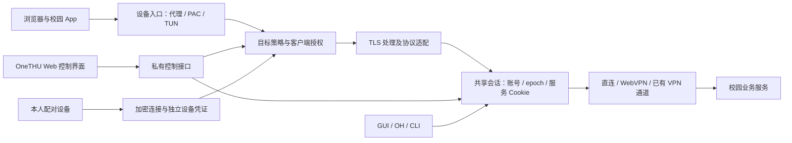

# OneTHU 校园超级代理实施计划


**Goal:** 在用户授权的设备上，仅需安装 OneTHU 即可自动完成校园网访问与登录会话复用，目标覆盖桌面浏览器、手机浏览器、清华相关微信小程序以及用户本人的配对设备。

**Architecture:** 由 OneTHU 原生伴随服务承载本机网络入口，既有的账号运行时统一持有学校会话，Web 控制面板提供状态查看与启停管理。代理模块与 GUI、OH、CLI 共享同一个权威会话源，代理业务数据流则走独立的流式通道，与控制面的 JSON-RPC 分离运行，全程无需安装浏览器扩展。

**Tech Stack:** 基于 Node.js `^20.19.0 || >=22.12.0` 的 HTTP、TLS 与流模块，使用 `@peculiar/x509` 生成并管理本机安装专属 CA；既有 SDK 与 daemon 持有学校会话，Tauri 主窗口提供私有控制桥接。macOS 与 Windows 平台适配层各自调用对应系统的原生网络与证书工具，贴合不同操作系统的原生机制。

**状态：** 开发位于 `web` 分支；目前已落地本机协议内核、权威会话接入、桌面端控制面板、独立校园浏览器、本机专属 CA、macOS / Windows 系统代理适配器及配置恢复日志，面向全场景覆盖的目标稳步推进。当前已跑通本地测试夹具，并在本机 Mac 上直接复用既有登录账号完成了网络学堂课程列表与首个课程主页的真实读取；测试全程保持只读，未提交业务数据、下载真实附件、写入系统根证书信任、改动系统全局代理、开放局域网监听或新建独立登录运行时。

**2026-10-31 验证：** 当前 gateway 53/53、SDK 239/239、CLI 80/80、桌面 UI fixture 22/22、启动交接 guard 18/18 全部通过；桌面端 TypeScript 检查通过，中英文词典各 7746 键、0 错误，协议内核与管理器的独立 Chromium 夹具测试一并通过。随后在当前 Mac 上保留原有 GUI 进程与同一登录账号，顺利完成网络学堂课程列表及首个课程页面的真实读取（详见下方实测记录）。首轮 G0 的 24 项测试归档为早期协议基线，见 `docs/reviews/2026-10-31-campus-gateway-prototype.md`。至此 G1/G2 的网络学堂只读路径已具备实机验证记录，其余校园子系统、完整的账号切换生命周期以及 G3 的操作系统级授权仍待后续实测，G4–G6 排入下一阶段推进。

## 用户约束

- 用户只需安装 OneTHU 本体，免装浏览器扩展；完成首次系统级授权后，日常打开校园网页面即可自动接管。
- 覆盖目标涵盖现有校园网域名、主流第三方浏览器以及微信小程序入口。
- 完整覆盖要求同时打通底层网络连接、TLS 握手、学校登录会话、站点业务身份与页面交互功能，确保端到端真实可用。
- 当学校服务端要求二次验证或重新认证时，保留顺畅可完成的验证入口；设备信任的建立与撤销严格遵循学校统一身份策略。
- `main` 与 `dev3` 分支保持稳定，网关研发集中在 `web` 分支进行（`web` 为开发分支名，系统代理切换、根证书安装与 TUN 虚拟网卡均由本机原生服务执行）。

## 架构与数据流



每条代理请求均绑定发起时刻的账号 epoch；一旦切换账号、撤销设备授权或退出登录，在途的旧请求会立即停止向客户端输出数据。学校会话 Cookie 全程留在权威会话管理器内，浏览器请求头中附带的其他账号 Cookie 在入口处即被剥离，保持共享 Cookie 仓纯净。

## 架构决策

### ADR-001：原生伴随服务承载代理

前期对比了浏览器扩展、纯网页入口与本机原生代理三条技术路线：浏览器扩展违背免装扩展的设计目标，纯网页形态虽适合作为管理界面和受控入口，却无法配置整机网络与证书信任，因此选定原生伴随代理方案。系统级权限申请、原有代理备份恢复、卸载时证书清理以及平台二进制签名均由各操作系统的原生适配层负责。

### ADR-002：共享现有会话，另设流式数据入口

既有的 `createNodeSession` 具备单实例约束与数据目录独占锁；后台 daemon 的私有 JSON-RPC 专职传输轻量控制指令，网页渲染与大文件传输则走独立的流式代理通道。`createManagedGateway` 直接挂载在既有 SDK 实例上，由 `createCampusProxySession` 复用当前活跃会话与 Cookie 仓，将账号创建与恢复统一交由主会话管理。`gateway.control` 仅对私有 daemon 与 Tauri 主窗口开放，与公开的 MCP 工具目录隔离；CLI 的 `gateway` 子命令也只连接正在运行的 daemon，若后台未启动则直接给出提示。从桌面端显式启动代理时，已就绪的同账号 daemon 继续保持权威会话；仅当后台尚无登录账号、处于 `idle` 空闲状态、允许 `bootstrap` 且无显式登出标记时，才经异步身份与 epoch 核验后完成初始交接，整个启动链路与可选组件的策略及任务同步互不干扰。

### ADR-003：HTTPS 接管需要客户端明确建立信任

标准的 HTTP `CONNECT` 隧道仅做字节透传；若要在 HTTPS 请求中自动注入并复用学校会话，客户端需信任本机代理签发的站点证书。当前实现在每次安装时生成本机独有的根 CA，将私钥保存在用户私有目录中，且在代码层严格限定只为白名单内的校园主机动态签发内存站点证书；执行 `setup` 与 `start` 时保持系统证书库原状不变。独立校园浏览器模式采用临时用户资料目录、私有 CDP 管道及指定 CA 公钥指纹的进程内信任参数，既无需安装扩展，也不会触碰用户日常浏览器的个人配置。系统级的 `trust` 与 `untrust` 操作均须用户主动确认，macOS 与 Windows 真机上的授权弹窗、平滑升级与卸载清理将在专门的系统接入验收中逐一核实。

由于常规本地根证书在密码学格式上具备通用签发能力，仅对校园域名签发的约束主要由本机网关的代码白名单严格把关。若个别第三方客户端内置了证书公钥固定（Certificate Pinning）或拒绝用户级根证书，则即使底层网络已经连通，也需完成应用层信任适配与真实会话读写后才计入已覆盖列表。

### ADR-004：代理授权与浏览器请求来源同时校验

测试代理端口配备独立的鉴权凭据并仅监听 `127.0.0.1`。即便连接来自本机回环地址，请求也须同时通过精确的 `Origin` 白名单与 Fetch Metadata 跨站检查，缺少来源标识的业务请求同样会被拦截，防止本机其他网页或脚本借用学校账号。对于名单内的旧版纯 HTTP 校园站点，允许无请求体的 `GET` / `HEAD` 导航先重定向至对应的 HTTPS 门面（此跳转阶段尚不挂载学校会话），进入 HTTPS 门面后再对每条业务请求核验来源，且全程不会触发 `POST` 或文件上传自动重放。`CONNECT` 隧道握手阶段先核验目标域名，进入隧道后再逐条校验内层 HTTP 请求。浏览器自带的 `Cookie` 与 `Authorization` 头在转发前全部剥离，由权威会话适配器统一附加学校凭据；网络学堂前端脚本依赖的 `XSRF-TOKEN` 仅从权威仓中精确匹配且明确非 `HttpOnly` 的应用记录按需投影，核心认证 Cookie 始终留在后台。正式校园 SSO 的跨域跳转、Cookie `SameSite` 属性、CSRF 校验与业务令牌均按各站点协议针对性适配，完整保留跨站安全边界。

### ADR-005：平台和局域网接入分别验收

操作系统全局代理在不同网络库中的生效范围各有差异；Android 系统在同一用户资料下同一时间仅支持激活一个 VPN 服务，需要妥善协调与 aTrust、Clash 等常用工具的并存切换。后续局域网配对模式也将引入逐设备扫码配对、端到端加密传输与独立可撤销的设备凭据（仅发现局域网设备本身不会授予任何账号权限），当前原型阶段仅监听本机回环地址。

## 已实现代码与边界

当前主要模块：

- `packages/gateway/src/manager.mjs`：管理既有会话内的代理生命周期、私有控制指令、限定域名的 PAC 脚本、运行状态与异常恢复。
- `packages/gateway/src/certificates.mjs`：负责本机专属 CA 生成、白名单校园主机证书签发与私有密钥文件保护。
- `packages/gateway/src/platform.mjs`：封装 macOS 与 Windows 的证书信任与系统代理读写；检测到已有外部代理开启时主动礼让保留，退出时按写前日志精准还原并保留期间发生的外部改动。
- `packages/gateway/src/browser.mjs`：拉起带独立资料目录的 Chrome / Chromium / Edge 进程，配置私有 CDP 管道、代理鉴权与进程内证书指纹白名单。
- `packages/gateway/src/routes.mjs` 与 `packages/sdk/src/node/campusProxy.ts`：提供旧版 HTTP 校内站点的 HTTPS 门面、校内直连与 WebVPN 智能选路、重定向改写及 HTML/CSS/JS/CSP 反向 URL 映射。
- `packages/sdk/src/index.ts`、`packages/cli/src/daemon.mjs`、`packages/cli/src/cli.mjs`：在共享运行时上挂载网关实例，暴露私有 `gateway.control` 与终端 `onethu gateway` 命令。
- `apps/desktop/src-tauri/src/cli_daemon.rs`：将网关控制方法纳入主窗口私有调用白名单。
- `apps/desktop/src/components/CampusGatewaySettings.tsx`：提供独立于外部 CLI 开关的网关状态卡片、启停按钮、独立校园浏览器入口、证书信任、代理恢复及手动接入凭据查看，配套完整的中英文词条与翻译 seed。
- `apps/desktop/src/lib/campusGatewayStart.ts` 与 `tools/campus-gateway-start-test.mjs`：负责启动前的会话归属核对、空账号初始引导检查与异步账号切换防护，附带 18 项专项单测。

SDK 仅针对已识别的特定 WebVPN 引导 Cookie 在 `GET` / `HEAD` 请求下自动完成一次会话预热与重取，`POST` 与文件上传全程保持单次转发。域名范围内的反向 URL 改写完整保留原有的 CSP 指令、`nonce` 与 `hash`，并对二进制响应及 `Range` 分片流自动跳过正文改写。前端脚本对 `document.cookie` 的特殊读写、各子系统自定义业务令牌、跨域 SSO 衔接以及 Service Worker 等细节，后续将结合各校园站点实测逐一拓展适配。

### 首轮协议工作（历史基线）

早期落地的基础文件：

- `packages/gateway/src/index.mjs`：实现 HTTP 正向代理、受控 `CONNECT`/TLS 拆包入口与流生命周期管理。
- `packages/gateway/src/policy.mjs`：集中定义 `Origin`、`Host`/SNI、代理鉴权、请求来源与请求头过滤策略。
- `packages/gateway/package.json`：本机代理子包清单；首轮协议内核零外部运行时依赖，后续引入本机 CA 管理时新增 `@peculiar/x509` 与 `reflect-metadata`。
- `packages/gateway/test/gateway.test.mjs`：基于真实本机回环 HTTP/TLS 套接字的端到端集成测试。
- `packages/gateway/README.md`：汇总模块接口、测试运行命令、已落地能力与接入前提。

首轮推进步骤：

1. 编写本机套接字集成测试，覆盖明文 HTTP 与 `CONNECT` 隧道内的 HTTPS 请求、二进制流响应、文件上传、重定向改写及非白名单目标拦截。
2. 实现目标域名受限的代理内核，`session.request` 固定采用 `redirect: manual` 与原始字节流模式，写请求一律单次发送。
3. 补充账号切换、响应超时、连接中途断开、报文大小超限、跨站请求伪造与 `Host`/SNI 不一致等异常注入测试，对暂未支持的协议返回清晰错误码。
4. 逐项核查代理鉴权口令、学校会话 Cookie、内部异常堆栈与内部响应头，确保无敏感信息向外泄漏。
5. 运行 `node --test packages/gateway/test/*.test.mjs` 归档协议基线结果，并在此基础上继续推进真实校园站点与操作系统级接管实测。

首轮协议范围聚焦于 HTTP/1.1，目前已打通权威会话衔接与桌面系统适配代码，后续将继续推进操作系统实机授权、其余校园业务站点以及 WebSocket、HTTP/2、HTTP/3 协议支持。大文件下载全程保持流式背压传输，一旦触及资源上限便明确报错中止，杜绝静默截断伪装成正常完成；遇到网络失败时也不会自动重放 `POST` 或上传请求。

## 后续阶段及完成条件

| 阶段 | 当前状态 | 完成条件 |
| --- | --- | --- |
| G0 协议内核 | 已实现并通过本地协议及 Chromium fixture | 真实套接字和故障集成测试通过 |
| G1 权威会话接入 | 已挂载既有 SDK / daemon；Mac 同账号真实学堂读取通过，完整生命周期未验收 | 同账号续期、退出、跨账号与并发刷新通过；不新增信任浏览器 |
| G2 校园网页 | 已实现 HTTPS 门面、WebVPN 路由与正文/CSP 改写；学堂列表和首个课程页读取通过，其他功能/服务未验收 | 网络学堂、信息门户、预约等逐站真实功能验收 |
| G3 桌面接管 | 已实现 CA、独立浏览器、系统代理/信任与恢复；实际 OS 授权未验收 | 全新浏览器资料、重启、异常退出、卸载恢复均通过 |
| G4 手机与小程序 | 未实现 Android/iOS 系统入口及微信业务接入 | 按设备、系统、浏览器/微信版本与具体服务记录通过或阻塞原因 |
| G5 协议补齐 | HTTP/1.1 流已实现；WebSocket、HTTP/2/3、其他网络能力未完成 | 无认证旁路、无静默降级/截断、网络切换恢复可用 |
| G6 配对设备 | 未实现 LAN 监听、加密配对与设备撤销 | 未配对设备拒绝，撤销立即生效，校园账号身份明确 |

## 2026-10-31 当前 Mac 实测记录

在保留本机 Mac dev GUI 进程（PID `67363`）与当前登录账号不变的前提下，仅热更新后台 daemon 运行时（构建标识 `f5c002823d1240b6cadd26877a910a3731aa067c66352642fff59c5201c2829a`）。测试全程未重启 GUI、未重新输入密码登录，也未改动系统全局代理或系统钥匙串信任，由独立的无界面 Chromium 实例发起真实校园页面读取。

| 已检查路径 | 证据 |
| --- | --- |
| 网络学堂课程列表 | 标题正确；11 张课程卡片，169 个链接；17 个 XHR 全部 HTTP 200；jQuery 为可用函数，防伪 Token 存在；无密码输入框、无 JavaScript 异常。 |
| 列表中的首个课程链接 | 跟随逻辑网址进入 `/f/wlxt/index/course/student/course`；HTTP 200，578 个 DOM 节点，10 个作业/课件/通知等导航链接；8 个课程 XHR（通知、讨论、作业列表、课件）全部 HTTP 200；无密码输入框、网关错误码或 JavaScript 异常。 |

真实的 `openGatewayBrowser` 辅助器也同步通过了实站拉起测试：通过自身的私有 CDP 管道与 PAC 配置顺利渲染出 11 张在修课程卡片且无登录拦截框，自动处理无界面弹窗后平稳退出。本轮实测详情参见[共享会话与 Mac dev 验收](../reviews/2026-10-31-campus-gateway-integration.md)。

学堂首页弹出的 2 个学校原生 `alert` 提示在无界面模式下由测试脚本自动关闭，可见浏览器窗口下的弹窗表现与完整点击交互将在后续桌面实机操作中专门核对。本轮验证聚焦于上述两级页面的只读加载，表单提交、场地预约、业务修改、附件下载及其余导航入口留待后续逐项测试；桌面端控制面板按钮已通过模拟原生桥接的 UI 夹具验证，原生主窗口内的真实点击链路也将单独复核。

English: The running Mac dev GUI process and signed-in account stayed untouched while only the daemon runtime was updated. Live Web Learning course-list rendering and navigation into the first course succeeded in isolated headless Chromium, with all 17 list-page XHRs and 8 course-page XHRs returning HTTP 200. The `openGatewayBrowser` helper likewise loaded the live course-list page over its private CDP pipe and PAC configuration and exited cleanly after dismissing two school `alert` dialogs. Visible-window dialog interactions, remaining navigation links, form submissions, file downloads, additional campus services, and live OS trust or system-proxy changes remain queued for dedicated verification.

## 当前 Mac dev 验收步骤 / Current Mac dev acceptance

面板入口已与源码核对一致：完整模式右下角设置齿轮 → **Harness → 高级配置 → 模型 / MCP / 日志 → 校园超级代理**（英文界面为 **Harness → Advanced configuration → Model / MCP / logs → Campus superproxy**）。该卡片与 MCP 配置位于同一区域，运行状态独立于「允许外部 CLI / MCP 访问」开关。

1. 启动包含本轮 Rust 白名单与新版运行时的桌面 dev 应用并保持账号已登录；若提示缺少本地运行环境，先在面板上方安装或更新 CLI 组件再刷新状态（纯 Vite 网页预览仅作静态展示，前端热更新也需配合新版原生宿主方可调用底层桥接）。
2. 点击「启动代理」核对本机回环监听端口，随后点击「打开校园浏览器」；该独立浏览器模式开箱即用，无需安装系统根证书或改动系统全局代理。
3. 在弹出的独立浏览器窗口中浏览网络学堂、切换栏目并查看只读附件，逐站记录加载表现；若遇到学校要求二次验证，回到 OneTHU 主窗口完成确认即可，任何涉及提交或预约的写操作均单独确认后再执行。
4. 测试结束后点击「停止代理」，确认回环监听端口与独立浏览器窗口同步关闭。若此前开启过系统代理，一并核对原网络设置是否已还原；若存在上一次异常退出留下的代理记录，基础操作栏会直接显示「恢复原代理设置」按钮，无需先启动代理即可一键还原。

English: Launch the updated native desktop dev build with an active sign-in, installing or updating the local CLI runtime first if prompted. Click **Start proxy**, then **Open campus browser**, and browse live campus pages and read-only attachments inside the isolated browser window. Note the behavior of each service and complete any renewed school verification in OneTHU. When finished, click **Stop proxy** and confirm that both the local listener and browser window close; if an earlier session left a proxy journal behind, click **Restore proxy settings** directly before starting a new system session.

系统级代理与证书信任作为可选专项单独验收：展开「系统代理与手动接入」→ 核对域名范围与证书指纹 → 点击「授权信任证书」→ 点击「启用系统代理」。若系统当前已开启 Clash、PAC、手动代理或 SOCKS 代理，程序会主动礼让并保留原配置，此时可直接使用独立校园浏览器。验证完毕后依次点击「恢复原代理设置」与按需「撤销信任」。**本轮未在宿主机上执行这一组系统级改写操作，真机钥匙串授权、异常恢复与卸载清理留待专门的系统接入验收执行。**

Optional OS-level acceptance is tracked separately: expand the system proxy section, review the domain scope and CA fingerprint, click **Trust certificate**, and then **Enable system proxy**. When an existing proxy is already active, OneTHU preserves it untouched and recommends using the isolated campus browser instead. Wrap up with **Restore proxy settings** followed by **Remove trust** as needed. **Live OS trust and system-proxy mutations are deferred to dedicated host-level acceptance.**

终端 CLI 对应命令如下（仅连接已运行的后台 daemon，除 `status` 外的操作均需显式附带 `--confirm`）：

```sh
onethu gateway status
onethu gateway start --confirm
onethu gateway open-browser --confirm
onethu gateway stop --confirm
```

此外还提供 `setup`、`trust`、`untrust`、`system-enable`、`system-disable` 与 `credentials` 子命令。其中 `credentials` 会输出独立的本地代理鉴权口令，专供用户手动配置客户端时查阅，日常巡检请使用 `status` 以避免口令写入终端日志。若后台 daemon 尚未运行，命令会直接提示先打开 OneTHU 或手动执行 `onethu daemon start`。完整自动化测试与命令参数说明参见 [Gateway README](../../packages/gateway/README.md)。

存量 Cookie 属性迁移仍作为独立事项跟进：新版 SDK 与 core 在引导会话时会保留未知的 `HttpOnly` 标记，而旧版原生快照曾把缺失的属性统一导出为 `false`，需要在后续会话刷新或重登时逐步更新；当前向浏览器侧投影的 Cookie 依然严格收敛在网络学堂精确作用域下的 `XSRF-TOKEN`。

## 验收矩阵与运行成本

各平台的完成判定需同时核对八个维度：网络可达、TLS 握手正常、学校会话有效、站点业务身份就绪、页面读取、业务写入、附件下载以及退出账号即时撤销；八项全部实测通过后，才将对应平台与场景记为已完成。

桌面端测试矩阵覆盖 Windows 与 macOS 上的 Chrome、Edge、Firefox 以及 macOS Safari；移动端分别覆盖目标 Android/iOS 浏览器与指定的清华微信小程序（浏览器与微信内置环境分开独立验证）。网络环境矩阵涵盖校内网、校外网、既有系统代理并存、aTrust 并存、Wi-Fi 与蜂窝网络切换以及本人局域网配对设备。

运行期监控仅采集活跃连接数、排队深度与错误分类码，完整隐去敏感 URL、Cookie、访问令牌与响应正文；同时对内存占用、上传下载体积、并发连接数、超时时限与动态证书缓存设定明确上限。正式放量前还将专项压测大文件流转、慢速客户端、并发登录刷新、断网重连及代理进程异常重启后的自动恢复能力。

## 依据

- [清华 VPN 服务与 aTrust 客户端](https://its.tsinghua.edu.cn/1wzcycejdh_list.jsp?urltype=tree.TreeTempUrl&wbtreeid=1771)
- [Android VPN](https://developer.android.com/develop/connectivity/vpn)
- [Android 网络安全配置与证书信任](https://developer.android.com/privacy-and-security/security-config)
- [Apple 手动安装证书的完全信任](https://support.apple.com/en-gb/102390)
- [Windows WinHTTP 与 WinINet 代理配置](https://learn.microsoft.com/en-us/windows/win32/winhttp/setting-wininet-proxy-configurations-in-winhttp)
- [HTTP/3](https://www.rfc-editor.org/rfc/rfc9114.html)
- 源码依据：`packages/sdk/src/node/session.ts`、`packages/sdk/src/node/transport.ts`、`packages/core/src/crypto/webvpn.ts`、`packages/cli/src/daemon.mjs`。
