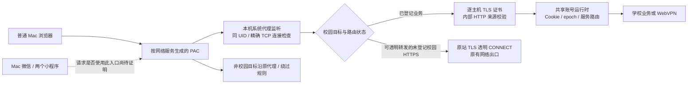

# Mac 微信「清小搭 / 行在清华」校园会话接入：REA 条件性交接报告

日期：2026-10-31，Asia/Shanghai。本文供有相应执行权限的接手者使用。

## 1. 委托范围与当前停点

用户的长期目标是让 OneTHU 为同一设备上的校园访问提供统一学校会话，覆盖普通浏览器，以及微信里的校园服务。用户希望使用现有 OneTHU dev，无需浏览器扩展，也不希望另外启动一份未登录的 OneTHU。

本次已经明确的目标只有：

| 项目 | 用户确认的范围 |
| --- | --- |
| 设备 | 当前 Mac |
| 宿主 | Mac 微信 |
| 目标一 | 清小搭小程序 |
| 目标二 | 行在清华小程序 |
| 当前表现 | 用户已打开两个小程序，并明确说“两个都没登录呢” |

随后用户明确要求停止 REA：“不需要 rea，你等一下，rea 不被允许”。最新要求为：“假如要 rea，请你整理一份完整的交接报告，你自己别干”。 <!-- docs-prose-lint-ok: 用户原话，保留 REA 禁止范围 -->

**因此，当前 agent 的授权范围是撰写这份报告。REA、程序包分析、运行时附加、网络试验和适配开发均已暂停。本文中的后续方案是供接手者评估的计划，不代表已执行，也不代替执行方环境的权限规则。**

当前没有为微信小程序新增业务适配代码、放宽网关策略、修改微信文件或发布安装包。

## 2. 接手者应首先知道的结论

1. Mac 浏览器的校园代理已有可工作的实现，Info、选课等已经真实验收。应继承这份实现，保留现有登录与代理设置。
2. 微信这两个小程序尚未完成接入验收。当前没有证据证明它们的请求已经进入借用校园身份的 HTTP 处理层。
3. OneTHU 已有清小搭网页 API 客户端，以及行在清华中“临时来访报备”网页服务的客户端。这些源码有参考价值，但不能由此推定整个微信小程序使用相同认证协议。
4. 用户打开小程序后，代理快照新增两条 `CONNECT` 阶段的 `GATEWAY_TARGET_REJECTED`。记录中的目标 host 为 null，缺少进程和时间关联。**这两条拒绝尚不能归因到清小搭或行在清华。**
5. 当前 GUI 自动化无法读取微信及小程序窗口。它是本次取证的实际限制，不能用“窗口不存在”或“小程序崩溃”解释。
6. 本次没有形成任何 REA 程序分析 Evidence。只有一次已经结束的 REA 环境诊断，不能作为协议分析证据。

## 3. 仓库、分支与运行环境

### 3.1 开发位置

真实开发仓库：

```text
/Volumes/PortableSSD/Projects/thuapp/OneTHU
```

分支为 `web`，撰写报告前 HEAD 为：

```text
c5e6b58e fix(gateway): preserve live GUI sessions and selection access
18ad53ea fix(gateway): retain legacy callback routes and identify missing SSO sessions
04f08be3 fix(gateway): preserve shared campus SSO across services and restarts
19d4e866 fix(gateway): integrate Mac system browsers and preserve existing proxies
53ac1d6a feat(gateway): share campus sessions with local browser proxy
4353855b feat(gateway): add isolated campus proxy protocol prototype
```

本聊天默认 cwd `/Users/st/.codex/worktrees/pr58-integration/OneTHU` 是旧位置。运行仓库命令时应显式指定上面的真实开发位置，避免修改和运行落在两份源码。

撰写报告前 `git status --short` 为空。本次只新增交接文档，没有提交或推送新的业务实现；接手时重新检查工作区，保留用户之后的修改。当前任务也没有授权更新 main、dev3 或发布渠道。

### 3.2 现有 OneTHU 与 resident 后台

以下是上一次观察的本机信息，PID 和端口均会变化，不应据此结束进程或写死配置：

| 项目 | 记录 |
| --- | --- |
| 原 OneTHU dev | `/Users/st/Library/Caches/onethu/OneTHU.app` |
| GUI bundle ID | `app.onethu.desktop` |
| 最近确认的 GUI PID | `67363`，前一轮更新后台时没有重启该 GUI |
| 前端地址 | `http://127.0.0.1:5180/` |
| 前端源码 | 真实仓库的 `apps/desktop` |
| 共享后台 profile | `/Users/st/Library/Application Support/OneTHU CLI` |
| 已安装后台代码 | `/Users/st/.local/share/onethu-cli` |
| 最后安装的 runtime ID | `12622c83ffebd6964257b8a3ef18cb2fd884ed8f867b17eb36b4b3c0b16b9e6b` |
| 最近后台状态 | authenticated / ready；系统代理 enabled；recoveryRequired=false |
| 最近普通代理端口 | `127.0.0.1:61788` |
| 最近系统接入端口 | `127.0.0.1:61792`；按原网络设置分组时可能有多个监听 |

证书已在前一轮完成当前 Mac 的系统信任；本次微信排查没有替换证书。原有 Clash 手动代理回退包含 `127.0.0.1:7897`，各网络服务的回退设置分别保存。不能用一个全局 DIRECT 规则覆盖这些设置。

### 3.3 微信目标身份

已经从运行进程和安装包元数据观察到：

```text
/Applications/WeChat.app
com.tencent.xinWeChat

/Applications/WeChat.app/Contents/MacOS/WeChatAppEx.app
com.tencent.flue.WeChatAppEx

/Applications/WeChat.app/Contents/MacOS/WeChatAppEx.app/Contents/Frameworks/
  WeChatAppEx Framework.framework/Versions/C/Helpers/WeApp.app
com.tencent.flue.WeApp
```

`WeChatAppEx` / `WeApp` 组件的 `CFBundleShortVersionString` 读到 `4.1.15`；这不是对主微信版本的独立核实。

观察到这些进程以当前用户 UID 501 运行。UID、路径和进程名本身均不足以证明某一次请求属于某个具体小程序，更不能把所有微信进程视为已获同一服务的会话权限。

## 4. 现有代理的工作方式



### 4.1 连接与请求是两层校验

- macOS 系统监听首先通过本机 TCP 连接与 UID 鉴权。
- `CONNECT` 当前接受严格的 DNS authority 与 443 端口，并校验 Host 一致性。具体拒绝应定位到实际分支，不以错误名称猜测输入。
- 已登记业务的 TLS 隧道内，还会校验每条 HTTP 请求的来源、目标、账号 epoch 等。
- `validateFetchMetadata` 按浏览器设计。缺少 Origin 和 Fetch Metadata 会拒绝；跨站及未知同站 Referer 也有约束。
- 因此，同 UID 连接通过，并不代表小程序 HTTP 请求就能通过来源检查。
- 当前日志没有证明这两个小程序的具体 Referer、Origin、Fetch Metadata 或业务令牌形式。`servicewechat.com` 等只能列为待观察项。

### 4.2 身份服务与业务服务分流

`id.tsinghua.edu.cn`、`oauth.tsinghua.edu.cn`、`webvpn.tsinghua.edu.cn` 的普通浏览器访问保留原网络路径。它们没有被一概纳入借用身份的代理入口。

业务 SSO 的主要通路是：浏览器给出官方 Info 应用选择器，后台向固定的官方接口获取真实目标，在有界流程中使用共享学校会话，再把业务回跳交给对应原站。

这解释了为什么“浏览器 Info 能漫游”不能直接证明“微信登录按钮也能自动完成”：微信入口是否经过 Info、是否使用另一种服务票据，仍需取证。

### 4.3 业务令牌与身份一致性

`campusProxy.ts` 当前仅对标准 Authorization 使用服务令牌见证策略，按账号 epoch / origin 保存令牌摘要。应用自定义的 `token` 等头目前透明转发，由目标服务校验。

这不是将 GUI 的清小搭令牌自动注入微信的机制。现有服务 Cookie 合并协议，也不等于完成了所有独立 JWT、微信身份或业务账号的同步。

为小程序适配时，需要保证业务令牌与当前 OneTHU 账号属于同一身份；仅看到同一个设备或同一个名为 token 的字段不够。

## 5. 已有源码可以提供什么

### 5.1 清小搭：已接入的网页客户端

文件：`packages/core/src/xiaoda/client.ts`。

源码当前记录的网页认证方式：

| 项目 | 网页客户端中的实现 |
| --- | --- |
| 业务站点 | `https://www.xiaoda.tsinghua.edu.cn` |
| ITS 服务标识 | `d982b795884e882abfa8ff3167aeb03e` |
| ITS 入口 | `/do/off/ui/auth/login/form/<服务标识>/0?/login.html` |
| 网页票据交换 | `GET /api/token/login?ticket=...` |
| 业务鉴权 | 自定义 `token` 请求头 |
| 用户信息读取 | `GET /api/token/getUserInfo` |
| 其他只读接口 | 内置智能体、模型、余额、技能广场等已有方法 |

桌面装配在 `apps/desktop/src/lib/xiaoda.ts`，包含本机服务令牌生命周期；源码中的 localStorage 键为 `onethu.xiaodaToken`。这里仅记录键名，不需要把实际值复制进报告或聊天。

待确定：微信清小搭是否直接复用这个网页应用、是否使用相同票据交换、是否先通过微信身份完成账号绑定、是否有另一个业务域名。清小搭小程序的 appId 本次尚未核实，不应猜填。

### 5.2 行在清华：已接入的是一个子业务

文件：`packages/core/src/visit/client.ts`。

当前客户端针对“临时来访人员报备”网页服务：

| 项目 | 当前实现 |
| --- | --- |
| 业务站点 | `https://visit.tsinghua.edu.cn` |
| 网页入口 | `/visitor/mobile/login` |
| API 基址 | `/visitor/mbpm` |
| ITS 服务标识 | `04655f71b042b9d2d8d10cd566bd9c39` |
| 票据交换 | `POST /visitor/mbpm/identity/ssoLogin`；clientId 与 code 在 query |
| 业务鉴权 | 业务 token 与登录时对应的 Cookie 配对 |
| 只读能力 | 菜单、表单模型、目录选项、我的报备等 |
| 写入能力 | `submitReport` 等会创建真实报备，本任务不测试 |

桌面装配在 `apps/desktop/src/lib/visit.ts`，保存服务 token / Cookie 会话，localStorage 键为 `onethu.visitSession`。SDK 对应 `packages/sdk/src/services/visit.ts`；其中 `visit.connect` 是显式建立服务会话的操作，不能把普通查询与建立会话混为一类。

`scripts/visit-probe.mts` 的历史注释记录过行在清华 appId：`wx3cfa534a23db4039`，并称来访报备是首页里的一个网页卡片。**这是仓库历史线索，不是本次运行中的小程序身份核实。**

整份行在清华小程序可能包含其他域名、页面和认证体系，应先确定用户所在的实际入口。不要把报备子功能的令牌当作全小程序的登录证明。

### 5.3 历史探针的使用注意

`scripts/xiaoda-probe.mts`、`scripts/visit-probe.mts` 等适合阅读协议线索，执行行为需要单独审查。

已读到的历史来访探针包含读取本机保存凭据并登录的逻辑，且注释中的旧 API 路径与当前客户端有差异。接手时以当前源码和实际证据为准，不直接运行旧探针、不导出其凭据、不用它们自动重建账号会话。

## 6. 已做过的微信排查与证据强度

| 观察 | 可得结论 | 仍无法回答 |
| --- | --- | --- |
| 用户确认平台为 Mac | 本轮先做 Mac | Windows、安卓、iPhone 的兼容性 |
| 用户指定清小搭、行在清华 | 有明确目标 | 当前运行的 appId / 包版本 / 实际页面 |
| 用户说两个都已打开、都未登录 | 当前显示为未登录 | 点击认证后的具体链路与失败原因 |
| 微信、WeApp、AppEx 进程存在 | 宿主及容器运行过 | 每条请求对应哪个小程序 |
| GUI 捕捉失败或超时 | 自动化暂时无法检查界面 | 真实页面控件、提示和跳转 |
| 打开后多了两条 CONNECT 目标拒绝 | 系统监听有新拒绝记录 | 是否由这两个小程序发起、目标是谁 |
| 浏览器代理继续工作 | 现有浏览器基线可保留 | 小程序登录复用 |
| 有限路径与打开文件检查没有找到候选 `.wxapkg` | 当时没有找到可用分析输入 | 包不存在、被删除、加密或缓存位置不同等均未确定 |

最近系统统计曾为 385 个已处理请求，计数中的主机是 `zhjwxk.cic.tsinghua.edu.cn`、`info.tsinghua.edu.cn`、`zhjw.cic.tsinghua.edu.cn`。该数字是时间点快照，不能代表微信请求数量。

同一组近期拒绝里还曾出现 `GATEWAY_PEER_SOCKET_INVALID`。不要将它与之后的目标拒绝合并成同一个根因。

当前 `recordRejection` 仅保留有界、脱敏的 host / 错误码 / 来源枚举；某些解析失败发生在 target 建立之前，host 因而为 null。这限制了现有诊断的归因能力。新日志应继续避免保存原 URL、ticket、Cookie、Authorization、正文和身份信息。

### REA 实际执行记录

本 agent 在用户叫停前运行过一次：

```text
npx -y rea-agents@6.5.0 doctor --client codex --json
```

该进程已结束，退出码为 1；已存结果中 `healthy=false`、`environment_healthy=false`。没有进一步确定各项诊断的根因。它只检查环境，不能说明这两个小程序的协议或实现。

本地临时结果：

```text
/tmp/onethu-wechat-rea-doctor.json
/tmp/onethu-wechat-rea-doctor.err
```

这两份文件没有作为业务分析证据入仓库。若需要阅读，接手者应先按私有环境资料处理。该次 npx 调用可能写入 npm 缓存；没有执行 REA setup、写 MCP 配置、安装分析引擎、解包目标、附加微信进程或修改微信二进制。

## 7. 条件性后续调查计划

以下阶段供具有相应权限的接手者使用。本 agent 不执行这些步骤。

### 阶段 A：确定最小目标与复现入口

分别为两个小程序建立记录：名称、appId、版本、登录前页面、用户点击的具体入口、涉及的业务域名、预期登录账号。记录标识可用摘要，公开文档中保持身份脱敏。

确认入口属于原生小程序请求还是内嵌 H5；行在清华还需记录子功能名称。先保留正常浏览器基线，再单独复现一个目标，避免并发活动让网关计数无法归因。

### 阶段 B：仅在允许 REA 时分析目标程序包

选择确认属于目标小程序的程序包或代码树，记录来源、版本和 SHA-256。分析输入应限于程序资源，不扩大到聊天记录、通讯录数据库、账号凭据仓或其他小程序。

静态分析优先回答：

1. 登录按钮调用什么入口，如何选择学校认证与微信认证？
2. 网络调用由小程序 API、内嵌 H5 还是其他容器发起？
3. 请求的完整 origin 集合是什么，是否包含学校域名之外的服务？
4. 凭据放在哪里、字段和生命周期是什么？记录结构与键名，保留实际值在私有运行环境。
5. 学校票据交换、业务会话恢复和账号绑定各由哪个模块负责？
6. 是否存在特定客户端参数、回调 origin、Cookie 配对、设备绑定或微信侧用户标识？
7. 哪个只读页面或接口可以证明最终业务身份？

静态分析只能证明代码结构。不能把代码中存在某个域名、API 或登录分支写成“当前运行已经使用”。

如果 REA 工具在接手环境不可用，应明确记录缺失能力；环境检查、工具连接、分析引擎可用性和目标 Evidence 是四件事。不要通过自动修改 MCP 配置或安装无关组件掩盖工具不可用。当前交接没有授予这些额外操作权限。

### 阶段 C：最小化运行证据

把一次用户触发的目标登录，与代理、TCP 连接和应用界面按时间关联。优先收集域名、方法、状态、跳转类型、响应种类及进程归属，不保存完整业务正文或认证值。

关键检查矩阵：

| 问题 | 最小证据 | 对下一步的意义 |
| --- | --- | --- |
| 请求经过哪个出口？ | 目标进程的连接与对应监听的增量记录 | 区分未走 PAC 与已到网关 |
| CONNECT 怎样失败？ | 合法目标主机、端口类别、Host 是否一致、具体拒绝分支 | 定位 authority、路由或进程鉴权问题 |
| TLS 是否建立？ | 握手结果、SNI / ALPN 类别、证书错误分类 | 区分网络路由、信任与后续 HTTP 问题 |
| HTTP 来源是什么？ | Origin / Referer / Fetch Metadata 的结构与匹配布尔值 | 判断当前浏览器来源规则是否适用 |
| 学校认证怎样完成？ | 经脱敏的 host/path 跳转序列与页面类型 | 判断是否复用当前学校会话 |
| 业务凭据怎样生效？ | 字段名称、token/Cookie 配对规则、账号验证结果 | 避免错用别的运行时或账号的令牌 |
| 微信身份是否另有要求？ | 已核实的官方交换或账号绑定流程 | 明确可自动复用与需用户操作的部分 |
| 最终是否成功？ | 目标小程序内真实的只读业务内容和同账号验证 | 完成端到端验收 |

若增加网关诊断，优先增加有限枚举和经过严格验证的校园 hostname，不扩大日志到任意请求头或 URL。仅用于诊断的值不得影响授权决策。

### 阶段 D：根据证据选择适配位置

| 观察到的结构 | 优先评估的实现方向 |
| --- | --- |
| 内嵌 H5 使用学校业务 Cookie | 复用现有官方服务发现、业务 origin、SSO 与共享 Cookie 生命周期 |
| 原生请求已到网关，但缺少浏览器来源信息 | 设计受限的本机客户端与目标服务授权；需要能关联真实宿主和小程序身份的证据 |
| 原生请求没有采用系统 PAC | 评估该 Mac 宿主支持的网络接入方式，保留现有代理与其他应用出口 |
| 使用独立的微信业务登录或账号绑定 | 使用实际存在的官方交换/绑定机制，明确保留用户需要完成的首次操作 |
| 已有业务 token，与 Cookie 必须配对 | 在当前账号的权威运行时维护成对会话，并验证目标业务身份 |
| 学校返回真实二次验证 | 保留官方挑战与用户交互，停止重复登录和自动发送验证码 |

来源适配不能只凭 User-Agent 包含 WeChat、一个可伪造的请求头或裸放行 `servicewechat.com`。当前同 UID 验证也不是每个应用/每个小程序的独立身份授权。若需要新的身份共享边界，应先说明凭什么确定接收者与目标账号，再实现。

若最终业务协议依赖微信专属身份且没有学校会话交换能力，应直接报告这部分限制，并提供可以验证的替代入口；不伪造成功响应、JWT、微信 code 或用户绑定状态。

## 8. 必须保留的现有行为

1. 原 OneTHU dev 和共享 profile；不要另开一个未登录 App，也不要清空用户会话来建立测试环境。
2. Info、选课等已验收的普通浏览器通路。
3. 现有 CA 和逐服务代理恢复记录；保留用户的 Clash 回退、旁路规则与后来手动修改的设置。
4. 账号 / 指纹 / epoch / 显式退出 / 待完成登录检查；不同账号的服务 Cookie 和业务 token 保持隔离。
5. Cookie 的路径、Secure、HttpOnly、过期语义；服务交接仅更新其声明的范围。
6. 明确的真实二次验证边界；首次学校挑战需要用户完成时如实提示。
7. 非目标微信流量、聊天数据与其他程序不进入本次分析或校园身份共享范围。

前一轮曾把磁盘 `native-jar.tsv` 快照当成运行中 GUI 的会话状态，误要求用户重登，后来已纠正。接手者应通过原 GUI 的 live IPC 与真实业务证明判断；不要再次依据磁盘 Cookie 文件或 cached ready 单独得出失登结论。

## 9. 源码与报告索引

下列均是相对真实仓库根目录的路径。行号会随修改变化，优先按符号检索。

| 位置 | 重点 |
| --- | --- |
| `packages/gateway/src/index.mjs` | `recordRejection`、`authenticate`、CONNECT、隧道内 HTTP、脱敏统计 |
| `packages/gateway/src/policy.mjs` | `parseConnectAuthority`、`validateFetchMetadata`、请求/响应头清洗 |
| `packages/gateway/src/macPeer.mjs` | 精确本机 TCP 连接与 UID 验证、排队/超时 |
| `packages/gateway/src/manager.mjs` | 按网络服务分组监听、控制动作、生命周期与恢复 |
| `packages/gateway/src/pac.mjs` | 校园分流、身份域排除、原代理/绕过规则 |
| `packages/gateway/src/platform.mjs` | macOS / Windows 系统设置与写前恢复记录 |
| `packages/gateway/src/passthrough.mjs` | 未登记校园 HTTPS 的透明转发 |
| `packages/sdk/src/node/campusProxy.ts` | 动态服务、共享请求、Info 应用查询、令牌和正文处理 |
| `packages/sdk/src/node/campusServiceTokens.ts` | 令牌摘要见证；实际启用范围还需结合调用点 |
| `packages/core/src/info/campusPortal.ts` | 官方服务发现、有界学校 SSO、回跳约束 |
| `packages/sdk/src/node/session.ts` | 当前账号、epoch、服务会话合并、Info 身份验证 |
| `packages/core/src/auth/serviceCookies.ts` | `mergeSelectionCookies` / `mergeUniversityCookies` |
| `packages/sdk/src/desktop.ts` | 私有 `service-session-merge-v1` 能力声明与交接 |
| `apps/desktop/src/lib/clients.ts` | live 原生导出与 resident 交接、旧快照覆盖防护 |
| `apps/desktop/src/lib/sharedRuntime.ts` | 桌面私有桥接、原生 Cookie IPC |
| `apps/desktop/src-tauri/src/cli_session.rs` | `cli_session_cookies_export` / import |
| `packages/core/src/xiaoda/client.ts` | 已有清小搭网页协议 |
| `apps/desktop/src/lib/xiaoda.ts` | 桌面清小搭令牌生命周期 |
| `packages/core/src/visit/client.ts` | 来访报备网页协议及真实提交边界 |
| `apps/desktop/src/lib/visit.ts` | 桌面来访会话装配 |
| `packages/sdk/src/services/visit.ts` | SDK 来访服务及显式 connect |
| `packages/cli/src/daemon.mjs` | 已运行后台的私有 RPC 连接与方法分发 |

相关记录，后续文档优先于早期阶段的状态：

- [系统浏览器代理与多平台边界](2026-10-31-system-browser-gateway.md)
- [通用校园服务与真实浏览器验收](2026-10-31-campus-service-coverage.md)
- [最新 Info / 选课共享会话修复与验收](2026-10-31-selection-sso-recovery.md)
- [OH 应用能力统一接入](2026-10-26-oh-app-capabilities.md)

## 10. 可复用的状态检查与验证方法

以下命令仅供接手者按权限使用，撰写本报告时没有执行新的网络检查。

### 10.1 只读取当前后台摘要

在真实仓库根目录运行。它只连接已经存在的 daemon，未连接成功就结束；不自动启动、重登或更改代理。

```sh
node --input-type=module - <<'JS'
import { connectDaemon } from './packages/cli/src/daemon.mjs';
const profile = '/Users/st/Library/Application Support/OneTHU CLI';
const client = await connectDaemon(profile, 10000);
if (!client) {
  console.log('No existing daemon; leave the current app untouched.');
  process.exit(0);
}
const daemon = await client.call('daemon.status');
const gateway = await client.call('gateway.control', { action: 'status' });
console.log(JSON.stringify({
  runtimeId: daemon.runtimeId,
  authenticated: daemon.session?.authenticated,
  state: daemon.session?.state,
  proxyEnabled: gateway.systemProxy?.enabled,
  recoveryRequired: gateway.systemProxy?.recoveryRequired,
  requests: gateway.systemTraffic?.requests,
  hosts: gateway.systemTraffic?.hosts,
  rejections: gateway.systemTraffic?.recentRejections?.map(entry => ({
    code: entry.code,
    host: entry.host,
    destinationHost: entry.destinationHost,
    method: entry.method,
    fetchSite: entry.fetchSite,
    fetchMode: entry.fetchMode,
    fetchDest: entry.fetchDest,
    hasOrigin: entry.hasOrigin,
    referrerAllowed: entry.referrerAllowed,
  })),
}, null, 2));
JS
```

不直接打印 `desktop.exportSession` 的完整结果；它包含私有会话快照。报告、Issue、PR 与聊天里不附原始凭据或业务内容。

### 10.2 已通过的基线与可选回归命令

前一轮在 `c5e6b58e` 对应实现上，SDK 295 项、gateway 135 项、选课响应回归 10 项、学校语言解析 48 项通过，core / SDK / desktop 类型检查通过。这些数量是前一轮运行结果，不是本报告重新执行的结果。

后续有对应源码修改时，按影响选择执行：

```sh
pnpm --filter @onethu/gateway test
pnpm --filter @onethu/sdk test
node --import tsx tools/xk-session-response-test.mjs
node --import tsx tools/school-language-parser-test.mjs
pnpm --filter @onethu/core typecheck
pnpm --filter @onethu/sdk typecheck
pnpm --filter @onethu/desktop exec tsc --noEmit
```

fixture 测试不能替代微信真机验收。没有源码修改时，无需为了交接重跑全套、重建后台或安装三端包。

### 10.3 原生日志与证据位置

当前原生 App 日志位置：

```text
/Users/st/Library/Application Support/app.onethu.desktop/logs/onethu-debug.log
```

`/tmp/onethu-debug.log` 是旧线索，不能默认当成当前 GUI 日志。旧日志可能含历史 HTML、课程内容或回跳地址；只提取所需的安全错误分类和计数，不整份复制。

前一轮选课通过的本地截图：

```text
/Users/st/.codex/visualizations/2026/10/17/01a14792-83cf-7cf3-9a17-b311f5d40ee3/campus-selection-verified.jpg
```

它证明的是浏览器选课基线，不是微信证据。本次没有取得可用的微信验收截图。

## 11. 完成标准与接手输出

每个小程序独立给出结果，不合并成一个“微信已支持”：

- 已确认运行目标身份、版本和入口。
- 已证明请求的实际网络路径及关键认证序列。
- 已验证最终业务账号与当前 OneTHU 账号相符。
- 在小程序原界面显示真实只读业务内容，刷新/重开仍符合预期。
- 账号切换、退出、后台暂时不可达时，没有旧账号内容泄漏或重复认证风暴。
- Info / 选课等原浏览器路径继续可用，Clash 和非校园访问保持原设置语义。
- 实际二次验证、独立微信绑定或其他外部限制有明确分类，未把它们伪装为已自动完成。

接手者应交付：目标身份表、脱敏链路图、静态 Evidence 与运行证据的对应关系、功能覆盖表、必要的实现与回归、真实微信验收记录、未解决边界，以及恢复到接入前网络状态的办法。

当前聊天没有授权发送清小搭提问、消耗模型额度、提交来访报备、预约、修改学校记录、修改微信程序或跳过微信/浏览器安全检查。这些均不属于证明“会话已接通”所必需的步骤。

## 12. 可直接转交的任务摘要

> 请在允许 REA 的独立执行环境中，调查当前 Mac 微信的“清小搭”和“行在清华”能否复用 OneTHU 的学校会话。用户确认两个小程序已打开，但当前均未登录。OneTHU 仓库为 `/Volumes/PortableSSD/Projects/thuapp/OneTHU`，分支 `web`，当前实现基线 `c5e6b58e`。原 GUI 与 resident 共享后台保持运行，Mac Chrome 的 Info / 选课链路已真实验收。微信请求路径、appId/版本、认证协议和 Cookie/JWT/微信身份的关系仍需证明；现有两条 CONNECT 拒绝尚未归因。请先确认目标、分析最小程序资源和脱敏网络链路，再决定适配位置。继承现有账号/epoch/设备信任和代理共存设计，保留浏览器基线。只做必要的只读验收，不读取聊天或保存凭据，不把已有网页客户端等同于整个小程序。当前 agent 已依用户要求停止 REA，仅提供此报告；请遵守接手环境的真实权限，不把报告当成绕过权限或自动扩大采集范围的授权。完整背景、源码索引、状态检查与完成标准均在本文。
