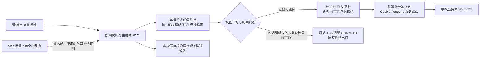

# Mac 微信「清小搭 / 行在清华」校园会话接入：REA 条件性交接报告


日期：2026-10-31，Asia/Shanghai。本文面向具备相应执行权限的接手人员。

## 1. 委托范围与当前停点

用户的长期目标是让 OneTHU 为同一设备上的校园访问提供统一的学校会话，同时覆盖普通浏览器与微信内的校园服务，直接复用当前运行中的 OneTHU dev，免装浏览器扩展，并维持单实例登录状态。

本次明确的目标范围如下：

| 项目 | 用户确认的范围 |
| --- | --- |
| 设备 | 当前 Mac |
| 宿主 | Mac 微信 |
| 目标一 | 清小搭小程序 |
| 目标二 | 行在清华小程序 |
| 当前表现 | 用户已打开两个小程序，并明确说“两个都没登录呢” |

随后用户明确要求停止 REA：“不需要 rea，你等一下，rea 不被允许”。最新要求为：“假如要 rea，请你整理一份完整的交接报告，你自己别干”。 <!-- docs-prose-lint-ok: 用户原话，保留 REA 禁止范围 -->

**根据这一要求，本轮工作限于整理并撰写本交接报告；REA、程序包分析、运行时附加、网络试验和适配开发均已暂停。后文列出的调查方案供接手人员在自身环境权限范围内评估与推进。**

当前网关策略、微信本地文件及安装包均保持原状，未新增微信小程序业务适配代码。

## 2. 接手者应首先知道的结论

1. Mac 浏览器的校园代理已有稳定可用的实现，Info、选课等链路已通过真实验收；后续工作应直接在此基础上展开，保留现有的登录状态与代理设置。
2. 微信内这两个小程序尚待完成接入验收，目前还未观测到它们的请求进入共享校园身份的 HTTP 处理层。
3. OneTHU 已内置清小搭网页版 API 客户端，以及行在清华“临时来访报备”网页服务的客户端；这部分源码可供协议对照参考，微信小程序端实际采用的认证流程仍需单独核实。
4. 用户打开小程序后，代理快照新增了两条 `CONNECT` 阶段的 `GATEWAY_TARGET_REJECTED` 记录，但目标 host 为 null，且缺少进程与时间戳关联，**暂无法确认是否来自清小搭或行在清华。**
5. 受限于当前环境的 GUI 自动化能力，工具暂时无法读取微信及小程序窗口内容；这属于采集侧的技术限制，微信与小程序窗口本身正常运行。
6. 本轮仅在暂停前运行过一次已结束的 REA 环境自检，尚未对小程序包开展静态或动态协议分析。

## 3. 仓库、分支与运行环境

### 3.1 开发位置

真实开发仓库：

```text
/Volumes/PortableSSD/Projects/thuapp/OneTHU
```

分支为 `web`，撰写报告前 HEAD 为：

```text
c5e6b58e fix(gateway): preserve live GUI sessions and selection access
18ad53ea fix(gateway): retain legacy callback routes and identify missing SSO sessions
04f08be3 fix(gateway): preserve shared campus SSO across services and restarts
19d4e866 fix(gateway): integrate Mac system browsers and preserve existing proxies
53ac1d6a feat(gateway): share campus sessions with local browser proxy
4353855b feat(gateway): add isolated campus proxy protocol prototype
```

当前会话默认 cwd `/Users/st/.codex/worktrees/pr58-integration/OneTHU` 为旧工作树；执行仓库命令时请显式指定上述真实开发目录，确保代码修改与实际运行落在同一份源码上。

撰写报告前 `git status --short` 为空。本轮仅新增本交接文档，未提交或推送新的业务实现，也未涉及 `main`、`dev3` 分支或发布渠道更新。接手时请先检查工作区状态，保留用户后续产生的本地修改。

### 3.2 现有 OneTHU 与 resident 后台

以下为最近一次观测到的本机运行信息（PID 和端口会随运行变化，仅供状态参考，请勿写死配置或直接按旧 PID 结束进程）：

| 项目 | 记录 |
| --- | --- |
| 原 OneTHU dev | `/Users/st/Library/Caches/onethu/OneTHU.app` |
| GUI bundle ID | `app.onethu.desktop` |
| 最近确认的 GUI PID | `67363`，前一轮更新后台时没有重启该 GUI |
| 前端地址 | `http://127.0.0.1:5180/` |
| 前端源码 | 真实仓库的 `apps/desktop` |
| 共享后台 profile | `/Users/st/Library/Application Support/OneTHU CLI` |
| 已安装后台代码 | `/Users/st/.local/share/onethu-cli` |
| 最后安装的 runtime ID | `12622c83ffebd6964257b8a3ef18cb2fd884ed8f867b17eb36b4b3c0b16b9e6b` |
| 最近后台状态 | authenticated / ready；系统代理 enabled；recoveryRequired=false |
| 最近普通代理端口 | `127.0.0.1:61788` |
| 最近系统接入端口 | `127.0.0.1:61792`；按原网络设置分组时可能有多个监听 |

根证书已在前一轮完成当前 Mac 的系统信任配置，本轮排查保持原证书不变。各网络服务分别保存了原有的代理回退设置（包含 Clash 手动代理 `127.0.0.1:7897`），调整代理时需按网络服务逐项保留各自的回退配置，避免以单一全局 `DIRECT` 规则覆盖。

### 3.3 微信目标身份

从运行进程与安装包元数据中已观测到以下组件：

```text
/Applications/WeChat.app
com.tencent.xinWeChat

/Applications/WeChat.app/Contents/MacOS/WeChatAppEx.app
com.tencent.flue.WeChatAppEx

/Applications/WeChat.app/Contents/MacOS/WeChatAppEx.app/Contents/Frameworks/
  WeChatAppEx Framework.framework/Versions/C/Helpers/WeApp.app
com.tencent.flue.WeApp
```

`WeChatAppEx` 与 `WeApp` 组件的 `CFBundleShortVersionString` 均为 `4.1.15`，主应用 `WeChat.app` 的版本号还需单独核实。

上述进程均以当前用户 UID 501 运行。要将某次网络请求准确归属到特定小程序并授予对应服务的会话权限，除核对 UID、路径和进程名外，还需结合小程序身份与请求上下文进一步验证。

## 4. 现有代理的工作方式



### 4.1 连接层与请求层的双层校验

- macOS 系统监听首先通过本机 TCP 连接与 UID 鉴权。
- `CONNECT` 当前要求严格的 DNS authority 与 443 端口，并校验 `Host` 一致性；排查拒绝记录时应对照具体代码分支定位原因。
- 进入已登记业务的 TLS 隧道后，网关还会逐条校验 HTTP 请求的来源、目标域名、账号 epoch 等。
- `validateFetchMetadata` 面向标准浏览器请求设计，要求携带合规的 `Origin` 和 Fetch Metadata，并对跨站及未知同站 `Referer` 施加约束。
- 因此，小程序连接通过同 UID 校验后，进入隧道内的 HTTP 请求仍需满足来源校验规则。
- 两个小程序实际发送的 `Referer`、`Origin`、Fetch Metadata 及业务令牌格式尚待抓包确认（例如是否携带 `servicewechat.com` 等来源标识）。

### 4.2 身份服务与业务服务分流

普通浏览器访问 `id.tsinghua.edu.cn`、`oauth.tsinghua.edu.cn`、`webvpn.tsinghua.edu.cn` 时保持原网络出口直连，未纳入共享身份代理入口。

业务 SSO 的主流程为：浏览器触发官方 Info 应用选择器后，后台向固定的官方接口获取真实目标地址，在有界流程中复用共享学校会话完成认证，再将业务回调交还给对应原站。

由于浏览器端依赖 Info 应用选择器完成漫游，微信内点击登录按钮是否经过 Info、或是否使用独立的服务票据机制，仍需结合实际流量确认。

### 4.3 业务令牌与身份一致性

`campusProxy.ts` 当前仅对标准 `Authorization` 请求头启用服务令牌见证策略，按账号 epoch 与 origin 保存令牌摘要；应用自定义的 `token` 等请求头目前按原样透传，由目标服务端自行校验。

现有机制主要负责共享学校 Cookie 会话；GUI 中保存的清小搭令牌、各业务独立的 JWT 以及微信侧账号绑定状态均各自独立维护，需在适配时单独设计衔接方案。

为小程序设计会话衔接时，需确保业务令牌对应的身份与当前 OneTHU 账号严格一致，在同设备环境与同名 `token` 字段之外完成明确的身份核验。

## 5. 已有源码可以提供什么

### 5.1 清小搭：已接入的网页客户端

文件：`packages/core/src/xiaoda/client.ts`。

源码当前记录的网页认证方式：

| 项目 | 网页客户端中的实现 |
| --- | --- |
| 业务站点 | `https://www.xiaoda.tsinghua.edu.cn` |
| ITS 服务标识 | `d982b795884e882abfa8ff3167aeb03e` |
| ITS 入口 | `/do/off/ui/auth/login/form/<服务标识>/0?/login.html` |
| 网页票据交换 | `GET /api/token/login?ticket=...` |
| 业务鉴权 | 自定义 `token` 请求头 |
| 用户信息读取 | `GET /api/token/getUserInfo` |
| 其他只读接口 | 内置智能体、模型、余额、技能广场等已有方法 |

桌面端封装位于 `apps/desktop/src/lib/xiaoda.ts`，负责管理本机服务令牌生命周期，对应的 `localStorage` 键名为 `onethu.xiaodaToken`（报告与沟通记录中仅保留键名，无需摘录实际令牌值）。

待核实事项：微信端清小搭是否直接复用该网页后端与相同的票据交换接口、是否需先通过微信身份完成账号绑定、是否启用了其他业务域名，以及清小搭小程序的真实 `appId`。

### 5.2 行在清华：已接入的是一个子业务

文件：`packages/core/src/visit/client.ts`。

当前客户端面向“临时来访人员报备”网页服务：

| 项目 | 当前实现 |
| --- | --- |
| 业务站点 | `https://visit.tsinghua.edu.cn` |
| 网页入口 | `/visitor/mobile/login` |
| API 基址 | `/visitor/mbpm` |
| ITS 服务标识 | `04655f71b042b9d2d8d10cd566bd9c39` |
| 票据交换 | `POST /visitor/mbpm/identity/ssoLogin`；clientId 与 code 在 query |
| 业务鉴权 | 业务 token 与登录时对应的 Cookie 配对 |
| 只读能力 | 菜单、表单模型、目录选项、我的报备等 |
| 写入能力 | `submitReport` 等会创建真实报备，本任务不测试 |

桌面端封装位于 `apps/desktop/src/lib/visit.ts`，通过 `localStorage` 键 `onethu.visitSession` 保存配对的服务 token 与 Cookie 会话。SDK 层对应 `packages/sdk/src/services/visit.ts`，其中建立服务会话需显式调用 `visit.connect`，与常规只读查询接口职责分开。

`scripts/visit-probe.mts` 的历史注释曾记录行在清华 `appId` 为 `wx3cfa534a23db4039`，并提到来访报备是首页内嵌的网页卡片。**该信息来自早期代码注释线索，接手后仍需与当前运行的小程序实例核对。**

行在清华小程序内可能聚合了多个业务域名、页面与认证体系；排查时应先确认用户所在的实际功能入口，按具体子业务分别验证登录状态。

### 5.3 历史探针的使用注意

`scripts/xiaoda-probe.mts`、`scripts/visit-probe.mts` 等历史脚本适合作为阅读协议细节的参考线索。

已读到的历史来访探针内含读取本机保存凭据并发起登录的逻辑，且注释中的早期 API 路径与现行客户端存在差异。接手时请以当前正式源码与实测证据为准，仅作静态阅读参考，避免直接运行旧探针、导出凭据或用其重建账号会话。

## 6. 已做过的微信排查与证据强度

| 观察 | 可得结论 | 仍无法回答 |
| --- | --- | --- |
| 用户确认平台为 Mac | 本轮先做 Mac | Windows、安卓、iPhone 的兼容性 |
| 用户指定清小搭、行在清华 | 有明确目标 | 当前运行的 appId / 包版本 / 实际页面 |
| 用户说两个都已打开、都未登录 | 当前显示为未登录 | 点击认证后的具体链路与失败原因 |
| 微信、WeApp、AppEx 进程存在 | 宿主及容器运行过 | 每条请求对应哪个小程序 |
| GUI 捕捉失败或超时 | 自动化暂时无法检查界面 | 真实页面控件、提示和跳转 |
| 打开后多了两条 CONNECT 目标拒绝 | 系统监听有新拒绝记录 | 是否由这两个小程序发起、目标是谁 |
| 浏览器代理继续工作 | 现有浏览器基线可保留 | 小程序登录复用 |
| 有限路径与打开文件检查没有找到候选 `.wxapkg` | 当时没有找到可用分析输入 | 包不存在、被删除、加密或缓存位置不同等均未确定 |

最近一次系统统计快照累计处理了 385 个请求，涉及主机为 `zhjwxk.cic.tsinghua.edu.cn`、`info.tsinghua.edu.cn`、`zhjw.cic.tsinghua.edu.cn`，反映的是浏览器侧累积的时间点计数。

同一组近期拒绝记录中还出现过 `GATEWAY_PEER_SOCKET_INVALID`，其触发阶段与后续的目标拒绝相互独立，排查时需分别定位原因。

当前 `recordRejection` 仅保留定长且脱敏的 host、错误码与来源枚举；部分解析失败发生在 target 建立之前，host 字段因而记录为 null，限制了仅凭现有日志直接归因的能力。后续新增日志时同样应保持脱敏，省略完整 URL、ticket、Cookie、`Authorization`、请求正文与个人身份信息。

### REA 实际执行记录

在用户要求暂停前，环境内运行过一次自检命令：

```text
npx -y rea-agents@6.5.0 doctor --client codex --json
```

该进程已结束，退出码为 1，已存结果中 `healthy=false`、`environment_healthy=false`。此命令仅用于检查本地工具链环境状态，未继续深究各项环境报错原因，也未涉及小程序本身的协议或实现分析。

本地临时结果：

```text
/tmp/onethu-wechat-rea-doctor.json
/tmp/onethu-wechat-rea-doctor.err
```

这两份临时文件未纳入仓库，如需查阅请按本机私有环境资料处理。该次 `npx` 调用除可能写入 npm 缓存外，未执行 REA setup、修改 MCP 配置、安装分析引擎、解包目标小程序、附加微信进程或修改微信二进制文件。

## 7. 条件性后续调查计划

以下分阶段方案供具备相应权限的接手人员评估执行。

### 阶段 A：确定最小目标与复现入口

分别为两个小程序建立台账：名称、`appId`、版本号、登录前页面、用户点击的具体入口、涉及的业务域名及预期登录账号（公开文档中账号标识使用脱敏摘要）。

确认目标入口属于原生小程序请求还是内嵌 H5，行在清华还需记录具体子功能名称。先验证普通浏览器基线正常，再每次单独复现一个小程序目标，避免并发流量干扰网关计数归因。

### 阶段 B：仅在允许 REA 时分析目标程序包

选取确认归属目标小程序的程序包或代码目录，记录其来源路径、版本号和 SHA-256。分析输入应严格限定在目标小程序自身的代码与静态资源内，避开聊天记录、通讯录数据库、账号凭据仓及其他小程序。

静态分析优先回答以下问题：

1. 登录按钮调用什么入口，如何选择学校认证与微信认证？
2. 网络调用由小程序 API、内嵌 H5 还是其他容器发起？
3. 请求的完整 origin 集合是什么，是否包含学校域名之外的服务？
4. 凭据存放在哪里、字段名和生命周期是什么？（仅记录结构与键名，实际值留在私有运行环境。）
5. 学校票据交换、业务会话恢复和账号绑定各由哪个模块负责？
6. 是否存在特定客户端参数、回调 origin、Cookie 配对、设备绑定或微信侧用户标识？
7. 哪个只读页面或接口可以验证最终登录的业务身份？

静态分析用于梳理代码结构与候选分支；代码树中出现的域名、API 或登录分支是否在当前运行中实际触发，仍需结合运行时流量确认。

若接手环境中 REA 工具不可用，请分别如实记录环境检查、工具连接、分析引擎可用性与目标包分析的进展状态；保持现有 MCP 配置与系统组件不变，避免在未获授权时自动改写配置或安装外部依赖。

### 阶段 C：最小化运行证据

将一次由用户触发的目标登录操作与代理日志、TCP 连接及应用界面变化按时间线关联，重点采集目标域名、请求方法、状态码、跳转类型、响应类别与进程归属，省略完整业务正文和敏感认证值。

关键检查矩阵：

| 问题 | 最小证据 | 对下一步的意义 |
| --- | --- | --- |
| 请求经过哪个出口？ | 目标进程的连接与对应监听的增量记录 | 区分未走 PAC 与已到网关 |
| CONNECT 怎样失败？ | 合法目标主机、端口类别、Host 是否一致、具体拒绝分支 | 定位 authority、路由或进程鉴权问题 |
| TLS 是否建立？ | 握手结果、SNI / ALPN 类别、证书错误分类 | 区分网络路由、信任与后续 HTTP 问题 |
| HTTP 来源是什么？ | Origin / Referer / Fetch Metadata 的结构与匹配布尔值 | 判断当前浏览器来源规则是否适用 |
| 学校认证怎样完成？ | 经脱敏的 host/path 跳转序列与页面类型 | 判断是否复用当前学校会话 |
| 业务凭据怎样生效？ | 字段名称、token/Cookie 配对规则、账号验证结果 | 避免错用别的运行时或账号的令牌 |
| 微信身份是否另有要求？ | 已核实的官方交换或账号绑定流程 | 明确可自动复用与需用户操作的部分 |
| 最终是否成功？ | 目标小程序内真实的只读业务内容和同账号验证 | 完成端到端验收 |

如需扩展网关诊断，建议优先增加有限枚举值与经过严格校验的校园 hostname，避免记录任意原始请求头或完整 URL，并确保诊断字段与实际授权判定逻辑相互独立。

### 阶段 D：根据证据选择适配位置

| 观察到的结构 | 优先评估的实现方向 |
| --- | --- |
| 内嵌 H5 使用学校业务 Cookie | 复用现有官方服务发现、业务 origin、SSO 与共享 Cookie 生命周期 |
| 原生请求已到网关，但缺少浏览器来源信息 | 设计受限的本机客户端与目标服务授权；需要能关联真实宿主和小程序身份的证据 |
| 原生请求没有采用系统 PAC | 评估该 Mac 宿主支持的网络接入方式，保留现有代理与其他应用出口 |
| 使用独立的微信业务登录或账号绑定 | 使用实际存在的官方交换/绑定机制，明确保留用户需要完成的首次操作 |
| 已有业务 token，与 Cookie 必须配对 | 在当前账号的权威运行时维护成对会话，并验证目标业务身份 |
| 学校返回真实二次验证 | 保留官方挑战与用户交互，停止重复登录和自动发送验证码 |

设计来源校验时，应在同 UID 连接验证的基础上结合可靠的宿主进程签名与小程序身份核验，避免仅凭 `User-Agent` 包含 `WeChat`、易伪造的自定义请求头或单独放行 `servicewechat.com` 来授予权限。若需建立新的身份共享边界，请先明确接收端身份与目标账号的核验依据，经确认后再编码落地。

若查明目标业务协议依赖微信专属身份绑定且无学校会话兑换机制，请直接记录该协议限制并提供可验证的替代入口，保持官方认证与绑定状态原貌。

## 8. 必须保留的现有行为

1. 继续复用当前运行中的 OneTHU dev 与共享 profile，保留现有用户登录会话。
2. Info、选课等已通过真实验收的普通浏览器通路。
3. 现有根证书与逐网络服务代理恢复记录，完整保留用户的 Clash 回退、旁路规则及后续手动修改的网络设置。
4. 账号、指纹、epoch、显式退出与待完成登录检查，确保不同账号的服务 Cookie 与业务 token 严格隔离。
5. Cookie 的路径、`Secure`、`HttpOnly` 与过期语义，服务交接仅更新其声明的域和路径范围。
6. 明确的学校二次验证边界：首次触发学校安全挑战时如实提示用户本人完成交互。
7. 仅处理目标小程序的校园业务请求，微信聊天数据、非目标流量与其他本地应用均保持隔离。

前序排查曾因直接读取磁盘上的 `native-jar.tsv` 快照来推断运行中 GUI 的会话状态，造成误判掉线（随后已纠正）。接手后请通过运行中 GUI 的实时 IPC 与真实业务访问结果核验会话状态，避免单凭磁盘 Cookie 文件或缓存状态判定失登。

## 9. 源码与报告索引

下列路径均相对于真实仓库根目录；行号会随迭代变化，检索时建议优先按符号名定位。

| 位置 | 重点 |
| --- | --- |
| `packages/gateway/src/index.mjs` | `recordRejection`、`authenticate`、CONNECT、隧道内 HTTP、脱敏统计 |
| `packages/gateway/src/policy.mjs` | `parseConnectAuthority`、`validateFetchMetadata`、请求/响应头清洗 |
| `packages/gateway/src/macPeer.mjs` | 精确本机 TCP 连接与 UID 验证、排队/超时 |
| `packages/gateway/src/manager.mjs` | 按网络服务分组监听、控制动作、生命周期与恢复 |
| `packages/gateway/src/pac.mjs` | 校园分流、身份域排除、原代理/绕过规则 |
| `packages/gateway/src/platform.mjs` | macOS / Windows 系统设置与写前恢复记录 |
| `packages/gateway/src/passthrough.mjs` | 未登记校园 HTTPS 的透明转发 |
| `packages/sdk/src/node/campusProxy.ts` | 动态服务、共享请求、Info 应用查询、令牌和正文处理 |
| `packages/sdk/src/node/campusServiceTokens.ts` | 令牌摘要见证；实际启用范围还需结合调用点 |
| `packages/core/src/info/campusPortal.ts` | 官方服务发现、有界学校 SSO、回跳约束 |
| `packages/sdk/src/node/session.ts` | 当前账号、epoch、服务会话合并、Info 身份验证 |
| `packages/core/src/auth/serviceCookies.ts` | `mergeSelectionCookies` / `mergeUniversityCookies` |
| `packages/sdk/src/desktop.ts` | 私有 `service-session-merge-v1` 能力声明与交接 |
| `apps/desktop/src/lib/clients.ts` | live 原生导出与 resident 交接、旧快照覆盖防护 |
| `apps/desktop/src/lib/sharedRuntime.ts` | 桌面私有桥接、原生 Cookie IPC |
| `apps/desktop/src-tauri/src/cli_session.rs` | `cli_session_cookies_export` / import |
| `packages/core/src/xiaoda/client.ts` | 已有清小搭网页协议 |
| `apps/desktop/src/lib/xiaoda.ts` | 桌面清小搭令牌生命周期 |
| `packages/core/src/visit/client.ts` | 来访报备网页协议及真实提交边界 |
| `apps/desktop/src/lib/visit.ts` | 桌面来访会话装配 |
| `packages/sdk/src/services/visit.ts` | SDK 来访服务及显式 connect |
| `packages/cli/src/daemon.mjs` | 已运行后台的私有 RPC 连接与方法分发 |

相关阶段记录（以时间靠后的文档状态为准）：

- [系统浏览器代理与多平台边界](2026-10-31-system-browser-gateway.md)
- [通用校园服务与真实浏览器验收](2026-10-31-campus-service-coverage.md)
- [最新 Info / 选课共享会话修复与验收](2026-10-31-selection-sso-recovery.md)
- [OH 应用能力统一接入](2026-10-26-oh-app-capabilities.md)

## 10. 可复用的状态检查与验证方法

以下命令供接手人员在授权范围内按需使用；撰写本报告期间未额外执行网络探测。

### 10.1 只读取当前后台摘要

在真实仓库根目录运行以下脚本即可只读查询当前运行中的 daemon 状态；若未连接上已有 daemon 则直接退出，全程保持后台进程、登录态与系统代理设置不变。

```sh
node --input-type=module - <<'JS'
import { connectDaemon } from './packages/cli/src/daemon.mjs';
const profile = '/Users/st/Library/Application Support/OneTHU CLI';
const client = await connectDaemon(profile, 10000);
if (!client) {
  console.log('No existing daemon; leave the current app untouched.');
  process.exit(0);
}
const daemon = await client.call('daemon.status');
const gateway = await client.call('gateway.control', { action: 'status' });
console.log(JSON.stringify({
  runtimeId: daemon.runtimeId,
  authenticated: daemon.session?.authenticated,
  state: daemon.session?.state,
  proxyEnabled: gateway.systemProxy?.enabled,
  recoveryRequired: gateway.systemProxy?.recoveryRequired,
  requests: gateway.systemTraffic?.requests,
  hosts: gateway.systemTraffic?.hosts,
  rejections: gateway.systemTraffic?.recentRejections?.map(entry => ({
    code: entry.code,
    host: entry.host,
    destinationHost: entry.destinationHost,
    method: entry.method,
    fetchSite: entry.fetchSite,
    fetchMode: entry.fetchMode,
    fetchDest: entry.fetchDest,
    hasOrigin: entry.hasOrigin,
    referrerAllowed: entry.referrerAllowed,
  })),
}, null, 2));
JS
```

请注意省略 `desktop.exportSession` 的完整返回内容（内含私有会话快照），在报告、Issue、PR 与沟通记录中均避免附带原始凭据或个人业务正文。

### 10.2 已通过的基线与可选回归命令

前一轮基于 `c5e6b58e` 的验证中，SDK 295 项、gateway 135 项、选课响应回归 10 项、学校语言解析 48 项测试以及 core / SDK / desktop 类型检查均已通过（此处引用前一轮实测记录，撰写本报告时未重复执行）。

后续修改对应模块源码后，可按受影响范围选跑：

```sh
pnpm --filter @onethu/gateway test
pnpm --filter @onethu/sdk test
node --import tsx tools/xk-session-response-test.mjs
node --import tsx tools/school-language-parser-test.mjs
pnpm --filter @onethu/core typecheck
pnpm --filter @onethu/sdk typecheck
pnpm --filter @onethu/desktop exec tsc --noEmit
```

自动化 fixture 测试通过后，仍需在微信客户端内完成真实操作验收；若尚未修改源码，交接阶段无需重跑全量测试、重建后台或重新打包三端安装包。

### 10.3 原生日志与证据位置

当前原生 App 日志位置：

```text
/Users/st/Library/Application Support/app.onethu.desktop/logs/onethu-debug.log
```

早期的 `/tmp/onethu-debug.log` 为历史遗留日志文件，排查当前 GUI 状态请以上述 Application Support 路径为准。查阅旧日志时仅提取所需的脱敏错误分类与计数即可，避免整份复制其中可能留存的历史 HTML、课程信息或回调地址。

前一轮浏览器选课验收留存的本地截图：

```text
/Users/st/.codex/visualizations/2026/10/17/01a14792-83cf-7cf3-9a17-b311f5d40ee3/campus-selection-verified.jpg
```

该截图记录了浏览器端选课通路的验收基线；微信端小程序的验收截图待后续接入完成后补充。

## 11. 完成标准与接手输出

请按“清小搭”和“行在清华”两个小程序分别独立给出验收结论：

- 已核实运行中目标小程序的身份、版本与具体功能入口。
- 已厘清请求的实际网络路径及关键认证序列。
- 已确认最终登录的业务账号与当前 OneTHU 账号一致。
- 在小程序原界面正常展示真实只读业务内容，刷新或重新打开后状态依然稳定。
- 切换账号、退出登录或后台短暂不可达时，旧账号内容保持隔离且无重复认证风暴。
- Info、选课等既有浏览器路径保持畅通，Clash 回退与非校园网访问维持原有配置语义。
- 如遇学校二次验证、独立微信账号绑定或其他外部协议限制，均已清晰归类并如实说明用户需配合的操作。

接手人员建议交付：目标身份表、脱敏链路图、静态分析结论与运行时流量的对应关系、功能覆盖表、必要的源码实现与回归测试、真实微信端验收记录、遗留边界说明，以及一键恢复至接入前网络状态的操作说明。

验证会话接通只需读取只读业务页面即可；请避免发送清小搭对话提问（以免消耗模型额度）、提交来访报备或预约、修改学校业务记录、改动微信程序文件或改动微信与浏览器的安全校验机制。

## 12. 可直接转交的任务摘要

> 请在允许 REA 的独立执行环境中，调查当前 Mac 微信内的“清小搭”和“行在清华”小程序如何复用 OneTHU 的学校会话。用户反馈两个小程序均已打开，当前处于未登录状态。OneTHU 仓库位于 `/Volumes/PortableSSD/Projects/thuapp/OneTHU`（分支 `web`，基线提交 `c5e6b58e`）；现有 GUI 与 resident 共享后台保持运行，Mac Chrome 的 Info 与选课链路已完成真实验收。接下来需核实小程序的 `appId` 与版本、实际网络路径、认证协议，以及学校 Cookie、业务 JWT 与微信身份之间的衔接关系，并排查此前两条尚未归因的 `CONNECT` 拒绝记录。请先锁定目标小程序的最小程序资源与脱敏网络链路，再决定适配方案；实现时沿用现有的账号、epoch、设备信任与代理共存设计，保持浏览器基线稳定。全程仅做只读业务验收，隔离聊天数据与个人凭据，并注意区分现有网页版客户端与小程序全量业务。前序会话已按用户要求暂停 REA 并整理本报告，请在接手环境的实际权限范围内推进，完整背景、源码索引、检查脚本与验收标准均载于正文。
