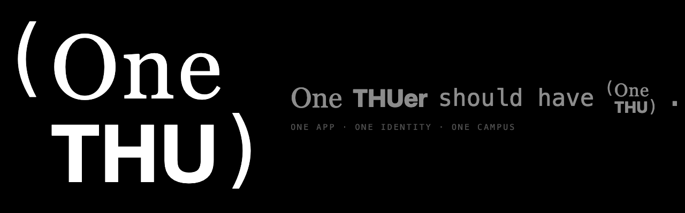

<div align="center">



# OneTHU NextTHULearn 0.2.1

[独立仓库与下载](https://github.com/smartThise/NextTHULearn) · [OneTHU](https://github.com/smartThise/OneTHU) · [NextTHUxk](https://github.com/smartThise/NextTHUxk)

</div>

打开网络学堂即可直接使用的学习工作台，复用当前浏览器的网页登录态，底层的数据读取、附件解析、作业提交与讨论接口均基于 OneTHU `LearnClient`。

## 功能

- **首页总览**：保留学校提供的未读通知、未读文件、未提交作业官方计数，分栏集中展示待办作业、课程通知与最新文件。
- **课程列表**：展示任课教师、课程号、上课时间地点及三类官方计数，支持搜索、学期切换与本地持久化置顶。
- **课程工作区**：涵盖课程概览、作业、通知、文件、讨论与分组，支持深层链接直达对应课程及具体条目详情。
- **作业全流程**：查看作业正文、教师/答案/提交/批改四类附件、成绩与批语；支持富文本作答、上传附件、提交或更新作业、移除已交附件。每次提交后都会回读学校端真实状态，提交被拒时自动保留当前编辑内容。
- **筛选与日历**：提供进行中、逾期、未交、已交、已批改、已忽略等带计数的状态筛选，已批改作业在列表中直接显示分数，支持导出截止时间 ICS 日历；置顶与忽略状态保存在当前浏览器本地，刷新后依然生效。
- **通知与课件**：查看通知正文、附件及已过期通知，阅读后自动回读学校端计数与已读状态；作业、通知、文件均支持跨课程汇总筛选，课件文件支持搜索、下载以及 PDF、图片、文本在线预览。
- **课程讨论**：支持按板块及精华/参与状态筛选、分页浏览、按楼层阅读、普通回复、楼中楼回复以及带附件发帖。
- **课程服务与分组**：支持分组成员查询；课程信息、答疑、问卷、邮件、在线课堂以及学校收藏与备注均在工作台内直接嵌入原站功能页，完整保留学校原有的表单与交互逻辑。刷新后若内嵌窗口尚未载入，界面会给出重试提示，点击“重新加载”即可恢复，也可直接在新窗口中打开。
- **学堂公共入口**：通过学堂服务入口可随时访问原站公开课程、课程搜索、校历等其余服务。
- **品牌图标**：构建时从 OneTHU 本体源码自动同步官方双行 Logo 与 26 枚 OneGUI SVG 图标。
- **状态提示色**：逾期及 24 小时内截止项标为红色，三天内截止项标为琥珀色；通知、作业、文件计数分别采用蓝、琥珀、绿三色，零与未知保持中性色，并同时保留文字说明。
- **外观与无障碍**：支持明暗外观切换、窄屏布局适配、键盘焦点导航与减少动态效果。

各项统计严格区分“未知”与“0”，单门课程读取失败时仍会展示其余课程结果并给出失败提示。扩展的数据管线最多同时发起 4 个请求，所有作业提交与讨论回复均由用户手动确认后发送。

## 安装与构建

在 Chrome 或 Edge 的扩展管理页开启“开发者模式”，加载本目录（含 `manifest.json`）即可使用。Firefox 正式签名包可前往[独立仓库发布页](https://github.com/smartThise/NextTHULearn/releases/latest)下载，也可在 `about:debugging` 中临时加载本目录。扩展仅作用于 `learn.tsinghua.edu.cn` 页面，无需额外启动 OneTHU 客户端、CLI 或本机服务；点击页面上的“原版网站”可随时切回学校原生界面。

在 OneTHU 仓库根目录安装依赖后运行：

```sh
plugins/NextTHULearn/build.sh
node --import tsx plugins/NextTHULearn/test/core.mts
node plugins/NextTHULearn/test/browser.cjs
```

构建脚本会先同步 OneTHU 官方 Logo 与 OneGUI SVG，再将 `packages/core` 中的学习客户端及相关依赖打包为 `extension/content.js`，扩展在浏览器内运行时无需 Node.js 环境。自动化测试基于 Playwright 与本机 Chrome，使用虚构的课程、附件和提交数据完成验证，详见 `docs/verification.md`。

浏览器登录与 Cookie 全程由学校网站自身管理；扩展仅在当前站点 `localStorage` 中保存外观主题以及按网页用户标识哈希分区的置顶、忽略条目 ID，密码、Cookie、课程正文与附件均留在浏览器原生会话中。本扩展专注于 `learn.tsinghua.edu.cn` 站内课程数据，雨课堂等外部教学平台的账号与作业可在 OneTHU 客户端中统一管理。

许可协议详见 `LICENSE` 和 `THIRD_PARTY_NOTICES.txt`。
